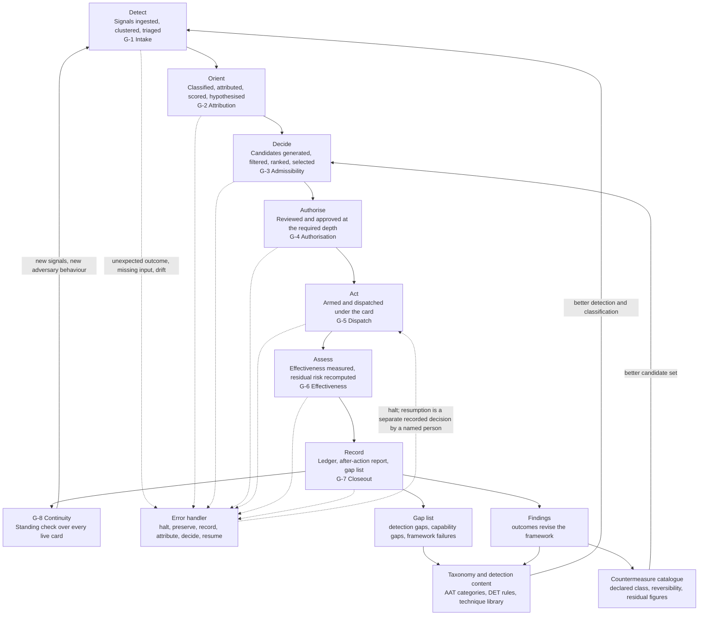

# Mission Lifecycle and Decision Loop: CAOS — Counter-Adversary Operations System

| Field | Value |
| --- | --- |
| Author | MIA |
| Attribution | This was supported for MIA by Kilo (kilo-auto/free). |
| Document type | Operational specification |
| Subject | The mission lifecycle of the Counter-Adversary Operations System: the seven phases, the eight gates, the Operation Card lifecycle, the decision record and the decision log, the error handler, the deconfliction procedure, the tabletop exercise cycle, and the after-action feedback loop |
| Scope | Layer L3 of CAOS. The process by which a signal becomes a decision and a decision becomes a record |
| Identifier range owned | `OP-1` to `OP-10`; `GATE-1` to `GATE-8`; `ERR-1` to `ERR-5`; `ML-1` to `ML-12`; `LIM-ML1` to `LIM-ML12`. The `ML-` prefix is introduced by this document |
| Version | 1.0 |
| Status | Authoritative for the mission lifecycle, the gates, the Operation Card lifecycle, the decision record, the decision log, the error handler, and the deconfliction procedure. Subordinate to the constitutional instrument; where both apply, the stricter prevails |
| Companion documents | See §1.5 |
| Relationship to the Axiom Hive set | Operational extension. Governed by `../../Docs/system-design-and-framework.md`; see master design §3.4 and limitation `LIM-13` |

---

## 1. Purpose and Scope

### 1.1 Purpose

The mission lifecycle is the control spine of the framework. It is the sequence by which a signal becomes a decision, and the sequence by which a decision becomes a record.

Those are two sequences, and they are not the same sequence. The first runs forwards: telemetry arrives, is clustered, is classified, is attributed, is scored, is hypothesised, and is turned into a bounded proposal for action. The second runs backwards from the point of consequence: a human authorises, a human executes, a human assesses what actually happened, and the whole of it is written down in a form that a reviewer who was not present can read and reconstruct. An operation that produced the right answer and left no record has failed the second sequence, and the framework treats it as a failure even where nothing went wrong in the world.

The lifecycle exists because the framework's central proposition — that a human remains the decision-maker, that every consequential decision is made under a known authorisation boundary, and that every such decision is recorded so that it can be reconstructed — is only true if the sequence by which decisions are reached and recorded is itself governed. A proposition about human authority that is not accompanied by a governed process is a sentiment. This document is the governed process.

Three things follow from the design.

First, **the phases are a sequence, and the sequence is the control.** Not the quality of any one phase but the fact that the phases occur, in order, each producing a recorded artefact that the next phase consumes.

Second, **the gates are the points at which the sequence can be stopped.** Eight of them, and each one is a place where a named person either clears the work or blocks it. A gate is not a checkpoint in the sense of a reminder; it is a place where the work stops unless a human says it may continue.

Third, **the record is the deliverable.** The operation's output is not the effect it had on the adversary, and not the decision that was taken; it is the set of artefacts by which the decision can be reconstructed, the effect accounted for, and the lessons transferred. An operation whose record is incomplete is an operation that must be repeated, because the next operator will not know what was done.

### 1.2 The tempo of the loop is deliberately uneven

The loop is **deliberately slow at the points where the cost of being wrong is high, and deliberately fast where it is low.**

This is a design commitment, not an accident of drafting, and it cuts across the framework's general preference for speed.

| Where the loop is slow | Why it is slow there | Where the loop is fast | Why it is fast there |
| --- | --- | --- | --- |
| G-4 Authorisation | A wrongful authorisation is the point at which a bounded action becomes an unbounded consequence. The approver must read the evidence, the alternatives, the rejected candidates, the residual risk, the risk of inaction, and the abort conditions, and must be able to change the decision (`HITL-2`, `HITL-7`) | G-1 Intake | A signal that is not triaged is a signal that is not seen. Triage is cheap, is reversible, is within the operator's own estate, and its cost of error is measured in minutes of delay |
| G-3 Admissibility | A countermeasure that fails an admissibility condition may affect a third party who had no relationship to the dispute and no opportunity to object | Orient and the formation of the hypothesis | Analysis costs nothing but the operator's time, and analysis is where a wrong turn is cheapest to correct |
| G-2 Attribution | Attribution is the framework's most likely error and its most consequential one. The thresholds rise with the collateral class (`INT-3`) | The Record phase | Recording is not a decision; it is a transcription of decisions already taken. Delay in recording degrades the record and therefore degrades every later use of it |
| G-5 Dispatch | The dispatch is where an effect becomes real and where the world state changes under the card | Detect and the mechanical routing of telemetry | Telemetry that is not collected cannot be triaged, and the cost of a late signal is borne by the operator's own estate |

The consequence is that the loop is not uniform in duration, and a reader of the ledger will see operations of very different lengths. That is correct. An operation at C0 against the operator's own estate is expected to be short, because the cost of being wrong is small and the decision is close to the evidence. An operation at C2 against a third party's service is expected to be slow, because the cost of being wrong falls on a party who did not choose it and cannot undo it.

**The tempo is a property of the class of the decision, not of the urgency of the adversary.** A rising campaign does not shorten a gate. It may, legitimately, produce an escalation request that asks the authority to decide sooner, and it may produce a re-timing of a countermeasure to a window the third party has agreed. What it may not do is move the approval into the dispatch.

### 1.3 No phase may be skipped because the previous one seemed to produce the right answer

**No phase of the mission lifecycle may be omitted, collapsed, or performed out of order on the ground that a later phase's output appeared to be already determined.**

This is the single most frequently broken rule in practice, and it is broken in a specific and characteristic way: the operator forms a view early, works backwards from the view to the evidence, and then performs the phases in an order that gets to the dispatch. The Orient phase, having already been answered in the operator's head, becomes a formality; the Decide phase becomes the transcription of a choice already made; the Record phase becomes a summary written from memory after the fact.

The framework's response is stated in the conduct standard and is repeated here because it is load-bearing: **where a phase would not have changed the decision, the phase is performed and recorded as having had no effect, and the record says so.** The absence of an effect is a finding, and a finding is recorded. A phase that produced nothing is not a phase that was omitted; the difference between those two states is the difference between a reconstructible operation and an unreconstructible one.

The rule is not a prohibition on efficiency. It is a prohibition on the *undocumented* collapse of a phase. A record that states "the candidate set was not generated because the attribution assessment was considered decisive, and the reasoning is as follows" is a legible record. A card with an empty candidate set and no explanation is a defect, and the defect is visible to an approver who is looking for it.

The enforcement point is the gate. Each gate's criteria include a completeness check on the output of the phase it terminates, and an empty mandatory field blocks structurally rather than by judgement.

### 1.4 Scope

| In scope | Out of scope |
| --- | --- |
| The phase sequence, the gate structure, and the rules for entering and leaving each phase (`OP-1` to `OP-10`, `ML-1` to `ML-12`) | The content of the taxonomy, which is owned by `operational/adversary-ai-taxonomy-and-threat-model.md` |
| The criteria, inputs, outputs, and failure paths of the eight gates (`GATE-1` to `GATE-8`) | The decision-support algebra, the scoring model, and the admissibility conditions, which are owned by `operational/decision-support-and-scoring-model.md` (`SCORE-1` to `SCORE-5`, `AD-1` to `AD-13`, `DS-1` to `DS-12`) |
| The states of the Operation Card, the rules for moving between them, and the rules for revision and amendment (`OP-1` to `OP-10`) | The countermeasure content, the declared class of each countermeasure, and the catalogue, which are owned by `operational/countermeasure-catalogue.md` (`OCC-01` to `OCC-43`) |
| The decision record, the decision log, and the writing rules that govern both | The operator's conduct duties, the human-in-the-loop checkpoints, and the evidence-labeling discipline, which are owned by `compliance/operator-conduct-and-human-in-loop-standard.md` (`HITL-1` to `HITL-8`, `EVD-1` to `EVD-8`) |
| The error handler, its trigger set, its procedure, and its independence rule (`ERR-1` to `ERR-5`) | The constitutional instrument, the ROE profiles, the collateral and autonomy classes, and the authorisation ladder, which are owned by `constitutional/engagement-authorisation-and-rules-of-engagement.md` (`AUTH-1` to `AUTH-8`, `ROE-1` to `ROE-8`, `CON-1` to `CON-12`) |
| The deconfliction procedure, its sources, its conflict classes, its resolution order, and its timing | The interface capabilities by which the operator exercises this process, which are owned by `operational/watchfloor-interface-specification.md` (`WF-01` to `WF-30`, `WFP-1` to `WFP-16`) |
| The role structure, the tempo of the loop, and the rules on concurrency | The platform, the control plane, the policy engine, and the ledger, which are owned by `operational/platform-architecture-and-agent-containment.md` (`INFRA-1` to `INFRA-8`, `CTG-1` to `CTG-7`) |
| The tabletop exercise cycle and the after-action feedback loop | The technique library, the external mapping register, and the audit and conformance procedures, which are owned by `reference/` |

**Precedence.** This document is subordinate to the constitutional instrument. Where a matter is governed by both, the stricter requirement prevails. This document never confers authority, never widens an authorisation, and never permits an action the constitutional instrument forbids.

**Boundary of this document.** This document specifies process, sequence, and criteria. It does not supply legal judgement, does not determine whether a proposed action is lawful in the jurisdiction in which it would be taken, and does not make attribution reliable. It structures the process by which such judgements are made and recorded.

### 1.5 Companion documents

Paths are relative to the set root, `/home/k/Desktop/AI C@ Op`.

| Document | Path | Bearing on this document |
| --- | --- | --- |
| System Design and Framework | `system-design-and-framework.md` | The master design. §4.6 defines the Operation Card field groups, §6 the selection algorithm and the admissibility algebra, §8.1 the control spine, §8.2 the error handler, and §8.3 the decision log. This document is the normative expansion of §8 |
| Set Index | `README.md` | Canonical map, controlled vocabulary, conventions, identifier registry, change control |
| Engagement Authorisation and Rules of Engagement | `constitutional/engagement-authorisation-and-rules-of-engagement.md` | The constitutional instrument. The ROE profiles, the collateral and autonomy classes, the abort catalogue at §10.1, the deconfliction requirement at §9, and the state-change table at §10.3 |
| Operator Conduct and Human-in-the-Loop Standard | `compliance/operator-conduct-and-human-in-loop-standard.md` | The conduct standard. Operator duty, the checkpoints exercised at G-4 and G-5, uncertainty handling, escalation ethics, refusal and pause obligations, evidence discipline |
| Decision Support and Scoring Model | `operational/decision-support-and-scoring-model.md` | The threat score, attribution confidence, residual risk, the admissibility algebra, and the selection algorithm that STEP-1 to STEP-6 of the Decide phase execute |
| Countermeasure Catalogue | `operational/countermeasure-catalogue.md` | The countermeasures from which the candidate set is drawn, and the declared class, reversibility, autonomy class, and attribution dependency of each |
| Adversary AI Taxonomy and Threat Model | `operational/adversary-ai-taxonomy-and-threat-model.md` | The AAT categories against which the Orient phase classifies, the detection engineering requirements `DET-1` to `DET-9`, the exercise and validation requirements `EX-1` to `EX-6`, and the detection coverage assessment |
| Watchfloor Interface Specification | `operational/watchfloor-interface-specification.md` | The console surfaces on which the gates are exercised, the approval surface, the abort control, and the audit export |
| Platform Architecture and Agent Containment | `operational/platform-architecture-and-agent-containment.md` | The policy engine, the control plane, the ledger, and the resilience behaviour on which the gates and the error handler depend |
| Audit and Conformance Procedures | `reference/audit-and-conformance-procedures.md` | The procedure by which conformance with this document is assessed, and the register of mechanically enforced requirements |
| Operation Card template | `templates/operation-card.md` | The artefact the card editor manipulates. §6 of that template states the card states and defers to this document for the gates |
| Decision Log template | `templates/decision-log.md` | The artefact in which the decision log is kept |
| Escalation Request template | `templates/escalation-request.md` | The instrument by which a ceiling is raised. Escalation is a new instrument, never a field edit (`ROE-3`) |
| After-Action Report template | `templates/after-action-report.md` | The structured report in which the findings of §13 are delivered |
| Tabletop Exercise Pack template | `templates/tabletop-exercise-pack.md` | The artefact produced by the exercise cycle of §12 |
| Rules of Engagement Card template | `templates/rules-of-engagement-card.md` | The pocket reference to the profile in force, rendered on the card |
| Axiom Hive governance set | `../../Docs/system-design-and-framework.md` and `../Docs/operational/ethical-framework-ai-research.md` | The general governance standard of which this set is an operational extension. The gate, error-handler, and decision-log treatment in the second of these is the ancestor of §5, §8, and §7 respectively |

### 1.6 Status of this specification

This document states design intent. Where it describes behaviour that has not been implemented, exercised, and independently checked, that behaviour is an **architectural assertion**, and the assertions are registered in §15 with what substantiation each would require. The verification status of any claim in this document is not implied by the existence of the reference implementation at `impl/`; the requirements that the implementation mechanically enforces are listed in `reference/audit-and-conformance-procedures.md` §3, and that register is maintained by the audit document's owner.

---

## 2. Interpretation of Normative Terms

The terms **must**, **must not**, **should**, **should not**, and **may** are to be interpreted as described in RFC 2119.

- **Must / must not** denote absolute requirements. A departure is a non-conformance, not a preference, and it is recorded as one.
- **Should / should not** denote recommendations that may be departed from only where legitimate reasons exist. Any departure must be made explicit and recorded on the card or in the decision log.
- **May** denotes optional behaviour that remains at the discretion of the named human within the constraints of this document and within the constraints of the authorisation in force.

Three conventions apply additionally.

**Identifier namespaces.** This document owns four prefixes and introduces one.

| Prefix | Range | Scope | Origin |
| --- | --- | --- | --- |
| `OP-` | `OP-1` to `OP-10` | Operational workflow and the Operation Card | Master design §4.6 and §6.6 (`OP-1` to `OP-6`). `OP-7` to `OP-10` are introduced by this document |
| `GATE-` | `GATE-1` to `GATE-8` | The eight gates, G-1 Intake to G-8 Continuity | Master design §8.1. The normative criteria, inputs, outputs, and failure paths are introduced by this document |
| `ERR-` | `ERR-1` to `ERR-5` | The error handler | Master design §8.2 and §8.3. Expanded by this document |
| `ML-` | `ML-1` to `ML-12` | Mission-lifecycle requirements: the phases, the loop structure, the roles, the tempo, and concurrency | **Introduced by this document** |
| `LIM-ML` | `LIM-ML1` to `LIM-ML12` | The limitations of this document | **Introduced by this document.** Prefixed to avoid collision with the set-level `LIM-1` to `LIM-14` in master design §11 and with the document-scoped `LIM-C`, `LIM-CC`, `LIM-WF`, and `LIM-DS` series |

**Registry note.** The `ML-` prefix is new to the set and is not recorded in the set index (`README.md` §5) or in the master design (§9.1). Those registers should be amended at their next version to record `ML- | 12 | Mission-lifecycle requirements — mission lifecycle document §14`. Until that amendment is made, the prefix is undeclared in the canonical index, which is a live hazard for a reader consulting the registry alone.

**Architectural assertions.** Where this document records a claim about how the framework or the system implementing it will behave, that claim is an architectural assertion of the framework authors and not, absent an explicit statement to the contrary, an independently verified property. Assertions are registered in §15.

**Labelling.** Claims made inside the mission loop carry the claim labels and source reliability tiers defined in `compliance/operator-conduct-and-human-in-loop-standard.md` §7.1 and §7.2. This document inherits those conventions and does not restate them.

**A note on counting in the source documents.** The master design's component table at §3.2 described L3 as comprising six phases — "Detect · Orient · Decide · Act · Assess · Record" — while the control-spine table at §8.1 separates **Authorise** as a distinct phase, giving seven. The gates are eight in both places. This document treats the §8.1 control spine as governing, because §8.1 is the table that assigns gates to phases, and because the separation of Authorise from Decide is what allows the authorisation gate to be a distinct point at which a different person takes over. The master design's component table has since been corrected, and the discrepancy is recorded as `LIM-ML5`.

---

## 3. Defined Terms

Defined terms are declared once here and referenced thereafter by the defined term rather than by repetition.

| Term | Definition |
| --- | --- |
| **CAOS** | The Counter-Adversary Operations System described by this set |
| **the framework** | CAOS as a whole: its mandate, its doctrine, its machinery, and its artefacts |
| **the master design** | `system-design-and-framework.md` |
| **the constitutional instrument** | `constitutional/engagement-authorisation-and-rules-of-engagement.md`, and the engagement authorisation issued under it |
| **the conduct standard** | `compliance/operator-conduct-and-human-in-loop-standard.md` |
| **the mission lifecycle** | The phase sequence and gate structure by which a signal becomes a decision and a decision becomes a record; the subject of this document |
| **the control spine** | The master design's term for the mission lifecycle and the gates within it (master design §8.1) |
| **mission** | A single cycle of the lifecycle, from the detection of a signal to the record that closes it. A mission is the unit of work; it is not a campaign, and a campaign is a sequence of missions |
| **operation** | A bounded, authorised act, or a bounded set of acts, performed under a single Operation Card against a single target set. An operation is a component of a mission; not every mission produces an operation, and an operation is only one of the possible outcomes of a mission |
| **phase** | One of the seven stages of the mission lifecycle: Detect, Orient, Decide, Authorise, Act, Assess, Record |
| **signal** | A discrete observation of adversary activity or of the operator's own estate, captured by a collector, with its source, timestamp, fidelity, and integrity state recorded. A signal is an observation and not a conclusion |
| **cluster** | A group of signals sharing indicators and a shared hypothesis, produced by the fusion layer. The cluster is the unit at which the triage queue is dispositioned and the input to the Orient phase |
| **classification** | The assignment of a cluster or signal to an AAT category and, where known, a technique, with a stated rationale, a confidence, and the taxonomy version in force (`TAX-1`, `TAX-2`) |
| **attribution assessment** | A statement of which specific adversary the activity is attributable to, expressed as a distribution over candidates with a stated basis and a confidence. A named adversary with a confidence is permitted; a name without a confidence is not (`INT-1`, `INT-2`) |
| **threat assessment** | The scored characterisation of how much the activity matters, with its components exposed and separately contestable (`SCORE-1`, `SCORE-2`) |
| **hypothesis** | A testable proposition about what the adversary is doing, with a disconfirming observation. A hypothesis without a disconfirming observation is a plan, not an operation (master design §4.6) |
| **Operation Card** | The atomic unit of authorised work: a document, a data structure, and a legal instrument at once. It carries the objective, the hypothesis, the authority, the target set, the threat, the candidate and selected countermeasure sets, the autonomy grant, the abort conditions, the risk assessment, the evidence, and the decision |
| **the card lifecycle** | The set of states a card may occupy, the permitted operations within each, and the transitions between them. Defined in §6 |
| **card states** | Draft, Submitted, Authorised, Armed, Executing, Suspended, Aborted, Assessing, Closed, Expired, Revoked. Defined in §6.1 |
| **card revision** | The revision number of a card. The identity fields are immutable once created; a change to them produces a new card, not a new revision (master design §4.6) |
| **material change of target set** | A change to the card's authorised targets that introduces a new organisation, a new infrastructure class, a new geography, a new third-party dependency, or a new jurisdiction. A material change requires a new card (`OP-2`) |
| **decision record** | The record of one decision: the state of the world as understood, the options considered, the choice, the reason, the authority relied upon, the confidence at the time, and the pre-registered contingency. The atomic unit of the decision log (master design §6.6) |
| **decision log** | The running, chronological narrative of an operation's reasoning, alternatives, and risk, by which the operation is made reconstructible. The decision log is composed of decision records and of the connective entries between them (master design §8.3) |
| **the ledger** | The append-only, hash-chained record of decisions, authorisations, dispatches, and state changes, in which the decision log and the card revisions are held |
| **gate** | One of the eight points at which the mission lifecycle may be stopped. A gate is cleared by a named authority or it is blocked; a gate is never passed by the mere absence of objection (master design §8.1) |
| **gate clearance** | The recorded act by which a named person permits the work to proceed past a gate. A clearance is bound to the revision of the artefact that was read and to the identity of the person who read it |
| **the error handler** | The single enforcement point to which every gate resolves. It halts progress, requires the issue to be recorded, and routes the work to re-verification or transparent rewriting (master design §8.2) |
| **deconfliction** | The check that a countermeasure does not interfere with live legitimate activity, and the procedure by which a conflict is identified and resolved. Owned by this document; the constitutional requirement is at the constitutional instrument §9 |
| **reversion** | The automatic return of the system to the passive posture on a declared trigger, without human action, with the termination of outstanding autonomy grants and the notification of the named authorities. A reversion is a mechanical event and not a decision (`HITL-5`) |
| **abort condition** | A stated condition on the Operation Card which, if observed, terminates the operation and returns it to the passive posture. A card with an empty abort category is not admissible (constitutional instrument §10.1) |
| **posture** | The mode the system is in. The **passive posture** is the state in which no countermeasure is dispatched and no autonomy grant is outstanding. The **defensive posture** is the state in which the operator's own estate is protected against adversary activity. The **counter-adversary posture** is the state in which an authorised operation is conducted against identified adversary systems. The two postures are concurrent and are not sequential phases (master design §3.3) |
| **round** | One complete run-through of an exercise scenario by a set of participants, from the first inject to the point at which the round is closed by the facilitator. An exercise may comprise one round or several, and the second round is normally run against the facilitator's own learning from the first |
| **inject** | A scripted, time-stamped stimulus delivered to participants during a round, carrying a stated purpose, an expected observation, and a scoring note. An inject is delivered by a named person and is logged as delivered, with the time |
| **analyst** | The named human who classifies, attributes, scores, and hypothesises, and who prepares the analytical products the Decide phase consumes. The analyst recommends and does not select, approve, or dispatch |
| **operator** | The named human who holds the operation at the console and who is accountable for the decisions taken under it (conduct standard §3) |
| **approver** | The named human who authorises an Operation Card at the depth required by its collateral class and its profile, and who is the only party who may clear G-4 |
| **duty manager** | The named human accountable for the conduct of operations during a period of duty; the default recipient of an escalation, an abort, and a report of collateral impact (conduct standard §3) |
| **legal contact** | The named human competent to advise on the legal position of the engagement, its authorisation, and its effects on third parties. Required at profile R2 and above (conduct standard §3) |
| **asset owner** | The named human accountable for a specific asset, system, or service that an operation may affect (conduct standard §3) |
| **scribe** | The named human who records the decision log in real time: the reasons, the alternatives, the confidence, the observations, and the timestamps. The scribe records what is said and what is observed, and does not editorialise, summarise, or improve the account |
| **facilitator** | The named human who designs, delivers, and scores a tabletop exercise: the scenario, the inject set, the observation capture, the debrief, and the findings. The facilitator is not a participant and does not decide operational questions raised by the exercise |
| **the scribe's rule** | The scribe records what was said and what was observed, at the time, without improving it. The scribe does not supply an argument the decision-maker did not make |
| **L0 — Mandate** | The engagement authorisation: purpose, legal basis, scope of authority (master design §3.1) |
| **L1 — Constitutional Layer** | The constitutional instrument: proportionality, human authority, exclusion of third parties |
| **L2 — Conduct and Doctrine Layer** | The conduct standard: operator duty, uncertainty handling, escalation ethics |
| **L3 — Mission Layer** | This document: the phases, the gates, the card lifecycle, the error handler, the deconfliction procedure |
| **L4 — Platform Layer** | The Watchfloor interface specification and the platform architecture and agent containment documents: ingest, fusion, policy, control plane, console |
| **L5 — Intelligence and Reference Layer** | The taxonomy and threat model, the technique library, the countermeasure catalogue, the decision-support model |
| **L6 — Operational Artefacts** | The Operation Card, the ROE Card, the decision log, the escalation request, the after-action report, the exercise pack |
| **the world model** | The operator's stated understanding of the state of the world at the time the card was written: what the adversary is doing, what the environment looks like, what is assumed about the state of the estate, and what is assumed about the target's configuration. The world model is recorded on the card, and it is the thing against which drift is detected |
| **drift** | A divergence between the world model recorded on a card and the world as observed to be. Drift is a trigger of the error handler, and it is a normal event rather than an exception |
| **the console's or the system's own state** | The material on the card that concerns the operation rather than the world: the target set, the ceilings, the abort conditions, the selected set, the residual risk |
| **the objective** | What the operation is to achieve, phrased so that its achievement is observable (master design §4.6) |
| **the disconfirming observation** | The observation that would show the hypothesis false. It is written before the operation runs and it is not a restatement of the proposition with a negative sign |
| **mandatory field** | A card field that must be populated for the card to be complete. An empty mandatory field blocks the card at the gate in which the field is used, structurally and not by judgement |
| **conditional field** | A card field that must be populated when its stated condition obtains. Where the condition does not obtain, the reason must be recorded in the field in the form `n/a — «reason»` |
| **n/a** | A recorded positive statement that a field does not apply to this operation, together with the structural reason. It never means "not yet filled" and never means "not known" (the operation card template §4.3) |
| **escalation request** | The instrument by which a profile, collateral, or autonomy ceiling is raised (constitutional instrument §3, `ROE-3`) |
| **the sufficiency criterion of the log** | An external criterion: another reviewer must be able to reconstruct how the decision was reached from the record alone. A log that satisfies only its author does not satisfy the design (master design §8.3) |
| **the separation rule** | The rule that a gate may not be cleared by the party whose output it is checking. Defined in §5.1 |
| **the after-action review** | The structured learning process that follows an operation, in which the causes of the outcome are examined and in which findings are transferred into the framework's content. It is distinct from the Record phase, which is the transcription |
| **the exercise cycle** | The sequence by which a scenario becomes an exercise, an exercise becomes observations, observations become findings, and findings become changes to the framework. Defined in §12 |
| **the feedback loop** | The path by which the outcomes of operations change the framework's content: the taxonomy, the detection content, the countermeasure catalogue, and the interface. Defined in §13 |
| **architectural assertion** | A statement of intended system behaviour that has not been independently substantiated. See §15 |
| **verification status** | Verified (primary), Verified (secondary), Corrected, Unverified, Requires confirmation (`README.md` §3) |

---

## 4. The Mission Structure

### 4.1 The seven phases

The mission lifecycle has seven phases and eight gates. Seven of the eight gates sit at a phase boundary; the eighth, G-8 Continuity, is a standing check that follows the close of every operation.

| # | Phase | What happens | Primary actor | Output artefact |
| --- | --- | --- | --- | --- |
| 1 | **Detect** | Signals are ingested, clustered, and triaged | Analyst | A cluster with its integrity state, fidelity, provenance, and triage disposition |
| 2 | **Orient** | The cluster is classified, attributed, scored, and hypothesised | Analyst | A classification, an attribution assessment, a threat assessment, a hypothesis with its disconfirming observation |
| 3 | **Decide** | Countermeasures are generated, filtered on admissibility, ranked, and a course is selected | Operator, on the analyst's products | A card draft with the candidate set, the admissibility results, the ranking, the selection, the rejected set with reasons, and the risk assessment |
| 4 | **Authorise** | The card is reviewed and approved at the depth required by its class and profile | Approver | An approved card and a recorded authority, bound to a card revision |
| 5 | **Act** | The countermeasure is armed and dispatched under the card | Operator | An execution record, a dispatch record, and the autonomy consumption record |
| 6 | **Assess** | Effectiveness is measured, residual risk is recomputed, the abort conditions are checked | Operator or an assessor other than the executor | An effectiveness assessment and a revised residual risk |
| 7 | **Record** | The ledger is completed, the after-action report is written, and the findings are transferred | Scribe, with the card owner | Ledger entries, the after-action report, and the gap list |

**Authorise is a phase distinct from Decide.** The separation is deliberate. In Decide the operator is at liberty to select any admissible candidate, to select none, and to select against the ranking; the output of Decide is a proposal, and the operator's own reasoning is part of it. In Authorise a different person takes the proposal and is at liberty to refuse it, to impose conditions on it, or to return it; the output of Authorise is an authority. Merging the two would collapse the distinction between making a decision and granting permission to act, and would make G-4 a formality with a name.

### 4.2 The phase table

| Phase | Purpose | Primary actor | Inputs | Outputs | Gate at the boundary | Typical duration | If the phase is skipped |
| --- | --- | --- | --- | --- | --- | --- | --- |
| **Detect** | To see the activity at all, and to know what is not being seen | Analyst | Raw telemetry from the collectors; the sensor and collector set | A clustered signal with its integrity state, fidelity, provenance, and a triage disposition | **G-1 Intake** — signal fidelity and provenance known; degraded sources flagged; the triage disposition recorded | Continuous in the defensive posture; a disposition within minutes to hours of the signal arriving | The activity remains unclustered and undisposed. G-1 has no input, and no card may be opened on the basis of an undisposed signal. The gap is recorded as a detection gap, and the omission is a reportable framework failure |
| **Orient** | To say what the activity is, who is doing it, how much it matters, and what hypothesis is being tested | Analyst | The clustered signal; the taxonomy; the adversary dossier; the source-fidelity statements | A classification with rationale, an attribution assessment, a threat assessment, a hypothesis with its disconfirming observation | **G-2 Attribution** — attribution confidence recorded; the basis stated; where the countermeasure requires identity, the `INT-3` threshold is met or the countermeasure is chosen so as not to require identity | Minutes to hours; longer where the attribution is contested or the dossier is thin | The threat assessment, the attribution, and the hypothesis are unrecorded, and the card is built on an unstated classification. G-2 cannot be cleared. At C1 and above this is a mandatory-field failure. The most likely skipped phase, because a confident view already exists in the operator's head |
| **Decide** | To convert the analytical picture into a bounded proposal, with its alternatives visible | Operator, on the analyst's products | The orientation products; the countermeasure catalogue; the admissibility conditions; the target set | A card draft: candidate set, admissibility results, ranking, selection, rejected set with reasons, risk assessment including the risk of inaction, and the deconfliction result | **G-3 Admissibility** — at least one admissible countermeasure, or an explicit recorded decision to take no countermeasure; the risk of inaction recorded; deconfliction passes | Tens of minutes to hours | The card has no candidate set, no admissibility results, and no rejected set, so the record cannot show what was considered. G-3 is blocked. The operation becomes a plan without a comparison, which is the form in which unexamined assumptions do most of their damage |
| **Authorise** | To grant, refuse, or qualify the authority to act | Approver | The card draft; the evidence; the ranking and the rejected set; the residual risk before and after; the risk of inaction; the abort conditions; the deconfliction result | An approval record: the approver's identity, the depth held, the card revision read, the attestation to the five (`HITL-7`), any conditions, any dissent | **G-4 Authorisation** — approver named, has read the card, and can change the decision; collateral class and autonomy class within the EA; abort conditions populated | Minutes at C0; hours to a day at C1; a day or more at C2 and C3, where a named legal contact and, at C3, an external authority must be involved | The operation proceeds without authority, or does not proceed at all. The control plane refuses a dispatch with no approval (`OP-1`, `ROE-2`). The omission is not a technicality: it is the state the framework exists to prevent, and it is reported as a framework failure on the same path as an adversary success |
| **Act** | To execute the authorised action, bounded by the card, and to stop it when required | Operator | The approved card; the arming configuration; the tested abort channel; the autonomy envelope, budget, and expiry | A dispatch record, an execution record, and the autonomy consumption record | **G-5 Dispatch** — admissibility re-checked at dispatch against the current world state; abort channel tested; autonomy budget available; the target set and the shared-tenancy answers re-checked | Seconds to minutes to dispatch; the operation's own duration thereafter | The objective is not achieved and nothing takes effect. G-5 is blocked. The card closes at G-6 as an operation that was authorised and never dispatched, and the reason is recorded. A skipped Act phase is usually the signature of a decision taken earlier without authority |
| **Assess** | To establish what actually happened, and to recompute the risk that is being carried | Operator, or an assessor other than the executor | The execution record; the telemetry; the abort conditions; the residual risk before the action | An effectiveness assessment, a revised expected effectiveness with its confidence, a revised residual risk, and a decision to close, escalate, extend, or abort | **G-6 Effectiveness** — or the card is escalated, extended, or closed; an unexpected outcome triggers the error handler | The observation window: hours to days for most measures; the full window where the card declares one | Effectiveness is unmeasured and the residual risk is carried forward at its pre-operation value, which is an overstatement of the risk that remains. G-6 is blocked and the card cannot close. The countermeasure's effectiveness figure in the catalogue is never updated, and the next operation inherits the error. This is the first of the two gates that exist to catch the failure mode of an operation that succeeded and was quietly forgotten |
| **Record** | To make the operation reconstructible, and to transfer what was learned | Scribe, with the card owner | The decision records; the card and its revisions; the execution record; the effectiveness assessment | Ledger entries, a completed after-action report, and the gap list | **G-7 Closeout** — ledger complete and hash-chain verified; after-action report filed; gaps fed back into the taxonomy and the detection content | The same shift; within twenty-four hours of the assessment | The operation is unreconstructible, the findings are never transferred, and the card remains open. G-8 picks it up, and the continuity check is a poor substitute for the record it was meant to replace. An operation that was never recorded will be repeated, because the next operator will not know what was done |
| — | — | — | — | — | **G-8 Continuity** — at the end of every operation, a standing check that no authorisation has expired silently, no card is left armed, no autonomy grant is outstanding, and no deferred action has been forgotten | Daily, and at each campaign cycle, over the whole set of live cards | The framework's outstanding state accumulates silently: an expired authorisation, an armed card, an outstanding autonomy grant, an unanswered escalation. This is the second of the two gates that exist to catch the failure mode of an operation that succeeded and the system quietly forgot about it |

### 4.3 The loop

Two features of the diagram carry most of the weight.

**The feedback path from Record back into Detect.** The Record phase is not the end of the loop; it is the point at which the loop's output re-enters its input. What the Record phase produces — the findings, the gap list, the corrections to the classification and attribution content, the revisions to the countermeasure figures — changes what the next Detect phase will be able to see and how the next Orient phase will reason. A framework that records but does not learn is a ledger with a console attached.

**The feedback path into the taxonomy and the detection content specifically.** The gap list is the mechanism, and it is not optional. Where an operation observed behaviour that the current taxonomy cannot express, or that no detector covers, that observation is a finding, and the finding is transferred to the owner of the taxonomy and the detection content. This is the point at which the framework's content is made adversarial to its own blind spots, and it is a governed path with an owner, not an informal suggestion to the next analyst.

The error handler is drawn as a side path that any phase may enter and from which only a named person may release the work. It is not on the main line, because it is not a phase: it is the interruption of the main line, and the loop resumes at the phase boundary whose input was invalidated.

---

## 5. The Gates

### 5.1 The separation rule and the structure of a gate

**The separation rule — a gate may not be cleared by the party whose output it is checking.**

Where the role that produced the output is the role that would clear the gate, a different named person must clear it. Where the framework provides no such person, the operation does not proceed past that gate. The rule is a rule of the framework and not of this document alone, and it is carried into the requirements register at `ML-5` (§14).

The rule is the mechanism by which the gates are more than a checklist. A gate whose clearance is available to the author of the artefact it examines records that the artefact was seen. A gate whose clearance is withheld from the author records that it was assessed. The rule is applied differently in different places, and the table below states the party whose output each gate examines and the party that may clear it.

Each gate section below states the same seven things: the trigger, the criteria as a checklist, the inputs it reads, the artefact it produces, the failure path, the authority that may clear it, and the application of the separation rule.

| Gate | Name | The output it examines | Who may clear it | Separation rule as applied |
| --- | --- | --- | --- | --- |
| **G-1** | Intake | The signal and the cluster | The analyst or operator who performed the triage | Not the collector that produced the telemetry. The collector does not clear its own fidelity |
| **G-2** | Attribution | The classification, the attribution assessment, and the hypothesis | An analyst other than the author of the attribution assessment; the operator where no second analyst is available | The analyst who wrote the attribution assessment may not clear it alone. A second analyst, or the operator, must |
| **G-3** | Admissibility | The candidate set, the admissibility results, the selection, and the deconfliction result | The operator who made the selection | No model clears this gate, in any role. The engine computes; the human disposes |
| **G-4** | Authorisation | The card, the evidence, the risk assessment, and the abort conditions | The approver at the depth required by the class and the profile | Never the card owner. Never the operator. Never delegated, in any form (§5.5) |
| **G-5** | Dispatch | The arming configuration, the current world state, and the abort channel | The operator executing, on the approver's authority | Where the card is C1+ or AC-2+, the person who armed it may not be the sole approver of the dispatch (`HITL-8`) |
| **G-6** | Effectiveness | The execution record and the observed effect | The operator, or an assessor other than the executor | The person who executed the countermeasure may not be the sole assessor of its effect |
| **G-7** | Closeout | The ledger, the card, the after-action report, and the gap list | The duty manager, or a reviewer other than the operation's owner | The card owner may not be the sole clearer of the closeout |
| **G-8** | Continuity | The standing state of every live card, authorisation, autonomy grant, and escalation | The duty manager, or the automated continuity check reporting to the duty manager | The owner of a card may not be the sole clearer of a continuity finding about that card |

### 5.2 G-1 — Intake

**GATE-1 — Intake.**

No signal may be carried into the Orient phase until its source, fidelity, integrity state, and provenance are known, its cluster membership is recorded, and its triage disposition has been made and recorded. A signal carried from a source of unknown provenance or an unknown integrity state may not be reasoned from as though it were sound, and the absence of a required source is a condition to be explained rather than a condition to be ignored.

**Trigger.** A cluster has been formed by the fusion layer and presented in the triage queue, or a signal has been raised directly for triage because it matched a rule.

**Criteria.**

1. The signal's source is named, and the source's fidelity and integrity state are recorded.
2. The cluster's membership is recorded, including the signals that were considered and excluded, and the basis of the exclusion.
3. Degraded, delayed, or silent sources are flagged, and the conclusions that depend on them are marked.
4. The disposition is recorded: escalated to Orient, held for further correlation, or closed with the reason.
5. The telemetry that is the subject of the signal is preserved, and its retention period is set.
6. Where the signal contains personal data, the minimisation applied is recorded, and the data is access-controlled.
7. Where the signal carries adversary-supplied content, it is treated as potentially adversarial input and is not evaluated as an instruction.

**Inputs read.** The raw signal; the collector's provenance record; the source liveness and integrity state; the ingest lag; the deduplication and clustering record.

**Artefact produced.** A triage disposition: the clustered signal, its integrity state, its provenance, the disposition, and the reason for it. This is the input to the Orient phase.

**Failure path.** Where any of criteria 1 to 3 cannot be satisfied — because the source is unknown, because the integrity state is unknown, or because a required source is silent — G-1 is **blocked** and the signal is held. A signal that has been ingested from a source of unknown provenance is not a signal the Orient phase may reason from as though it were sound. Where the condition is the silence of a source rather than a defect in one signal, the error handler is triggered (`ERR-3`).

**Authority that may clear it.** The analyst or operator who performed the triage, subject to the separation rule.

**Note.** G-1 is a low-consequence gate and is deliberately cheap. Its purpose is to establish, once and at the point of entry, that the material the rest of the loop will reason from is what it appears to be. The cost of that check is minutes; the cost of skipping it is an operation built on a sensor that was lying.

### 5.3 G-2 — Attribution

**GATE-2 — Attribution.**

The Orient phase may not be concluded until a classification, an attribution assessment, a threat assessment, and a hypothesis are recorded, each with its labels, tiers, and confidences, and each bound to the version of the taxonomy in force. No countermeasure may be selected against a cluster whose attribution confidence does not meet the threshold for that countermeasure's collateral class, unless the countermeasure has been identified as one that does not depend on identity.

**Trigger.** A cluster has been dispositioned into the Orient phase, and the classification, attribution assessment, threat assessment, and hypothesis have been drafted.

**Criteria.**

1. A classification is recorded against an AAT category, with a rationale, a confidence, and the taxonomy version in force (`TAX-1`, `TAX-2`).
2. Where the evidence supports more than one classification, more than one is carried; where it supports fewer, the classification is not narrowed below the evidence (`TAX-3`).
3. An attribution assessment is recorded as a distribution over candidate adversaries, with the basis stated and a source reliability tier attached to each basis (`INT-1`, `INT-2`).
4. The attribution is to a specific operator's use of AI and not to a generic finding that the activity is machine-generated (`INT-6`).
5. The attribution confidence meets the `INT-3` threshold for the collateral class of the countermeasure under consideration, **or** the countermeasure under consideration has been identified as not depending on identity (`INT-4`).
6. A threat assessment is recorded with its components exposed and separately contestable, and the velocity component is stated separately (`SCORE-1`, `SCORE-2`, `SCORE-3`).
7. A hypothesis is recorded with a disconfirming observation, and the observation is an observable rather than a restatement of the proposition.
8. The alternative explanations that were considered and not preferred are recorded, including the explanation that the activity is benign.
9. The inconvenient hypotheses remain on the hypothesis ladder, with their support and their contradictions, until the evidence disposes of them (conduct standard §6.3).
10. The taxonomy version and the framework version in force are recorded on the analytical product.

**Inputs read.** The clustered signal and its triage disposition; the source-fidelity statements; the adversary dossier; the technique library; the prior operations' records.

**Artefact produced.** The orientation record: the classification, the attribution assessment, the threat assessment, and the hypothesis, each with its labels, tiers, and confidences, bound to the taxonomy version in force.

**Failure path.** Where criteria 5 and 7 cannot be satisfied — because the attribution confidence is below the class threshold, or because the proposition has no disconfirming observation — G-2 is **blocked**. The block is not a dead end and it is not a reason to act anyway; it is a reason to select a countermeasure that does not depend on the contested claim, to gather more evidence, to record the risk of inaction and escalate it, or to take no action. Where the attribution confidence is below the threshold and no identity-independent countermeasure is available, the operation stops at G-2 and the risk of not acting is recorded and escalated.

**Authority that may clear it.** An analyst other than the author of the attribution assessment; the operator where no second analyst is available, in which case the operator's own authorship of the assessment is recorded against the clearance.

### 5.4 G-3 — Admissibility

**GATE-3 — Admissibility.**

The Decide phase may not be concluded until every admissibility condition has been evaluated against every candidate, every rejection has been recorded with the condition it failed and the value that would have made the candidate admissible, the residual risk and the risk of inaction have been recorded and compared, and the deconfliction check has returned a result that permits the action. A card with no admissible countermeasure may be submitted only where the record states the decision not to act, the risk of inaction, and the escalation raised or the decision not to raise one.

**Trigger.** The orientation products are complete and a course of action has been selected, and the card draft is ready for submission.

**Criteria.**

1. The candidate set was generated from the countermeasure catalogue by the bindings to the card's classification, or was proposed explicitly by the operator, and every candidate is recorded (`STEP-1`).
2. Every admissibility condition `AD-1` to `AD-12` has been evaluated against every candidate, and every result is recorded with the value or the margin (`STEP-2`).
3. Every rejected candidate is recorded with the condition it failed and the specific value that would have made it admissible (`AD-13`).
4. The survivors were ranked and the full ranked set was presented, including the rejected set and its reasons (`STEP-3`).
5. The selection is the operator's own, and where it departs from the ranking, the departure is recorded as a choice with a reason (`STEP-4`).
6. The residual risk before the action and after the action are recorded, and the risk of not acting is recorded alongside them (`SCORE-5`, `OP-4`).
7. The comparison between the risk of acting and the risk of inaction is written in the operator's words and not as a number alone.
8. The reversibility ladder has been applied, and where a less reversible countermeasure has been selected, the card records why the reversible alternative is insufficient (`OP-5`, `ROE-7`).
9. The deconfliction check has been performed and its result recorded (§9).
10. The shared-tenancy answers are recorded where an infrastructure-directed action is proposed (`AUTH-8`).
11. The card's mandatory fields are populated; where a conditional field does not apply, the reason is recorded in the field (`OP-9`).
12. The card's hypothesis carries a disconfirming observation.
13. The attestations that the hybrid and human admissibility conditions require are present on the card: the irreversibility argument where a selected countermeasure's reversibility is low or none; the indirect-effect attestation where the card declares techniques in AAT-3, which operate on people; the deconfliction attestation and the currency of the deconfliction map where that map is degraded; the non-weaponisation attestation where the countermeasure's catalogue entry carries no declaration of conformity; and the per-target authorisations alongside the shared-tenancy assessment where the action reaches a third party. A candidate whose catalogue status is withheld is refused at this gate, because the determination withheld cannot be made by the card.
14. Where a derived claim on the card rests on a derived confidence, the derivation chain and its declared penalty are shown, and the derived value is not more confident than its weakest input less that penalty (`INT-9`, `EVD-5`).

**Inputs read.** The orientation record; the countermeasure catalogue; the admissibility conditions and the scoring model; the target set and the third-party dependency table; the deconfliction sources; the engagement authorisation in force; the attestations required by criterion 13.

**Artefact produced.** The card draft at revision 0: the candidate set, the admissibility results, the ranking, the selection and its rationale, the rejected set with reasons, the risk assessment, the deconfliction result, and the objective, hypothesis, authority, target set, abort conditions, and evidence groups.

**Failure path.** Where criterion 2 finds no admissible candidate, G-3 is **blocked**, and the block is a legitimate outcome of the operation rather than a failure of it. The card records the risk of not acting, the alternatives considered, and the escalation raised (or the decision not to raise one). A refused countermeasure is a successful control (`ROE-2`) and is never recorded as a system failure. Where criterion 9 finds an unresolved conflict, the operation does not proceed to G-4 until the conflict is resolved by the order at §9.6 or the operation is abandoned.

**Authority that may clear it.** The operator who made the selection. No model clears this gate in any role, and the engine's admissibility result is a computation rather than a clearance.

### 5.5 G-4 — Authorisation

**GATE-4 — Authorisation.**

No countermeasure may be armed and no card may be dispatched until an approver holding the depth required by the strictest of the profile ceiling, the collateral class, and the autonomy class has read the card, the evidence, the alternatives and the grounds for rejecting each, the residual risk, the risk of inaction, and the abort conditions, and has recorded an approval bound to the revision read. G-4 may not be delegated, and no model, rule, schedule, precedent, policy engine, or standing arrangement may supply the approval.

**Trigger.** A card draft has been submitted, and the approver named by the authorisation ladder for the profile in force and the collateral class is available.

**Criteria.**

1. The approver is named, and the approver holds the role required at the depth required by the strictest of the profile ceiling, the collateral class, and the autonomy class (constitutional instrument §8.1).
2. The approver's own authority is current and has not been revoked or expired, and the console has verified this at the moment of approval (`HITL-6`).
3. The approver has read the five: the evidence with its labels, tiers, and derivation; the alternatives considered and the grounds for rejecting each; the residual risk the action leaves behind; the risk of not acting; and the abort conditions under which the action will be withdrawn (`HITL-7`).
4. The approval is bound to the card revision that was read. Where the card has been revised since, the approval is void against the new revision and a fresh approval is required.
5. The approver is able to change the decision, and the refusal affordance is symmetric with the approval affordance (`HITL-2`, `HITL-6`).
6. The collateral class, the autonomy class, and the target set on the card are within the ceilings of the engagement authorisation in force, and the card's expiry does not exceed the EA's expiry.
7. The abort conditions are populated in every category required by the constitutional instrument §10.1, and the abort mechanism and the abort owner are named.
8. The autonomy grant, where the card is AC-2 or above, carries an envelope, a budget, an expiry, an on-call rota, and a declared reversion trigger.
9. The approver has confirmed that the residual risk and the risk of inaction have been compared, and that the comparison favours proceeding.
10. Where the card is C1+ or AC-2+, a second approver is present, and the person executing may not be the sole approver (`HITL-8`).
11. No model, rule, schedule, precedent, or aggregate appears in the approval chain in any role (`CON-1`).
12. Any dissent recorded is recorded with its grounds, and the dissent is not a condition of the approval unless the approver has adopted it.

**Inputs read.** The card and its revision; the evidence panel; the admissibility results; the ranking and the rejected set; the residual risk before and after; the risk of inaction; the abort conditions; the third-party dependency table and the shared-tenancy answers; the deconfliction result; the engagement authorisation in force; the abort condition catalogue.

**Artefact produced.** The approval record: the approver's identity and role, the depth held, the basis of that authority, the timestamp, the card revision read, the attestation to the five, any conditions imposed, any dissent, and the depth of the second approver where one was required.

**Failure path.** Where any criterion is unmet, G-4 is **blocked**, and the card returns to the operator with the specific unmet criterion named. A blocked G-4 does not authorise anything, does not authorise a partial action, and does not permit the operation to proceed to G-5 on the assumption that the approval will come later (`HITL-4`). Where the approver declines, the refusal is recorded as a refusal with its reason and the rule relied upon, and it is not a failure of the framework. Where the card is revised after approval, the approval is void, the void is recorded as void rather than silently honoured, and a fresh approval is required.

**Authority that may clear it.** The named approver at the required depth, and the second approver where the class requires one.

**G-4 is the only gate that may not be delegated.** No other gate's clearance may be given by another gate, by a model, by a rule, by a schedule, by a precedent, by a policy engine, by a standing arrangement, or by silence. Every other gate may be cleared by the role that owns its output, and several are cleared in whole or in part by machinery. The authorisation gate is bound to a named human at a stated depth, in person, on that revision. The reason is the one the constitutional instrument gives: authority is not derived from precedent, from urgency, from the behaviour of the adversary, or from the advice of the system (`AUTH-5`).

### 5.6 G-5 — Dispatch

**GATE-5 — Dispatch.**

No countermeasure may be dispatched until the card's revision is the revision that was approved, the engagement authorisation is in force and has neither expired nor been downgraded, admissibility has been re-evaluated against the current world state, the target set and the shared-tenancy answers have been re-checked, the deconfliction check has been re-run, the abort channel has been tested, and the autonomy budget, envelope, and expiry are available. A dispatch that fails any of these conditions is refused, and the refusal is recorded.

**Trigger.** The card has been approved, and the operator is about to arm and dispatch the countermeasure.

**Criteria.**

1. The card's revision is the revision that was approved, or a fresh approval has been obtained for the current revision.
2. The engagement authorisation is in force, has not expired, and has not been revoked or downgraded below the card's ceiling.
3. The card has not expired, and the dispatch is within the card's expiry.
4. Admissibility is re-evaluated at dispatch against the current world state, not against the state at planning (`STEP-6`).
5. The target set on the card is re-checked against the world as it now is, and the shared-tenancy answers are re-checked, because the tenancy of infrastructure may change while an operation is running (`AUTH-8`).
6. The deconfliction check is re-run and its result recorded (§9.7).
7. The abort channel is tested, and where the card is AC-2 or above, a current abort rehearsal is recorded against the deployment it will run on (`HITL-3`).
8. The autonomy budget has available capacity, the envelope has not been breached, and the autonomy expiry is in the future.
9. The armed configuration matches the approved card, and the dispatch carries the card's abort conditions.
10. The person dispatching is not the sole approver of the dispatch where the card is C1+ or AC-2+ (`HITL-8`).
11. The on-call responder is reachable, and the response interval is recorded where the card is AC-2 or above.
12. The state of the target is consistent with the card's world model; where it is not, the drift is reconciled before dispatch, or the error handler is triggered.

**Inputs read.** The approved card and its revision; the engagement authorisation in force; the live world state; the current telemetry and the current deconfliction sources; the abort channel test record; the autonomy budget and envelope state.

**Artefact produced.** The dispatch record: the dispatch-time admissibility result, the deconfliction re-check, the abort channel test reference, the arming configuration, the autonomy consumption record, the identity of the dispatcher, and the time to dispatch.

**Failure path.** Where any criterion is unmet, the dispatch is **refused**, not delayed, and the refusal is recorded with the specific criterion and margin of failure. A refusal is a successful control (`ROE-2`). Where the refusal is caused by a changed world state rather than by a defect in the card, the card is returned for revision and re-approval; the operation does not proceed on the stale card. Where the world state cannot be established — because telemetry is silent or the control plane is unreachable — the abort conditions on the card's system-conditional list obtain, reversion is automatic and unconditional (`HITL-5`), and the error handler is triggered (`ERR-3`).

**Authority that may clear it.** The operator executing, on the approver's authority. The dispatch gate is a gate the operator clears; what it checks is the continued currency of the world, not a judgement the operator is not entitled to make.

### 5.7 G-6 — Effectiveness

**GATE-6 — Effectiveness.**

An operation may not be concluded until the observed effect has been measured and recorded, compared with the effect stated on the card, the expected effectiveness and the residual risk have been recomputed, the abort conditions and the deconfliction position have been checked, the third-party position has been recorded, and a decision to close, escalate, extend, or abort has been recorded. Where the observed effect diverges materially from the stated effect, the error handler is triggered before the operation is concluded as a success.

**Trigger.** The operation has run its course, or an abort condition has obtained, or the operator has determined that the operation will not be continued, and the observation window has closed or the operator has a basis for assessing before it closes.

**Criteria.**

1. The observed effect is recorded, in operational terms, with the observation that establishes it.
2. The observed effect is compared with the effect stated on the card, and any divergence is recorded as a divergence.
3. The expected effectiveness `e` is recomputed, with its confidence, and the residual risk is recomputed from the recomputed figure.
4. Where the observed effect materially exceeds the stated effect, the divergence is treated as a trigger of the error handler, and the operation is not assessed as a success until the handler has been cleared.
5. Where the stated effect is not observed within the stated window, the measurement is recorded as a failure to achieve, and not as an absence of evidence of failure.
6. The abort conditions are checked, and their state is recorded.
7. The deconfliction position is re-checked, and any interference with legitimate activity that occurred is inventoried and reported.
8. The third-party position is recorded, including any effect on a party outside the operator's estate, whether or not it was anticipated.
9. The decision is recorded: close, escalate, extend, or abort. Where the card is extended, the extension is a new authorisation and a new card, and is not a continuation of the present one.
10. The assessment is made by a person other than the sole executor of the countermeasure, where one is available.
11. The measurement that was not taken is recorded as not taken (`CON-9`).

**Inputs read.** The execution record; the autonomy consumption record; the telemetry over the observation window; the abort conditions; the residual risk as stated on the card; the deconfliction sources; the third-party notification record.

**Artefact produced.** The effectiveness assessment: the observed effect, the comparison with the stated effect, the recomputed expected effectiveness with its confidence, the revised residual risk, the third-party position, and the decision to close, escalate, extend, or abort.

**Failure path.** Where the assessment cannot be completed — because the telemetry needed to measure the effect is unavailable, or because the operation was aborted before an effect could be observed — the assessment is recorded as **incomplete**, with the reason, and the residual risk is carried forward at its pre-operation value with that fact stated. An incomplete assessment is a legitimate outcome and is not a failure of the operation; what it does not do is close the operation as a success. Where the observed effect diverges materially from the stated effect, or where third-party harm has occurred, the error handler is triggered before the assessment is concluded.

**Authority that may clear it.** The operator, or an assessor other than the executor.

**Why this gate exists.** G-6 exists to catch the failure mode in which an operation appeared to succeed, or appeared to fail, and the system quietly moved on. An operation is not concluded by the passage of time or by the operator's recollection of it. It is concluded by a measurement, a comparison, a recomputed residual risk, and a recorded decision. The gate is where the difference between *the countermeasure worked* and *the countermeasure appears to have worked and nobody looked* is caught.

### 5.8 G-7 — Closeout

**GATE-7 — Closeout.**

An operation may not be closed until the ledger is complete and its hash chain verifies, every mandatory field is populated and every conditional field carries either a value or a recorded reason, the after-action report is filed, the findings are transferred to the framework's owners, the gap list is updated, the residual risk carried forward is stated, and the reporting and disclosure obligations are discharged and shown to be discharged. A card left open by a blocked G-7 is picked up by the continuity check, and the continuity check is a poor substitute for the record it replaces.

**Trigger.** The assessment at G-6 is complete, and the card is to be closed.

**Criteria.**

1. The ledger contains every decision record, card revision, approval, dispatch, abort, reversion, and notification for the operation, and the hash chain verifies.
2. The card is complete in every mandatory field, and every conditional field carries either a value or a recorded reason.
3. The after-action report is written, filed, and states the effectiveness, the confidence, and the residual risk as they are (`CON-9`).
4. The findings are recorded separately from the narrative, and each finding is either a change to the framework or an explicit decision not to change it, with the reason (§13).
5. The gap list is updated: detection gaps, capability gaps, and framework failures, each with the owner it is routed to.
6. The residual risk carried forward is stated and is carried into the next relevant operation.
7. The engagement authorisation's reporting and disclosure obligations are discharged, and the record shows that they were (`CON-8`).
8. Where the operation was aborted, the abort record carries its cause, its time to passive posture, and the effect that could not be stopped.
9. The open escalations raised by or against this card are closed, answered, or explicitly carried forward.
10. The record states what was known at the time and what was decided, and does not characterise the conduct of any named person (conduct standard §6.5, §10.3).
11. No card is left in the armed or executing state.

**Inputs read.** The whole record: the ledger, the card and its revisions, the decision log, the approvals, the dispatch and execution records, the assessment, the escalation requests and their dispositions, the after-action report.

**Artefact produced.** The closeout record: the ledger verification result, the filed after-action report, the transferred gap list, the residual risk carried forward, and the discharged obligations.

**Failure path.** Where criterion 1 fails — the ledger is incomplete or the hash chain does not verify — G-7 is **blocked** and the card remains open. An operation whose record cannot be verified is not closed; it is quarantined, and the reason is recorded. Where criterion 5 fails — the findings exist but are not transferred — G-7 is blocked. Closing an operation whose findings are not routed is the mechanism by which a framework stops improving while appearing to be running.

**Authority that may clear it.** The duty manager, or a reviewer other than the operation's owner.

### 5.9 G-8 — Continuity

**GATE-8 — Continuity.**

The end of every operation is followed by a standing check of the whole live set, confirming that no authorisation has expired silently, no card is left armed or executing, no autonomy grant is outstanding, no deferred action has been forgotten, no escalation is unanswered, and no finding transferred at closeout has been left without an owner. The check is itself recorded, and a finding at G-8 is brought back rather than closed.

**Trigger.** G-8 is a standing check, not a phase. It runs at the end of every operation and, independently, on a daily cadence and at each campaign cycle, across the whole set of live cards, authorisations, autonomy grants, and escalations.

**Criteria.** The check establishes and records, across the whole live set:

1. No engagement authorisation has expired silently, and no card is running under an expired or revoked authorisation.
2. No card is left armed or executing, and no card is left suspended without a recorded resumption condition and a recorded cost.
3. No autonomy grant is outstanding beyond its expiry, and no autonomy budget is open without a live card that declares it.
4. No deferred action has been forgotten: every pause, every pending evidence request, every outstanding escalation, every open abort follow-up, and every third-party notification owed has a named owner and a current state.
5. No card's expiry has been extended by practice; each live card's expiry is within the expiry of the authorisation beneath it.
6. No operation that was aborted remains in the ledger as though it had concluded.
7. No card left open by a blocked G-7 has been forgotten, and no blocked gate is without a named owner and a current disposition.
8. No finding transferred at G-7 remains without an owner.
9. The check itself is recorded, with the time, the scope, and the results, so that a later reader can tell when the set was last known to be clean.

**Inputs read.** The live card set; the authorisations in force and their expiry and revocation state; the autonomy grants and their budgets and expiries; the escalation queue; the pause and follow-up queue; the gap list and the finding transfer records.

**Artefact produced.** The continuity record: the time of the check, the scope, the findings, and the action taken on each.

**Failure path.** A finding at G-8 is not an error in an operation; it is a state that must be brought back. Where a card is found armed, it is disarmed or brought under a current authorisation. Where an authorisation has expired, the cards beneath it are revoked and re-authorisation is required. Where an escalation is unanswered, the affected card is unauthorised for the action that required it (`HITL-4`). Where the check itself cannot be run because the platform is unavailable, that is recorded as a finding of the highest order, and the manual equivalent is performed by the duty manager.

**Authority that may clear it.** The duty manager, or the automated continuity check reporting to the duty manager.

**Why this gate exists.** G-8 exists to catch the failure mode in which an operation succeeded, the system forgot about it, and the outstanding state — an armed card, an expiring authorisation, an unanswered escalation, a forgotten third-party notification — persisted silently until something else failed. It is the framework's insurance against the accumulation of small, individually tolerable omissions. It is also the gate that no operation can pass on its own account, because the accumulation it detects is by definition spread across operations that each closed cleanly.

### 5.10 The gate summary

| Gate | Name | Boundary | Trigger | Artefact produced | Failure is | May be cleared by | Delegable |
| --- | --- | --- | --- | --- | --- | --- | --- |
| **G-1** | Intake | End of Detect | A cluster or signal is presented for triage | Triage disposition | Blocked; the signal is held | The triaging analyst or operator | No; not delegable to a collector or a model |
| **G-2** | Attribution | End of Orient | The orientation products are drafted | Orientation record | Blocked; the operation stops at orientation | A second analyst, or the operator | No; not delegable to the author of the assessment alone |
| **G-3** | Admissibility | End of Decide | A course has been selected and the card is drafted | Card draft at revision 0 | Blocked; the card returns to the operator | The operator who selected | No; not delegable to the engine |
| **G-4** | Authorisation | End of Authorise | The card is submitted | Approval record | Blocked; the card returns to the operator | The approver at the required depth | **No. G-4 is the only gate that may not be delegated** |
| **G-5** | Dispatch | End of Act | The countermeasure is about to be armed and dispatched | Dispatch record | Refused; recorded as a successful control | The executing operator | No; the re-checks are not delegable to a prior result |
| **G-6** | Effectiveness | End of Assess | The operation has run its course | Effectiveness assessment | Recorded as incomplete; the card does not close | The operator or a non-executing assessor | No |
| **G-7** | Closeout | End of Record | The assessment is complete | Closeout record | Blocked; the card remains open or is quarantined | The duty manager or a non-owning reviewer | No |
| **G-8** | Continuity | After every operation; standing | A daily cadence, a campaign cycle, or an operation's close | Continuity record | The outstanding state is brought back; the card is not closed | The duty manager or the automated check | The check may be automated; the clearance may not be taken by the owner of the affected card |

**G-4 is the only gate that may not be delegated.** The reason is structural. Every other gate examines a product of the framework's own machinery, and the machinery's determinations may be delegated, computed, and repeated without loss. G-4 examines a human's authority to permit an effect on a party who may have no relationship to the dispute, and no other party can supply that authority. Delegation of G-4 would be a delegation of the framework's central claim.

**G-6 and G-8 exist to catch the failure mode in which an operation succeeded and the system quietly forgot about it.** The two gates address the failure at different scales. G-6 is inside the operation: it establishes that what happened was measured, compared with what was predicted, and accounted for. G-8 is outside the operation: it establishes that the operation's residue — its armed cards, its expiring authorisations, its unanswered escalations, its owed notifications — did not persist unnoticed. A framework can have either and be vulnerable; it needs both, because the failure it is guarding against is a failure of memory, and memory fails at the level of the individual operation and at the level of the accumulated set.

---

## 6. The Operation Card Lifecycle

### 6.1 The card states

The card is a state machine. A card occupies exactly one state at a time, and the permitted operations within each state are narrower than the operations the state might suggest.

| State | Meaning | Entry condition | Permitted operations while in this state | Exit transitions | Authority required to enter |
| --- | --- | --- | --- | --- | --- |
| **Draft** | The card is being written. It authorises nothing | The card has been created against an engagement authorisation in force | Amend any field; complete any mandatory field; record the reasoning; attach evidence; draft the abort conditions; record the risk of inaction | → Submitted, where the mandatory fields are complete; → Closed (abandoned), where the card is abandoned with the reason recorded | Any operator on shift |
| **Submitted** | The card is with the approver, awaiting a decision. It authorises nothing | A draft has been submitted with all mandatory fields populated | Amend only on request of the approver, and only by a revision that voids any approval given; record the approver's questions; withdraw the submission | → Authorised, on approval; → Draft, on return for revision; → Closed (refused or abandoned) | The card owner or the duty manager |
| **Authorised** | The card carries an approval against a stated revision. It is not yet live and it authorises no dispatch until it is armed | The approver at the required depth has recorded an approval, an attestation to the five, and any conditions | Amend only by a revision, which voids the approval; impose and record conditions; withdraw the approval; arm the card where the conditions are met | → Armed, where the approval is current and the card is not expired; → Draft, on withdrawal or on a voiding revision; → Expired, on expiry; → Revoked, on revocation or downgrade of the authority | The approver at the required depth |
| **Armed** | The countermeasure is prepared for dispatch with its envelope, budget, expiry, and abort conditions. It authorises a dispatch that has not yet occurred | The card is authorised, the revision is the approved revision, and the abort conditions are populated | Complete the arming configuration; test the abort channel; check the autonomy budget; re-run the dispatch-time checks; disarm | → Executing, on dispatch; → Authorised, on disarm; → Expired; → Revoked | The card owner, on the approver's authority |
| **Executing** | The operation is running. Effects may be occurring | The dispatch has been accepted by the control plane | Monitor; consume the autonomy budget; abort; trigger the error handler; re-check the deconfliction position; pause | → Assessing, on completion of the action; → Suspended, on a pause or on a condition requiring human assessment; → Aborted, on an abort; → Revoked, on revocation, which terminates the action immediately | The card owner or the dispatcher |
| **Suspended** | The operation is stopped short of completion, pending information, authority, or clarification. Nothing is dispatched and nothing is closed | A condition requires the operation to pause, or the error handler has been triggered and not yet cleared | Investigate; gather the missing information; record the reason and the cost of the pause; amend the card where the change is material | → Executing, on a recorded resumption decision; → Authorised, where a revision is required and re-approved; → Aborted, where the operation will not be resumed; → Expired, where the pause outlasts the card's expiry | The card owner, the duty manager, or the approver |
| **Aborted** | The operation was terminated. The effects that occurred are inventoried and the record is preserved | An abort condition obtained, a named person called the abort, or the error handler determined that the operation could not be resumed | Inventory the effects; revert what is reversible; enumerate what is not; preserve the evidence; complete the assessment; close the card | → Assessing, where the outcome must be assessed before closing; → Closed | The abort owner, the duty manager, the approver, or the control plane automatically on a reversion trigger |
| **Assessing** | The operation has run its course and the question is what actually happened | The operation has concluded, been aborted, or its observation window has closed | Measure; compare; recompute the residual risk; check the abort conditions and the deconfliction position; trigger the error handler where the observed effect diverges; decide to close, escalate, extend, or abort | → Closed, on a decision to close and the after-action report; → Executing, on a decision to extend, by a new authorisation and a new card; → Aborted, on a decision to abort | The operator, or an assessor other than the executor |
| **Closed** | The operation is complete on the record. The card is not reopened | The after-action report is filed, the gap list is transferred, and the ledger verifies | None. A closed card is read-only | → None. Further work requires a new card | The duty manager, or a reviewer other than the operation's owner |
| **Expired** | The card's expiry passed. The card authorises nothing | The card's expiry passed, or the engagement authorisation beneath it expired | None. The expiry record and the continuity entry are the residue | → None. Re-authorisation and a new card are required | The control plane, automatically |
| **Revoked** | The authority beneath the card was revoked or downgraded below the card's ceiling. The card authorises nothing | The engagement authorisation was revoked, or downgraded, or the per-target authorisation lapsed | Record the termination; preserve the evidence; complete the assessment; report | → Assessing, where the outcome must be assessed; → Closed | The issuer of the engagement authorisation, or the control plane automatically |

**Reconciliation with the card template.** The operation card template (`templates/operation-card.md` §6) states a set of card states under its own names and defers to this document for the gates. The two vocabularies are reconciled as follows; this document governs.

| This document | Operation card template §6 | Note |
| --- | --- | --- |
| Draft | Draft | Identical |
| Submitted | Under review | The template's name is a description of activity; the state's meaning is the same |
| Authorised | Approved | The template's "Approved" carries the approval; the state means the same |
| Armed | Armed | Identical |
| Executing | Active | The template's "Active" is the running state |
| Suspended | Suspended | Identical |
| Aborted | Aborted | Identical |
| Assessing | *(no equivalent)* | The template moves from Active to Completed. This document separates the measurement of what happened from the closeout, because the measurement is where the effectiveness comparison and the recomputed residual risk are made, and it is the gate at which the error handler is triggered |
| Closed | Closed | Identical |
| Expired | Expired | Identical |
| Revoked | Revoked | Identical |
| *(no state)* | Escalated | An escalation request is an instrument raised against a card, not a state the card occupies. A card under escalation remains in Draft, Submitted, or Authorised, and the escalation request is recorded against it |
| *(no state)* | Superseded | Supersession is recorded by a cross-reference between two cards. The superseded card reaches Closed in the ordinary way |

### 6.2 The card is a per-target-set instrument

**OP-2 — Cards are per-target-set.**

A card authorises work against a specified target set. A material change of target set — a new organisation, a new infrastructure class, a new geography, a new third-party dependency, or a new jurisdiction — requires a new card, because the risk and the legal analysis change with it. *(Restated from `system-design-and-framework.md` §4.6.)*

The reasoning is not administrative tidiness. The legal analysis of an action against a shared third-party service is different in kind from the legal analysis of an action against the operator's own estate; the collateral class is a property of effect and not of the countermeasure's entry; and the shared-tenancy answers, the deconfliction position, and the third-party notification obligations are all properties of the specific target set. A card whose target set has moved is a card whose analysis no longer describes what it authorises.

**OP-7 — One card, one operation, one target set.**

A card may not be reused for a second operation, a second objective, or a second target set. Where work continues after a card closes, it continues under a new card against a current authorisation; where it continues within a card's life, the card is extended by a new authorisation and a new card rather than by the passage of time.

### 6.3 Revision, amendment, and the expiry of authority

**OP-3 — Cards expire.**

A card's expiry is inherited from the engagement authorisation unless set earlier. Expiry revokes the card and everything under it. *(Restated from `system-design-and-framework.md` §4.6.)*

**OP-8 — A material change is a new revision, and every revision is recorded.**

Any change to the card's content after it has been created increments the revision number, records the reason for the change in the ledger, and preserves the superseded revision. A revision never overwrites. Where a change would alter the target set materially, the ceilings, the authority, the selected countermeasures, the abort conditions, or the objective, it is not a revision; it is a new card.

The consequences of a revision are stated, because they are where the rule is usually bent:

| Consequence of a revision | Rule | Basis |
| --- | --- | --- |
| An approval given against the earlier revision | Void. A fresh approval against the current revision is required. The void is recorded as void rather than silently honoured | `HITL-7` |
| An arming configuration built against the earlier revision | Rebuilt and re-checked | `GATE-1` to `GATE-5` |
| A dispatch-time admissibility result computed against the earlier revision | Recomputed | `STEP-6` |
| The identity fields | Immutable. A change to the card ID, the title, the creation time, the owner, or the framework version produces a new card with a cross-reference | Master design §4.6 |
| The reason for the revision | Recorded in the ledger, in the words of the person who made it | `CON-10` |

**Rules for amendment while a card is executing.** A card in the Executing state may be amended, but the amendment is constrained, because an amendment to a running operation is a change to the thing that is currently producing effects.

1. An amendment to an Executing card may not raise the collateral ceiling, the autonomy class, the profile ceiling, the target set, or the expiry. Any of those requires a new card, a new or amended authorisation, and a fresh approval.
2. An amendment that adds a countermeasure, widens an envelope, increases a budget, or relaxes an abort condition requires the approval of the same depth as the original approval, taken against the amended revision, and it takes effect only at the next dispatch boundary. It is not applied to an action already in flight.
3. An amendment that narrows the operation — removing a countermeasure, tightening an envelope, reducing a budget, adding an abort condition, narrowing the target set — takes effect immediately, without further approval, and is recorded with its reason. Narrowing an operation is always permitted, and the reason is required only so that the record shows whether the narrowing was an error or a correction.
4. Where the amendment is prompted by new evidence that contradicts the card's world model, the error handler is triggered before the amendment is made, not after (`ERR-1`).
5. An amendment made during a dispatch is recorded against the dispatch, with the time at which it was made and the actions already in flight at that time.

**OP-10 — An expired card authorises nothing.**

Where a card has expired, or the engagement authorisation beneath it has expired or been revoked, the card authorises no dispatch, no continuation, and no reversion of an effect that has already been applied. The only actions available under an expired card are the actions that bring the operation to a safe and recorded state: the assessment, the preservation of evidence, and the closeout. An expired card is closed at G-7 with the reason recorded, and any work that is to continue requires a new authorisation and a new card. Expiry is a hard stop and it happens without a judgement call (`AUTH-3`).

### 6.4 Mandatory fields, conditional fields, and the treatment of fields that do not apply

**OP-9 — Mandatory fields block structurally.**

A card with an empty mandatory field does not progress past the gate in which that field is used. The block is structural: it is not a judgement by the approver, and the approver is not entitled to approve around it. The control plane does not accept a dispatch for a card with an unresolved mandatory field, and the field that is empty is visible on the approval surface with the gate that is blocked by it named.

**OP-4 — The risk of inaction is recorded.**

Every card records the assessed risk of not acting, alongside the risk of acting. A card that only considers the risk of acting is an incomplete assessment, and this is the most common way a legitimate operation goes wrong in practice: the countermeasure is judged against a straw-man of inaction. *(Restated from `system-design-and-framework.md` §4.6.)*

**OP-5 — Reversibility ladder.**

Where a reversible countermeasure achieves an acceptable reduction in residual risk, a more irreversible one is not proposed. Where the more irreversible one is nonetheless proposed, the card records why the reversible one is insufficient, in the words of the person who decided. *(Restated from `system-design-and-framework.md` §4.6.)*

**OP-1 — No operation without a card.**

Every countermeasure dispatch is associated with a card. The control plane will not accept a dispatch without one. *(Restated from `system-design-and-framework.md` §4.6.)*

**OP-6 — The pre-registered contingency is part of the record.**

The abort conditions and the contingency plan are written before the action, not after the outcome. A post-hoc rationale is not a decision record. *(Restated from `system-design-and-framework.md` §6.6.)*

**The treatment of fields that do not apply.** The card's fields fall into three statuses, and the distinction between them is the distinction between a record and a form.

| Status | Rule | Consequence of an empty field |
| --- | --- | --- |
| **Mandatory** | Must be populated before the card passes the gate in which the field is used | The card is blocked at that gate, structurally |
| **Conditional** | Must be populated when its stated condition obtains. Where the condition does not obtain, the field carries `n/a — «the structural reason the condition does not obtain»` | A defect even when the condition does not obtain, because the reader cannot tell whether the condition was considered |
| **Optional** | May be left empty | Nothing |

Two further rules govern the entries themselves.

**`n/a` is a positive statement.** It means the field does not apply to this operation, for the structural reason given in the field. It does not mean the answer was not known, that the work was not done, that the question was not thought about, or that the matter is inconvenient. An `n/a` that is not accompanied by its reason is an empty field wearing a label.

**`unknown` is also a positive statement.** Where a value could not be established, the field records `unknown — «why it could not be established»`, and the consequence of the uncertainty is recorded in the same field or in the evidence group. A value that is unknown and material is a reason to select a countermeasure that does not depend on it (`INT-4`), and where no such countermeasure exists it is a reason to escalate the residual uncertainty rather than to proceed as though the value were known.

**The empty-cell rule.** An empty cell means one thing only: incomplete. It never means "not applicable" and it never means "default". There are no defaults in the card. A card with a field the operator has not thought about is in a different condition from a card with a field the operator has considered and found inapplicable, and the difference is legible in the record.

### 6.5 What the card does not do

The card does not create authority. It records authority that has already been granted by a named human against an engagement authorisation in force. It does not test whether that authority is lawful, and it is not the place at which that question is answered. It does not judge proportionality; it records the comparison. It does not make attribution reliable; it records the attribution and its confidence, and the confidence the card carries is the operator's estimate and not a measurement.

The card is a document written to be read under pressure by someone who is not its author. Where a field cannot be written so that a stranger would understand the choice, the card is not finished.

---

## 7. The Decision Record and the Decision Log

### 7.1 The distinction

**The decision record is one decision. The decision log is the running narrative that makes the operation reconstructible.**

The distinction is one of granularity and of purpose, and both records are needed because neither substitutes for the other.

| | Decision record | Decision log |
| --- | --- | --- |
| **What it is** | The structured record of a single decision: the world as understood, the options, the choice, the reason, the authority, the confidence, the contingency | The chronological account of the operation's reasoning, composed of the decision records and of the connective entries between them |
| **Unit** | One decision | One operation, or one shift, or one continuous line of work |
| **Structure** | Fixed fields, in a fixed order, each with a completion rule | Narrative, with a spine of decision records and connective entries between them |
| **Sufficiency criterion** | A reviewer can reconstruct that decision from the record alone | A reviewer can reconstruct how the operation reached the position it reached, including the changes of mind along the way |
| **Written by** | The decision-maker, or the scribe from the decision-maker's stated reasoning | The scribe, in real time, from what was said and observed |
| **What it is not** | A summary of the outcome | An apology, an apportionment of fault, or a reconstruction written after the fact |

The relationship is the same as the relationship between a bank statement and a current account: the statement records the transactions, and the account records what was happening in the period. A reviewer who holds only the statements has the transactions and none of the reasoning. A reviewer who holds only the account has the reasoning and none of the transaction. The sufficiency criterion of the design is the second one: another reviewer must be able to reconstruct how the decision was reached from the record alone (master design §8.3).

### 7.2 The decision record's fields

Every consequential decision produces a decision record. The fields are fixed; the completion rule of each is stated with it.

| # | Field | Meaning | Completion rule |
| --- | --- | --- | --- |
| 1 | **Record ID** | The identifier of the decision record, unique within the operation | Assigned at creation. Never reused, never renumbered |
| 2 | **Operation and card reference** | The card ID and revision to which the decision relates | Mandatory. A decision record that references no card is not part of the mission lifecycle and is not accepted into the log |
| 3 | **Timestamp** | The time at which the decision was taken | Mandatory, ISO 8601 in UTC. Where the decision was taken under time pressure, the time is still recorded |
| 4 | **Decision point** | What the decision was about, stated in one sentence | Mandatory. It names the question, not the answer |
| 5 | **Decision-maker** | The named human who took the decision, with their role | Mandatory. A role, a rota position, a shift, or a group identity is not a decision-maker |
| 6 | **State of the world as understood** | The situation as the decision-maker believed it to be at the moment of the decision, including what was believed about the target, the estate, and the adversary | Mandatory. Where the card carries a world model, the record refers to the revision of it that was believed at the time |
| 7 | **Information available** | The evidence that was available to the decision-maker, with its claim labels, source tiers, and confidence, including the material that was unavailable and its absence | Mandatory. A record that lists only the evidence that supported the decision is incomplete; the absence is part of the information set |
| 8 | **Options considered** | The real courses that were on the table, including the option of taking no action | Mandatory. The option of inaction is always one of the options and is always recorded |
| 9 | **Selection** | The course taken | Mandatory |
| 10 | **Rationale** | Why that course, in the decision-maker's own words | Mandatory. Not paraphrased by the scribe. Where the decision-maker's own words are not available, the scribe records the words used, or records that the decision-maker did not state a reason, and that absence is itself the record |
| 11 | **Rejected alternatives** | Each option not taken, with the ground of its rejection | Mandatory for each option in field 8. The ground must be a reason, not a dismissal |
| 12 | **Dissent** | Any recorded dissent, with the grounds and the identity of the person who dissented | Mandatory where any dissent was recorded. The presence of dissent does not void a decision; the concealment of it does |
| 13 | **Residual uncertainty** | What remained uncertain at the moment of the decision, in the terms that bear on the choice, and what was done about it | Mandatory (conduct standard §6.1). An empty field is not a statement that there was no uncertainty |
| 14 | **Assumptions relied upon** | The assumptions the decision rested on, each with its basis and its confidence, and the conclusions that depend on it | Mandatory. An assumption discovered later to be false must be traceable to the decisions that rested on it (`EVD-6`) |
| 15 | **Confidence at the time** | The decision-maker's confidence in the assessment, as it stood at the decision point | Mandatory, as a value and as a stated basis. A confidence recorded without its basis is not a confidence; it is a number |
| 16 | **Authority relied upon** | The instrument under which the decision was taken: the engagement authorisation, the card revision, the approval, and the profile in force | Mandatory for any decision with effect. The record of a decision taken without authority is still made, and says so |
| 17 | **Pre-registered contingency** | What the decision-maker will do if the specified condition obtains | Mandatory, written before the action (`OP-6`). A contingency written after the outcome is not a contingency |
| 18 | **Abort conditions in force** | The abort conditions that were live at the decision point | Mandatory for any decision that leads to action |
| 19 | **Residual risk before and after** | The residual risk as assessed before the decision and as assessed after it | Mandatory for any decision that selects a countermeasure, in the decomposed form (`SCORE-2`) |
| 20 | **Risk of inaction** | The residual risk carried if nothing were done, on the same measure | Mandatory for any decision that selects a countermeasure (`OP-4`) |
| 21 | **What would have changed the decision** | The observation, evidence, or condition that would have caused the decision to be different, or to be withdrawn | Mandatory. It is the field that makes the decision testable against the record rather than merely recorded |
| 22 | **Disposition** | Where the decision stands: taken and in effect, superseded, reversed, or abandoned | Mandatory. A decision that was reversed records the reversal as a new record, and the superseded record remains visible |

### 7.3 The decision log's structure

The log is kept in the ledger, under the operation's ledger reference, in chronological order, append-only. Its structure is a spine of decision records with connective entries between them.

| Element | What it is | Where it appears |
| --- | --- | --- |
| **Header** | The operation, the card and its revisions, the people in the chain, the versions of the framework, the taxonomy, and the doctrine in force | At the head of the log, and updated by revision entries |
| **Timeline** | The chronological account of the operation: what was observed, what was decided, what was done, what was halted, and when | The spine of the log |
| **Decision records** | One per consequential decision, in the form of §7.2 | Within the timeline, at the point the decision was taken |
| **Connective entries** | The things that happened that are not decisions: an observation, a question asked and not yet answered, an instruction received and not followed, a handover, a period in which no decision could be formed | Between the decision records |
| **Changes** | Changes to scope, to assumptions, to evidence quality, to the card's world model, and to the selected course | Recorded as their own entries, each naming what changed and why |
| **Open questions** | The questions that were live and not resolved, each with its owner and its current state | Carried forward to the closeout, and to G-8 where they remain open |
| **Closeout entry** | The record that the operation is closed, the findings, and the disposition of the open questions | At the end, bound to the G-7 closeout |

The connective entries are what distinguish a log from a series of decision records. A reviewer reconstructing an operation needs to know what the operator was looking at while they were deciding, and that information is in the connective entries rather than in the decisions.

### 7.4 The writing rules

*The normative statement of `ERR-5` is at §8.2, where the error handler's requirements are set out. It governs the writing of the log, and it is stated in the imperative in the table below because the failure mode is specific: a log written after the fact, by or with the person who took the decision, and shaped by what has since been learned.*

Six rules govern the writing. They are stated in the imperative because the failure mode is specific: a log written after the fact, by or with the person who took the decision, and shaped by what has since been learned.

| # | Rule | What it forbids | What it requires instead |
| --- | --- | --- | --- |
| 1 | **Record the decision as taken** | Writing the decision as it would appear in retrospect, in the light of the outcome | The reasoning as it was held at the decision point, with the information then available and the confidence then held |
| 2 | **Record the alternatives** | A decision with no recorded alternatives; alternatives listed after the fact as obvious non-options | The real courses that were on the table, each with the ground of its rejection. The rejected set is the evidence that the decision was made rather than defaulted into |
| 3 | **Record what would have changed the decision** | A record that closes the question: the decision was taken and the matter is settled | The observation, evidence, or condition that would have altered or withdrawn the decision, stated so that a later reader can test whether it obtained |
| 4 | **Do not smooth over divergence** | Editing, omitting, or re-framing an earlier entry once a later reviewer would have decided differently; the quiet amendment of a record that turns out to have been wrong | The earlier entry remains visible; the correction is a new entry that states the error, gives the reason, and links to the entry it supersedes; the divergence between what was decided and what a reviewer would now conclude is recorded as a known limitation of the assessment |
| 5 | **Do not record confidence as certainty** | "Confirmed", "proven", "certain", "the adversary", "safe"; a confidence presented without its basis | The claim label, the source tier, the confidence, and the basis, separately and in that order (`EVD-4`); the wording of the underlying evidence |
| 6 | **State facts, not fault** | A record that apportments blame, that characterises a named person's conduct, or that reads as a complaint | The decision attributed to a named person, the information available at the time, the reason, and the consequence. Characterisation belongs in the after-action review (conduct standard §6.5, §10.3) |

Two further rules, taken from the conduct standard and repeated because they bear directly on the log's integrity.

**Write at the time.** The log is written in real time by the scribe. The duty of record is discharged by the quality of the judgement and the honesty of its record, not by its outcome, and a record reconstructed afterwards from memory is a record of a memory.

**The record is append-only.** An entry is never edited, never deleted, and never overwritten. Where an entry is later found to be wrong, the correction is a new entry that states the error, gives the reason, and links to the entry it supersedes, and the hash chain remains unbroken. A record in which a wrong judgement has been quietly removed is worse than a record showing a wrong judgement, because the first conceals the lesson and the second preserves it.

### 7.5 The prohibition on post-hoc rationale

**A rationale written after the outcome is not a decision record and must not be entered as one.**

The distinction is between a record of a decision and an account of a decision. A decision record describes the state of the world as understood, the options as they appeared, the reason as it was held, the confidence as it was felt, and the contingency as it was written, at a stated moment. A post-hoc rationale describes a decision in the light of what subsequently happened, and it will always be more coherent than the decision was, because it has the benefit of the answer.

Where a rationale is written after the fact, the record must say so: the time at which it was written, the time of the decision, and the fact that the reasoning is retrospective. A retrospective rationale is not prohibited; it is a legitimate and sometimes necessary part of the after-action review. What is prohibited is its entry into the decision log as though it were the reasoning held at the decision point, and its use to satisfy the completeness of a decision record.

The pre-registered contingency is the field most exposed to this failure, because a contingency written after the outcome is trivially available and is worth nothing as a prediction. `OP-6` requires the contingency to be written before the action, and the record of it is bound to the card revision on which it was written.

---

## 8. The Error Handler

### 8.1 What the handler is

The error handler is the single enforcement point to which every gate resolves. It halts progress, requires the issue to be recorded, and routes the work to re-verification or transparent rewriting (master design §8.2).

The handler is a **control and not a procedure**. It is not a checklist that an operator consults, and it is not a meeting. It is invoked on a fixed trigger set, and the invocation is a mechanical event with consequences: the operation stops, and it does not restart until a named person has decided that it may.

The distinction the handler enforces is the one the whole framework rests on: the difference between an operation that was wrong and an operation that was wrong and nobody knew. The handler exists to make the second category rare.

### 8.2 The requirements

**ERR-1 — The handler halts; it does not advise.**

It stops the operation. Resumption is a separate, recorded decision by a named person. *(Restated from `system-design-and-framework.md` §8.2.)*

An operator who has triggered the handler and then continued without a recorded resumption decision has not used the handler; they have logged a note and carried on. The handler's output is a stopped operation, a record of the issue, and a named person's decision about what happens next.

**ERR-2 — The handler is independent of the model.**

Where the model is the source of the difficulty, the model does not clear it. *(Restated from `system-design-and-framework.md` §8.2.)*

**ERR-3 — Silence is a trigger.**

A signal that stops arriving, a telemetry source that goes dark, a card field that remains empty when it must be populated — all trigger the handler. The system treats absence as a condition to be explained, not a condition to be ignored. *(Restated from `system-design-and-framework.md` §8.2.)*

**ERR-4 — The error handler cannot be bypassed by scale.**

A large operation with many counters is not exempt from review. Higher volume raises the required review depth; it does not lower it. *(Restated from `system-design-and-framework.md` §8.2.)*

**ERR-5 — The log records the decision as taken, not the decision as it would appear in retrospect.**

*(Restated in §7.4, where it is one of the writing rules for the decision log.)*

**The model may not clear a difficulty it caused.** This is the operational form of ERR-2, and it is stated separately because it is the rule most often broken in practice.

Where the difficulty arose from something a model did — a classification that was wrong, an attribution that named the wrong adversary, a recommendation that led the operator into a plan the card did not support, a generated summary that was mistaken for an assessment — the clearance of that difficulty must not be supplied by a model, in any role, and the absence of a model's objection is not clearance. The clearance is a named human's recorded judgement, that person having read the evidence, and it must record what was found and what was decided.

Two consequences follow. First, the review of a model-caused difficulty must be conducted on the underlying evidence, not on the model's account of itself. Second, the person who reviews it must be competent to do so, and where the competence is a specialism, the specialist is consulted and the consultation is recorded.

### 8.3 The trigger set

The trigger set is fixed. It is not configurable by the operator, and it is not exhausted by the list.

| # | Trigger | The observable condition | The immediate action | The notification | The resumption requirement |
| --- | --- | --- | --- | --- | --- |
| T-1 | **An unexpected outcome** | The operation's outcome differs materially from the outcome the card stated, in direction or in magnitude | The operation is halted; the outcome is characterised before anything further is done | The approver, the on-call responder, the duty manager, and the authorising authority's contact | A named person records what was found and decides whether to resume, to amend the card, to escalate, or to close. The resumption decision is bound to the card revision |
| T-2 | **A countermeasure produced an effect not predicted on the card** | The observed effect falls outside the effect stated on the card, in kind or in scale, whether or not it is harmful | The operation is halted; the effect is inventoried and characterised, including the effects on third parties | The approver, the duty manager, the legal contact where a third-party effect is possible, and the affected third party where the effect has already occurred and is known | A named person decides, and where the effect is outside the card's ceiling the decision is made at the depth required by the class of the effect, not by the depth that authorised the original action |
| T-3 | **A misattribution discovered after dispatch** | The attribution on which the action rested is found to be wrong in whole or in part | The operation is halted; every action taken under the attribution is inventoried; reversible actions are reverted; irrecoverable effects are enumerated | In the order set by the conduct standard §6.6: containment first, then the duty manager and the abort owner; then the approver and the authorising authority; then the legal contact; then the asset owner; then the owner of the intelligence content, so that the error does not propagate | A named person decides, and the decision takes account of the third-party position. Where third-party harm has occurred, the disclosure duty at `CON-8` is triggered. The handler does not wait for certainty, and a suspected misattribution is a reportable condition |
| T-4 | **A collateral impact beyond the card's ceiling** | An effect on a party outside the operator's estate beyond the tolerance stated on the card | The operation is halted; the affected party is identified; the effect is inventoried; the operation reverts to the passive posture | The duty manager, the legal contact, and the asset owner of the affected asset, immediately | A named person decides. The effect is disclosed under `CON-8` where the consequences bear, and the card is not closed as a success |
| T-5 | **A gate cannot be evaluated because its input is unavailable** | A criterion at any gate depends on a source, a measurement, an input, or a person who is not available | The gate is blocked; the operation stops at that gate; the missing input is named and its absence recorded as a condition to be explained | The duty manager, and the owner of the missing source | A named person records the resumption condition and the cost of the pause. Where the input cannot be restored, the operation is closed, or the missing input is replaced by an alternative with the substitution recorded |
| T-6 | **Drift between the card's world model and the observed one** | The world as observed differs from the world model recorded on the card, in the target's configuration, the estate's state, the adversary's behaviour, or the shared-tenancy position | The operation is halted; the drift is characterised and its extent assessed; the assumptions that depended on the drifted element are identified | The duty manager, and the card owner | A named person decides. Where the drift is material to the authorised action, the card is amended and re-approved, or the operation is closed. The assumptions that depended on the drift are returned for review rather than left standing (`EVD-6`) |
| T-7 | **A silent telemetry loss** | A source the card declares as required stops arriving, and the loss is not a declared absence | The operation is halted; the card is annotated with the last known state of the source and the interval of the loss; reversion is automatic and unconditional | The on-call responder and the operator on duty, immediately | A named person assesses whether the operation may resume, on the basis of what the missing telemetry was needed for. Where the loss is also a failure of detection, the manual equivalent is performed and recorded |
| T-8 | **A reduction in rigour, including a reduction made for reasons of speed** | A step is skipped, shortened, or carried out at a lower standard than the framework requires, whether or not the reason is a schedule, a volume, an alert state, or an individual judgement | The operation is halted; the reduction is characterised: what was skipped, by whom, when, and on what stated reason | The duty manager, and the card owner | A named person decides, and the decision records the reason for the reduction as a reason, not as an excuse. The volume or the schedule is treated as the cause of the difficulty, and the cause is itself a finding |

**The trigger set is a floor.** The obligation to trigger the handler is not discharged by the absence of a matching row in the table. A condition of the same kind triggers the handler, and the handler is invoked by a person rather than by a rule that would have to enumerate every possible condition.

**The order of the first three actions on any trigger is fixed: halt, preserve, record.** Halting precedes investigation because the continuing harm is real and the investigation is not. Preserving precedes recording because the record is made from the preserved material, and a record made from live telemetry is a record made from material that is still changing.

### 8.4 The procedure

The handler's procedure is six steps. The steps are in order, and a step is not skipped because the next one is more urgent.

| Step | What happens | Who | Output | The rule that governs it |
| --- | --- | --- | --- | --- |
| **1. Halt** | The operation stops. Armed actions are released, outstanding autonomy grants are withdrawn, and the system returns to the passive posture. The halt is not contingent on the cause being understood | The control plane automatically, or the person invoking the handler | A halt record with the time, the state of the operation at the moment of the halt, and the cause as understood at that moment | Reversion is automatic and unconditional and does not wait for a human to notice (`HITL-5`) |
| **2. Preserve** | The telemetry, the card, the ledger entries, the arming configuration, the third-party correspondence, and any other material bearing on what was done and what was known are preserved in the form in which they were produced, with their integrity state recorded | The operator, with the platform | A preservation record naming the material, the time, and the integrity state | `CON-10` |
| **3. Record** | The condition is written down: what was observed, what was known at the time, what was decided, and what the consequence was. The record is factual and does not characterise anyone's conduct | The scribe, with the operator | An error record in the decision log, and a ledger entry | `ERR-5`; conduct standard §6.5 and §10.3 |
| **4. Attribute** | The condition is characterised: which component, rule, judgement, input, or material it arose from, and which party bears the operational consequence. Attribution here means locating the cause, not attributing blame | The operator, with the duty manager and any specialist | A characterisation in the error record, naming the component or the judgement | Conduct standard §6.5: the record states what happened, not who is at fault |
| **5. Decide** | A named person decides what happens: resume as recorded, resume with a revised card and a fresh approval, escalate, suspend pending information, or close. The decision is recorded with its reason, and the reason may not be a schedule | The named person holding the relevant authority | A resumption decision | `ERR-1`; `CON-12`; conduct standard §9.1 |
| **6. Resume** | The operation resumes at the phase boundary whose input was invalidated, under the revised card, with the fresh approval, and with the corrections carried forward into the content | The operator | A new or resumed card revision, and the continuation of the loop | `ML-3`; the gate whose input was invalidated is cleared afresh |

**A handler invocation is not a finding of fault.** The handler is invoked in the ordinary course of operations, and the invocation of a handler on a well-run operation is a sign that the control is working. An operation in which the handler has never been invoked across a large portfolio is more likely to be an operation in which the handler is not being reached than an operation in which nothing has gone wrong.

### 8.5 The handler's relationship to the gates

Every gate resolves into the handler. The two are not sequential: the handler is what a gate becomes when the gate cannot be cleared, and a blocked gate and a triggered handler are two descriptions of the same event seen from different ends.

| Relationship | Statement |
| --- | --- |
| **The gate stops the work; the handler explains it** | A gate is blocked because a criterion is unmet. A handler is triggered because a condition has obtained. The gate's block is the operational consequence; the handler is the process that runs once the work has stopped |
| **A blocked gate is not automatically a handler trigger** | A card with an incomplete mandatory field is blocked at G-4 and does not necessarily require the handler. The handler is for conditions, not for incompleteness |
| **A handler trigger may be a gate that could not be evaluated** | T-5 is exactly this: a gate whose input is unavailable, and the input's unavailability is a condition requiring explanation rather than a merely incomplete form |
| **The handler is resolved by a resumption decision, and the resumption is a gate clearance** | Where the operation resumes, the gate whose input was invalidated is cleared afresh by the authority that clears it. The resumption decision is not a substitute for the gate |
| **A handler invocation does not void the authority** | The card remains valid; what has stopped is the operation. A card that has been aborted, expired, or revoked has left the loop entirely and cannot be resumed |

---

## 9. Deconfliction

### 9.1 What deconfliction is for

Deconfliction is the check that a countermeasure does not interfere with activity that is legitimate. The constitutional instrument owns the requirement; this document owns the procedure.

Its purpose is narrow and worth stating plainly: **the framework, acting against an adversary, must not harm the operator's own work or the operator's obligations to others.** The adversary is not the only party on the network, in the estate, or in the supply chain. The framework is capable of causing exactly the harm it exists to prevent, and deconfliction is the control against that.

### 9.2 What the check covers

| Source of legitimate activity | What must be checked | Why it is checked | Where the answer is found |
| --- | --- | --- | --- |
| **Live operations** | The target of each live operation, the systems it uses, the time window it occupies, and the person who owns it | The operator's own live activity is the most likely thing to be damaged by a countermeasure aimed at similar infrastructure | The operations board and the change records |
| **Change freezes** | The scope and the duration of every active freeze, and whether the intended effect falls inside one | A countermeasure dispatched during a freeze converts a controlled change into an incident | The change management system and the freeze calendar |
| **Production traffic** | Whether the affected path carries live customer traffic, and the volume and the criticality of that traffic | The operator's own service is a third party to the countermeasure whenever it is shared with the adversary's path | The service catalogue, the traffic records, and the asset owner |
| **Shared tenancy** | Every party that co-resides on the affected infrastructure, the nature of each party's reliance, and the effect on them | This is the substance of the third-party exclusion (`AUTH-6`) and the shared-tenancy test (`AUTH-8`) | The tenancy records, the asset inventory, and the per-target authorisations |
| **Third-party service levels** | Every service level agreement, contractual commitment, and availability undertaking that binds the operator to a level of service or a standard of care | A countermeasure that breaches a contractual commitment is a legal event, and the legal contact must see it before dispatch | The contracts register and the legal contact |
| **Incident response in progress** | Whether an incident is open, what it concerns, and whether the intended effect would degrade the response or the affected service | Disabling a control that a live incident depends upon, or acting on a system the incident response is using, damages the response at the moment it is most needed | The incident record and the incident commander |
| **Regulatory blackout periods** | Whether the jurisdiction, the sector, or the contract imposes a period in which the intended effect is prohibited, restricted, or subject to notification | A blackout may convert an authorised action into an unauthorised one without anything else changing | The regulatory register, maintained with the legal contact, and the engagement authorisation |

**The sources are consulted, not inferred.** Each row above names a source that must be consulted and a person who maintains it. The check is not a judgement about what is probably running; it is a set of enquiries whose answers are recorded.

### 9.3 The conflict classes

The conflict classes are the constitutional instrument's (§9.3) and are used unchanged. What this document adds is the procedure by which each class is reached and what the operator does in each.

| Class | The observable condition | What the operator does | The record |
| --- | --- | --- | --- |
| **No conflict** | The intended effect does not intersect the legitimate activity | The check passes | The check's result, the sources consulted, and the time |
| **Informational overlap** | The intended effect intersects the legitimate activity's environment but does not materially interfere with it | The check passes with a note | The note, and what the overlap is |
| **Potential interference** | The intended effect could disrupt the legitimate activity, and the magnitude is not established | The action does not dispatch until the potential is resolved: the effect is narrowed, re-timed, or substituted, the owner of the legitimate activity is consulted, or the action is escalated | The class, the reasoning, the resolution, and the person who took it |
| **Actual interference** | The legitimate activity is degraded or interrupted | The action is aborted or reverted; the owner of the legitimate activity is informed; the effect is inventoried | The abort record, the inventory, and the notification |
| **Prohibited interference** | The countermeasure would act against a system that is itself part of a live legitimate operation | The action is refused. This class is not resolved by escalation: the live operation takes precedence and the countermeasure is redesigned or abandoned | The refusal, the class, and the redesign or the abandonment |

**Prohibited interference is not a scheduling problem.** Where the countermeasure would act against a system that is part of a live operation, the answer is that the countermeasure does not happen. Escalation cannot convert a prohibited interference into a permitted one, and the resolution order stops before the escalation step for this reason.

### 9.4 The resolution order

A conflict is resolved by the first of the following that is available. The order is not a preference; it is the sequence in which the operator must try, because the earlier steps cost less and harm less than the later ones (constitutional instrument §9.4).

| # | Step | What it means | The record it produces |
| --- | --- | --- | --- |
| 1 | **Narrow the effect** | Reduce the blast radius until the legitimate activity is no longer intersected: scope the action to the identity rather than the infrastructure, reduce the volume, reduce the duration, or move the action to a narrower path | The narrowed scope, and the reason it was sufficient |
| 2 | **Re-time** | Defer the action until the legitimate activity completes, or schedule it into a window the legitimate activity's owner has agreed | The window, the agreement, and its conditions |
| 3 | **Substitute** | Use a different countermeasure that does not interfere | The substituted countermeasure, and the rejected candidate with its reason (`AD-13`) |
| 4 | **Consult and escalate** | Obtain the legitimate activity owner's agreement, and escalate to the depth named by the authorisation ladder where the class or the profile requires it. The owner may accept the interference, impose conditions, or refuse | The owner's response, the conditions, and the escalation and its disposition |
| 5 | **Do not proceed** | Abort the action, record the decision and its reasons, and record the residual risk of inaction in its place | The decision, the reasons, and the residual risk of inaction |

A conflict resolved at step 4 or step 5 is recorded with the class, the source of legitimate activity, the resolution taken, the person who took it, and the residual risk carried forward.

### 9.5 The timing relative to G-3 and G-4

**Deconfliction is performed before G-3 is cleared.** The result is an input to the card: the deconfliction result is a field of the card's risk group, and a card that reaches G-4 without a deconfliction result is incomplete. A conflict of the class "potential interference" blocks the card at G-3, because the class means the action does not dispatch until the potential is resolved.

**Deconfliction is presented to the approver at G-4.** The approver sees the deconfliction result, the sources consulted, the class, and any resolution and its conditions. The approver's judgement is that the resolution is adequate; the deconfliction procedure's judgement is that the check was performed. Neither substitutes for the other.

**Deconfliction is re-run at dispatch.** The world changes while a card is in flight: a change freeze is declared, a new operation starts, an incident is raised, a tenancy changes, a blackout period begins. The re-run at G-5 is a fresh check against the current state, not a confirmation of the earlier one.

**A conflict detected after dispatch is an error-handler trigger.** It is T-8's neighbour and is handled under §8.3: the operation is halted, the effect is inventoried, and the owner of the legitimate activity is informed.

### 9.6 The procedure in full

| Step | What the operator does | Output | The rule it serves |
| --- | --- | --- | --- |
| 1 | Identifies the intended effect in its concrete terms: what will be changed, on which systems, for how long, at what volume, and by what mechanism | A written description of the intended effect, specific enough to be intersected with a live activity | The check is meaningless against a vague effect |
| 2 | Consults each source in §9.2 and records what was consulted, by whom, and when | A source record | `CON-10`; the check is evidence, not a recollection |
| 3 | Intersects the intended effect with each live activity found | An intersection list | — |
| 4 | Assigns each intersection a conflict class | A class per intersection | Constitutional instrument §9.3 |
| 5 | Resolves each conflict of the class "potential interference" by the order at §9.4, and records the resolution, the person, and the residual risk carried | Resolutions | §9.4 |
| 6 | Determines the overall result: pass, pass with note, or blocked | The deconfliction result, entered on the card's risk group | `AD-10` |
| 7 | Re-runs steps 1 to 6 at dispatch | A second result, bound to the dispatch time | §9.5 |
| 8 | Re-runs the check on any material change to the intended effect, to the target set, or to the world model, before the change is applied | A third and subsequent results | `ML-3`; drift |

### 9.7 Deconfliction and the authority of the record

The deconfliction result is a record of a check, and it has three properties that should not be confused.

It is **not a guarantee** that nothing will interfere. The check covers the sources that are integrated with it and the legitimate activity that is declared in them. Legitimate activity that is not visible to the system, or not declared, is not covered.

It is **not a waiver** of the third-party exclusion. Where the countermeasure affects infrastructure the operator does not own, the requirement for specific per-target written authorisation stands regardless of what the deconfliction check found (`AUTH-6`).

It is **not a substitute for the shared-tenancy test.** The deconfliction check establishes that the operator's own activity is not interfered with; the shared-tenancy test establishes who else is affected and how much harm they are expected to take (`AUTH-8`). They are different questions with different sources and they are both required.

---

## 10. Tempo, Roles, and the Shape of the Loop

### 10.1 The tempo of each phase

**The time budgets in the table below are design targets expressed as orders of magnitude. They are not measurements.** No latency data for this framework exists, and the targets are stated so that a reader can judge whether an operation is running at an expected tempo or an anomalous one, not so that a reader can treat the figures as achieved performance. This is recorded as `LIM-ML2` and `LIM-ML6`.

| Phase | Indicative time budget | The cost of a wrong decision at this phase | What shortens it legitimately | What shortens it illegitimately |
| --- | --- | --- | --- | --- |
| **Detect** | Continuous collection; a disposition within minutes to hours of the signal arriving | **Low.** A signal that is not triaged is a signal not seen, and the cost is delay and, eventually, a campaign that has run unopposed | Pre-computed triage rules; an existing cluster to attach to | Passing over a signal because the queue is busy |
| **Orient** | Minutes to hours; longer where the attribution is contested or the dossier is thin | **Moderate to high.** A wrong classification propagates into the candidate set, the countermeasure selection, and the residual risk. A wrong attribution propagates further, into the possibility of harming a third party | An existing dossier; corroborating telemetry arriving quickly | A confident classification that was never made a classification, and an attribution that was never a distribution |
| **Decide** | Tens of minutes to hours | **High.** A wrong selection is a countermeasure that does not do what was intended, at a cost that scales with the class | The catalogue and the admissibility engine; a narrow, well-understood campaign | Skipping the candidate generation and the rejected set, and recording the chosen measure as though it had been selected from a set |
| **Authorise** | Minutes at C0; hours to a day at C1; a day or more at C2 and C3 | **Very high.** A wrongful authorisation is the point at which a bounded action becomes an unbounded consequence, and the cost falls on a party who did not choose it and cannot undo it | The approver being present; the card being complete at submission; the legal contact being reachable | A bulk or delegated approval; an approval given against a summary; an approval of a revision that was not read |
| **Act** | Seconds to minutes to dispatch; the operation's own duration thereafter | **Highest.** The effect is now real, and it is borne by whoever it lands on | A tested abort channel and a prepared arming configuration | Dispatching without the dispatch-time re-checks, in the belief that they will pass |
| **Assess** | The observation window: hours to days for most measures; the full window where the card declares one | **High.** A wrong assessment leaves the residual risk understated, the countermeasure's figure wrong for the next operation, and the failure unrecorded | A declared and short observation window; instrumentation that measures the effect directly | Closing the operation on the strength of the fact that it felt as though it had worked |
| **Record** | The same shift; within twenty-four hours of the assessment | **Moderate to high.** An unreconstructible operation will be repeated, and the next operator will not know what was done | A scribe present throughout; a template that makes the fields obvious | Writing the log after the fact from memory; deferring the after-action report to a backlog |
| **Continuity** | Daily, and at each campaign cycle, across the whole live set | **High.** Outstanding state accumulates silently: an armed card, an expiring authorisation, an unanswered escalation, an owed third-party notification | An automated check over the whole live set | Not running the check because the operations all closed cleanly, which is the condition under which the check is most valuable |

**The tempo is a property of the class of the decision.** The table above gives the range that the class permits. A card at C0 may move in minutes. A card at C2 may not move in less than a day, and the reason is not caution for its own sake: the legal contact's judgement, the asset owner's knowledge of the estate, the target owner's notification, and the depth of the approval are all things that take time to obtain, and obtaining them faster does not make them better.

### 10.2 The roles

| Role | What the role is accountable for | What the role may decide | What the role may not decide | The role's own obligations |
| --- | --- | --- | --- | --- |
| **Analyst** | The analytical picture: what the activity is, who is doing it, how much it matters, what hypothesis is under test | The classification and its rationale; the attribution assessment and its confidence; the threat assessment; the hypothesis and its disconfirming observation; whether the analysis is ready to be offered to the operator | The selection of a countermeasure; the approval of a card; the dispatch of anything; the clearance of a gate whose output is their own; the alteration of the intelligence content outside their own correction process | To state the evidence and the confidence, and not to convert an uncertainty into a confidence by the passage of time; to keep the inconvenient hypothesis visible; to label every material claim (`EVD-1`) |
| **Operator** | The conduct of the operation at the console, and the accountability for the decisions taken under it | The selection among admissible candidates, including a selection against the ranking; the dispatch of an authorised card; the pause; the abort; the trigger of the error handler; the amendment of a card in the narrowing direction | The approval of their own action; any action outside the card's ceilings; the upward amendment of a live card; the clearance of the error handler they triggered; the resumption of an operation that they halted without a recorded resumption decision | To remain within the profile, the card, and the target set in force; to name the residual uncertainty in the record; to trigger the handler when a trigger condition exists (`CON-12`) |
| **Approver** | The authority to permit an effect | Whether to approve, refuse, approve with conditions, or withdraw an approval; whether the residual risk and the risk of inaction have been weighed adequately; whether the abort conditions are adequate | To approve at a depth they do not hold; to approve without having read the five; to approve a revision they did not read; to delegate the approval to anyone, including a model, a rule, a schedule, and a precedent | To be able to refuse as easily as they can approve; to have the material on the same surface as the approval control (`HITL-2`, `HITL-6`); to read the five and attest to the revision (`HITL-7`) |
| **Duty manager** | The conduct of operations during a period of duty | The clearance of G-7 and of G-8 findings; the acceptance or refusal of a card at their depth; the disposition of a pause, a suspension, and an abort; the resumption of a suspended operation | To clear G-4 on another approver's behalf; to authorise a class they do not hold; to waive a gate; to permit a card to continue under an expired authorisation | To be the default recipient of escalations, aborts, and reports of collateral impact; to discharge the continuity check and its findings |
| **Legal contact** | The legal position of the engagement, its authorisation, and its effects on third parties | Whether the operation may proceed on the legal question; what the disclosure obligation requires; whether a per-target authorisation is required; the conditions to attach | To grant authority the engagement authorisation does not contain; to waive a constitutional constraint; to close a legal question that the facts have not yet settled | To be consulted before the operation opens and not after the effect is felt (`CON-7`); to be named at profile R2 and above; to record the advice given, including the advice that the operation should not proceed |
| **Asset owner** | The estate, system, or service that an operation may affect | Whether the effect on their estate is acceptable; the conditions on it; whether to defer the action; whether to agree a window | To authorise a class they do not hold; to authorise an effect on an estate they do not own; to waive a deconfliction conflict on behalf of a party they do not represent | To state the operational consequence in operational terms; to be notified before a disruptive action, not after (constitutional instrument §5.6) |
| **Scribe** | The decision log, in real time | The form and the completeness of the record; the raising of a question with the decision-maker when the reasoning is not stated | The substance of the decision; the rationale, which is the decision-maker's; the classification or the assessment; the resolution of a material ambiguity on the decision-maker's behalf | To record what was said and what was observed, at the time, without improving it; to record the absence of a reason where a reason was not given; to record the material that was inconvenient (`CON-10`) |
| **Facilitator** | The exercise: the scenario, the injects, the observation capture, the debrief, the scoring, and the findings | The scenario and the inject set; the timing and the sequence of the injects; the scoring against the rubric; the findings, and whether they are routed to the framework's owners | The operational decisions the exercise raises; the outcome of a real operation; the framework's content, which the findings are routed to and do not change directly | To prepare the exercise against the framework as it is and not as it was intended to be; to record what participants did and not only what they said; to write the findings in the same terms as an after-action report (`CON-9`) |

### 10.3 The separation of roles

**One person may hold several roles only where the collateral class of the card is C0.**

At C0 the effect is confined to the operator's own estate, the action is reversible, and the consequence of a mistake is borne by the operator's own organisation. Combining roles there costs a second pair of eyes on the operator's own housekeeping, and the framework accepts that cost.

Above C0 the roles must be separated, and the minimum separation is fixed by the conduct standard and by the constitutional instrument's prohibition on self-approval:

| Card | The minimum separation | Basis |
| --- | --- | --- |
| **C0** | One person may hold analyst, operator, approver, scribe, and asset owner, provided that the card is within the operator's own estate | The effect is internal and reversible |
| **C0** with AC-2 or above | The approver may not be the executor, and the duty manager must be recorded | `HITL-8`; constitutional instrument §8.1 |
| **C1** | A second operator reviews the card before approval, and the approver is not the executor | Constitutional instrument §8.1; `INT-3` |
| **C2** | The approver is a director, the legal contact and the asset owner are separate named people, and a second operator reviews | Constitutional instrument §8.1 |
| **C3** | As C2, with the executive and the external authority, a second review by an operator not involved in the operation, and a disclosure plan agreed before dispatch | Constitutional instrument §8.1 |

**The person executing may never be the sole approver above C0.** This is the conduct standard's `HITL-8`, and it is restated here because the mission lifecycle is where the arrangement is either made or broken. At C1 and above, and at AC-2 and above, the executor and the approver are different people, and the console displays both identities together on the approval surface. Where the person who prepared the card is also the only person competent to approve it, the arrangement does not work and must be resourced differently; a framework that requires two people in the small hours of the night has to have two people in the small hours of the night.

A second-approver who is present in the quorum and unable to refuse satisfies the rule as written and not its purpose. The rule constrains the count and not the substance of the second judgement, which is recorded as `LIM-CC4` in the conduct standard and is not restated here.

### 10.4 The shape of the loop in operation

| Aspect | The rule | The consequence in practice |
| --- | --- | --- |
| **Direction** | The loop runs forwards from Detect and backwards from Record, and the backwards path is the one that makes the forwards path better | The Record phase is not a formality at the end of the operation; it is the mechanism by which the next operation is better than this one |
| **Entry** | Any member of the team may raise a signal; the entry is the triage disposition, not the raising | The decision to look is not the decision to act, and it is not gated |
| **Exit** | The loop exits at G-8, with the outstanding state brought back | There is no condition in which the loop simply stops |
| **Re-entry** | A card's amendment and re-approval is a re-entry at the gate whose input changed | An operation is not re-planned from the beginning; it is re-planned at the point the change bears |
| **Interruption** | The error handler interrupts the loop from any phase, and the loop resumes at the phase boundary whose input was invalidated | The handler does not restart the operation; it returns it to the point of damage |
| **Parallelism** | The loop is per-mission, and more than one may be in flight (§11) | The framework is not a queue; it is a set of concurrent missions, each with its own card |
| **Closure** | The loop closes on the closeout, and the closeout is what transfers the findings | An operation that does not transfer its findings has not finished, however complete its ledger |

---

## 11. Concurrency and What May Run in Parallel

### 11.1 Concurrency is the normal condition

More than one mission is in flight at any time. A defensive operation against the operator's own estate runs alongside a counter-adversary operation against a distant system; several defensive operations run against different parts of the estate; and the observation work that precedes a decision runs continuously alongside all of it. The framework is a set of concurrent missions, each with its own card, its own authority, and its own record.

This has two consequences that the rest of this section addresses. The first is that the sequence discipline the framework relies on — each phase in order, each gate cleared before the next phase begins — is a discipline *within* a mission, and it is not diluted by the presence of other missions. The second is that the world state on which one mission depends is altered by the others, and the framework must say what alterations are permitted and which are not.

### 11.2 What may proceed while a card is in flight

| May proceed | Conditions | Why it is permitted |
| --- | --- | --- |
| Observation and analysis under R0 | None beyond the standing observation authority. R0 produces evidence and no countermeasure against the adversary | Observation is the cheapest way to be wrong, and the evidence it produces is the input to every other decision |
| Detection engineering and hardening on the operator's own estate | The work must not touch the in-flight card's target set, the systems the card's countermeasure depends on, the paths by which the card's telemetry arrives, or the abort channel | Hardening changes the estate, and a change to the estate changes the world model the in-flight card was written against |
| Another card at C0 that shares no target, no source, no credential, and no abort channel with the in-flight card | The deconfliction check for the second card covers the first | Two operations that touch nothing in common cannot interfere with each other |
| Read-only analytics over an in-flight operation's own telemetry | The analytics must not alter the operation's state, and the operation's owner must know the analytics are running | The intelligence value of the operation's own telemetry is high, and reading it does not change the operation |
| Detection and hardening on the adversary's own behaviour *in the operator's own environment* under R3 | The deconfliction check must pass against every live operation, including the in-flight one | Shaping at the operator's own perimeter is a C1 effect and is the most common form of concurrent work |
| The assessment of a completed operation while another is in flight | None | The assessment is a reading of a closed record and does not alter the world |
| The G-8 continuity check | None. It is a standing check over the whole live set and is the only process that should be running across all missions simultaneously | The continuity check exists precisely to see the set as a whole |

### 11.3 What may not proceed while a card is in flight

| May not proceed | Consequence if it does | The rule |
| --- | --- | --- |
| **Any change to the world the in-flight card depends on**, without a re-check of that card | The card authorises an action against a world that no longer exists | A change to the card's world model is a change to the card. The card is amended, the gate whose input changed is cleared afresh, and where the change is material the card is re-approved |
| **Any action on a target in the in-flight card's target set, under another card** | Two operations act on the same target, and neither knows what the other did | The target set is reserved to the card for the card's life. Where a second card needs the target, the first card is closed or suspended, and the sequence is recorded |
| **Any change to the abort channel, the control plane, the ledger, or the on-call rota while a card at AC-2 or above is in flight**, without a recorded re-check | The abort path the operator has been trained on silently changes underneath them | The abort channel is a control and not a configuration. A change to it is a change to the card's abort conditions, and the abort rehearsal is repeated |
| **Any change to the taxonomy, the doctrine, or the countermeasure catalogue while a card is in flight** | The card was written against a version that is no longer the version in force | The version in force is recorded on the card, and the card remains reviewable against the version it was written under. A change to the framework's content is a governed event (§13) and does not retroactively alter a live card |
| **Any escalation of a live card's ceiling** | The card's authority is widened by a field edit, and the approval attaches to a document that no longer exists | Escalation is a new instrument: an escalation request, an approval at the depth, a new or amended EA, and a new card (`ROE-3`) |
| **Any dispatch of a class of action at volume that has not been reviewed at the required depth** | The batch is a scale-based exemption from review, which the framework prohibits | `ERR-4`: the error handler is not bypassed by scale. Higher volume raises the required review depth |
| **Any action whose effect could degrade the in-flight card's telemetry, its abort channel, or its control plane** | The in-flight operation loses the ability to see itself or to stop | The rule is the same as the first row, applied to the machinery rather than to the world |

### 11.4 Running a defensive operation concurrently with a counter-adversary operation

The two postures are concurrent and are not sequential phases (master design §3.3). A counter-adversary operation continues to require a defensive posture on the operator's own estate, and a defensive operation may produce the intelligence that later justifies a counter-adversary operation. The rules below govern the case where both are live at once.

| # | Rule | Statement |
| --- | --- | --- |
| 1 | **Separate instruments** | The two operations run under separate cards, separate authority records, and separate approvers. Neither is a condition of the other, and neither is implied by the other |
| 2 | **Mutual deconfliction** | Each card records the other operation as a source of legitimate activity in its deconfliction check. The deconfliction sources are consulted in both directions |
| 3 | **No pretext** | The defensive operation may not be used to justify, to prepare for, or to conceal the counter-adversary operation's effects. A defensive action that is chosen because it advances the offensive operation is recorded as what it is |
| 4 | **Single-bear effects** | Where a defensive action and a counter-adversary action would bear on the same system, only one proceeds. The one that proceeds is the one whose withdrawal would cause the greater harm, and the other is suspended with a recorded reason and a recorded cost (conduct standard §9.3) |
| 5 | **No shared telemetry without a recorded dependency** | Neither operation may rely on the other's telemetry for its attribution, classification, or effect measurement unless both cards record the dependency and the shared source's fidelity and integrity state |
| 6 | **No automatic resumption** | A defensive operation suspended because of a counter-adversary operation is resumed by a recorded decision, not by the counter-adversary operation's ending. This is the specific instance of the failure that G-6 and G-8 exist to catch |
| 7 | **Independent closure** | Each operation closes on its own assessment, its own closeout, and its own findings. Neither is a step in the other |
| 8 | **Combined effect on the residual risk** | Where a defensive action and a counter-adversary action are both part of one card's selected set, the card's residual risk accounts for both, and the interaction between them is stated. Two countermeasures that are each safe may not be jointly safe, and the card says so where it can and records the uncertainty where it cannot |

---

## 12. The Tabletop Exercise Cycle

### 12.1 What the cycle is for

The exercise cycle is how the framework is tested against failure before it is relied upon. A framework that has never been observed handling an attribution error, an unavailable specialist, a refused escalation, an expiring grant, and a console that is giving the operator a confident recommendation has not been shown to work; the exercise mode is what supplies that observation (conduct standard §11.3).

The cycle is also the mechanism by which the framework's content is tested against the adversary's behaviour. The proving ground simulates an adversary so that detection can be validated and operators rehearsed; the exercise pack supplies the scenario, the injects, the facilitator guidance, and the scoring rubric.

The exercise and the operation are different things and are not confused. An exercise tests the framework. An operation tests the adversary's behaviour against the framework. The after-action review of an operation feeds the framework's content; the after-action review of an exercise feeds the exercise design and the framework's content. The exercise is the more direct test, because the scenario author chooses what to test, and the operation is the more honest test, because the adversary chooses.

### 12.2 How a scenario becomes an exercise

| Stage | What happens | Who | The artefact | The rule |
| --- | --- | --- | --- | --- |
| **1. Selection and provenance** | A scenario is selected: a class of adversary behaviour, a technique, a campaign shape, a known operational problem, or a framework weakness reported from an operation. Its provenance is recorded, and whether it is synthetic, drawn from a real operation, or constructed is stated | The facilitator, with the duty manager | A scenario entry with its provenance and its source | A scenario drawn from a real operation is handled under the same evidence discipline as the operation's record, and the material is not used in a way the source did not permit |
| **2. Ground truth** | The scenario's underlying truth is written: what the adversary is doing, what the operator will see, what the operator will not see, what the ground truth is that the participants are not told, and what the exercise is designed to expose | The facilitator | A ground-truth document, held by the facilitator and not distributed | The ground truth is written before the injects, because the injects must follow from it. A scenario without a ground truth is a series of events |
| **3. Inject set** | The injects are constructed: each with its time, its delivery route, its content, its purpose, the observation it is designed to elicit, and its scoring note. The injects are sequenced to place pressure on specific gates at specific points | The facilitator | The inject set | Every inject must be answerable by something the framework requires. An inject that no requirement bears on is noise |
| **4. Design statement** | What the exercise is testing is written down, and — as importantly — what it is **not** testing is written down | The facilitator | A design statement | The exclusion is the more important half. An exercise that is read as a general test of the framework will be read as a general pass, which is the inference the exclusions exist to prevent |
| **5. Preparation** | The participants are briefed; the environment, tooling, and data are prepared; the inject owners are named; the ground truth, the inject set, and the scoring rubric are issued to the inject owners and not to the participants | The facilitator, with the platform owner | A participant brief, an environment check, an inject-owner allocation | The participants are told what is being exercised. They are not told what the scenario is |
| **6. Conduct** | The round is run. Injects are delivered on their schedule; the facilitator observes and records; participants' actions are recorded as they happen; the clock is the exercise clock, not the wall clock | The facilitator, with the inject owners | A run sheet: the injects as delivered, with the times, and the observations | The observation capture is contemporaneous. Notes made after a debrief are recollections and are marked as such |
| **7. Hot wash** | A short, immediate, factual round-up: what happened, in order, without analysis. It exists to fix the sequence of events in the participants' memory before the debrief reconstructs it | The facilitator | A hot-wash note | The hot wash is not the debrief. It collects what happened; the debrief explains it |
| **8. Debrief** | The causes are examined: why each decision was taken, what the framework required, what the framework made easy, what it made hard, and where the participants and the framework each failed | The facilitator, with the participants | A debrief record | Characterisation belongs here and not in the ledger, and the debrief is not an apportionment of fault (conduct standard §6.5) |
| **9. Scoring** | Each dimension is scored against the rubric's anchors, with the evidence for the score recorded | The facilitator, with an assessor | A scored assessment | The score is against the anchors and not against a number, and the evidence for each score is shown. A score without evidence is not a score |
| **10. Findings and gap list** | The findings are written, each with its owner and its destination: a detection gap, a capability gap, a framework failure, a doctrine gap, or an interface gap | The facilitator, with the duty manager | A findings list | A finding is a finding whether or not it reflects badly on the framework. The framework's failures are reported on the same path and with the same seriousness as the adversary's successes |
| **11. Transfer** | The findings are routed to the framework's owners and entered into the change-control process (§13) | The document owners | A change request, a gap entry, a correction | The exercise does not change the framework directly. It routes findings to the owners who may change it, and the change is a governed event |
| **12. Re-test** | The exercise is scheduled to be run again against the revised framework, and the earlier version's findings are checked for closure | The facilitator, with the duty manager | A schedule entry and a closure check | A finding that is not re-tested has not been verified as fixed. A change that was never exercised is an assertion, not a fix |

### 12.3 The inject sequence

The inject sequence is the designed pressure of the exercise. It is built in the same order as the loop, so that the exercise tests the sequence as well as the content.

| Phase the inject targets | What the injects are designed to do | Typical shape | What the exercise is looking for |
| --- | --- | --- | --- |
| **Detect** | Introduce a signal of poor fidelity, a silent source, a signal from an unknown provenance, and a signal that should be closed | A source goes dark mid-scenario; a cluster arrives with a degraded member | Whether the absence is noticed and treated as a condition to be explained (`ERR-3`), or absorbed |
| **Orient** | Offer a classification that is plausible and wrong, a second attribution that becomes better supported, and an activity that is benign | A second candidate appears in the attribution distribution at the moment of maximum pressure | Whether the wrong classification is caught and the correction recorded (`TAX-4`), and whether the inconvenient hypothesis survives |
| **Decide** | Offer a countermeasure that is inadmissible, a reversible alternative that was overlooked, and a deconfliction conflict | A shared tenancy is revealed at the moment the action is ready | Whether the admissibility algebra is applied, whether the reversible option is found, and whether the conflict is caught before dispatch |
| **Authorise** | Present pressure to approve without reading, a partial or summary surface, an approval that is about to be given by inference, and an unavailable specialist | The clock is near the card's expiry and the duty manager is on another call | Whether the approver reads the five, whether the refusal is available and used, and whether the expiry is treated as a fact about authority rather than about competence |
| **Act** | Offer an abort condition that obtains, a drift between the card's world model and the observed world, and a live change freeze that has just been declared | The adversary's behaviour changes in a way the card did not contemplate | Whether the abort is called, whether drift is recognised, and whether the re-check at dispatch catches the freeze |
| **Assess** | Produce an effect that differs from the card's stated effect, an effect that exceeds it, and a third-party impact | The countermeasure works better than predicted, in a way that damages a customer | Whether the divergence is recognised, whether the handler is triggered rather than the operation being closed as a success, and whether the third party is notified |
| **Record and close** | Interrupt the record: the scribe is unavailable, the ledger is degraded, the after-action report is not filed | The operator must close an operation whose findings cannot be routed | Whether the closeout is blocked, and whether the framework's failure is reported as a framework failure |

### 12.4 The observation capture

What is captured is the participants' **actions and their timing**, not only their statements. A decision that was taken in forty seconds under a countdown is a different finding from the same decision taken deliberately, and only the observation record distinguishes them.

| Captured | Not captured | Note |
| --- | --- | --- |
| What was done, in what order, at what time | What the participant meant | The facilitator does not interpret during the run |
| What was said, where it bears on a decision | What the facilitator inferred about the reasoning | Statements are quoted or summarised as speech, and marked as such |
| Where the participant looked, and what they opened | What they were thinking | The console's own record of the surfaces opened is a better source than the facilitator's observation of it |
| What the framework surfaced and when | What the framework should have surfaced | The difference between the two is a finding against the interface, and it is captured by noting the absence |
| Where the participant hesitated, and for how long | What the hesitation meant | Hesitation is a finding about the interface and about the decision-support presentation |
| The inject as delivered, and by whom | The inject as designed | A substitute facilitator delivers the inject differently, and that difference is a finding about the inject's robustness |
| The condition of the environment, including any degradation of the console | — | A framework that only works on a healthy console is a framework that will not work at 03:00 |

### 12.5 The scoring

The scoring is against anchors, not against a number, and every score carries its evidence.

| Dimension | What it assesses | The lowest anchor | The highest anchor |
| --- | --- | --- | --- |
| **Detection** | Whether the signal was noticed, triaged, and recorded, and whether the silence was noticed | The signal was not noticed, or the silence was absorbed | The signal was triaged, the degraded source was flagged, and the disposition was recorded |
| **Classification** | Whether the classification was made with a rationale, a confidence, and the version in force, and whether the wrong classification was caught | The classification was asserted without a rationale, or a wrong classification stood uncorrected | The classification carried its rationale and confidence, and the correction was made and recorded with its reason |
| **Attribution** | Whether the attribution was a distribution with a basis, whether the threshold was applied, and whether the identity-independent route was found | The attribution was a name, or the threshold was not applied, or the operation proceeded on a contested claim above C0 | The attribution was a distribution, the basis was tiered, the threshold was applied, and the identity-independent countermeasure was selected where the threshold was unmet |
| **Admissibility** | Whether the algebra was applied, the rejected set recorded, and the deconfliction performed | The action was dispatched without an admissibility result, or the rejected set was not recorded | Every condition was evaluated, every rejection named its condition and its remedy, and the deconfliction check was performed and recorded |
| **Authorisation** | Whether the approver read the five, whether the decision was open to change, and whether the approval was bound to the revision | The approval was given against a summary, or without the five, or bound to a different revision | The five were surfaced and attested, the refusal was available, and the approval was bound to the revision read |
| **Execution and abort** | Whether the abort was reachable, called, and effective, and whether the dispatch re-checks were performed | The abort was not called, or was not effective, or the re-checks were skipped | The abort was called and took effect, the re-checks were performed, and the reason was captured |
| **Error handling** | Whether the handler was triggered, whether it halted, and whether the clearance was independent of the model | The condition was absorbed, or the handler was used as a note, or the model cleared its own difficulty | The handler triggered and halted, the issue was recorded, and the clearance was a named person's recorded judgement |
| **Communication** | Whether the notifications went where they should, in the right order, within the right time | A required notification was omitted, late, or made in the wrong order | The notifications were made in the required order and within the required time, with the content that was required |
| **Record** | Whether the log was contemporaneous, whether the alternatives and the contingency were recorded, and whether the record distinguishes what was known at the time | The log was written afterwards from memory, or the alternatives were absent | The log was contemporaneous, the alternatives and the contingency were present, and the divergence from what a reviewer would now conclude was recorded rather than smoothed over |

**Scoring is a measurement of the framework and of the team, and both are reported.** The score is not an assessment of the participants' worth, and the exercise record is not a personnel file. A team that scores poorly on a dimension has been given information about the framework it works with, and the finding is routed accordingly.

**The scores are not comparable across exercises.** A score is a measurement against anchors in a particular scenario, by a particular facilitator, against a particular version of the framework. They may be compared across exercises only where the scenario, the rubric, and the framework version are the same, and the comparison is then a statement about the framework's change and not about the people.

### 12.6 The feed into the framework

| From the exercise | To | By | The route |
| --- | --- | --- | --- |
| A behaviour the taxonomy cannot express | The taxonomy | The taxonomy's owner | A taxonomy change request under the set index's change control, with a version increment, and a note of the cards that used the previous version |
| A behaviour no detector covers | The detection content | The detection engineering owner | A detection gap entry, and a detector work item |
| A scenario that revealed a wrong threshold or a wrong rule | The decision-support model and the doctrine | The document owner and the duty manager | A change request, with the specific rule, the specific input, and the specific output, in the manner the conduct standard §9.4 requires |
| A finding that a countermeasure's declared class, reversibility, or effect was wrong | The countermeasure catalogue | The catalogue's owner | A catalogue revision, with the previous figure retained, and a note of the cards that relied on it |
| A finding that the console made an approved action easier to take than a refused one | The interface | The interface's owner | An interface change request, treated as a component failure with a failure mode like any other |
| A finding that the sequence was compressed under time pressure | The conduct standard, the mission lifecycle, and the exercise design | The duty manager and the document owners | A change request, and a redesign of the exercise so that the pressure is applied at the point the weakness was found rather than at a point the author preferred |
| A finding that a role separation was unworkable in practice | The mission lifecycle and the resourcing of the on-call rota | The duty manager | A change request, or a recorded decision that the requirement stands and the staffing must change |
| A finding about the framework itself | The framework's owners | The duty manager | Reported on the same path and with the same seriousness as an adversary's success |

---

## 13. The After-Action Feedback Loop

### 13.1 What the loop is for

An operation is a source of information about the framework as well as about the adversary. Where the framework failed, that failure is recorded in the same terms as a detection gap, because an unnamed framework failure is repeated until somebody else pays for it.

The loop has three parts: the findings are **identified** at the closeout or the exercise; the findings are **routed** to the owner of the content they bear on; and the content is **changed** through the set's change control, with a version, a rationale, and a note of what relied on the previous version.

An operation that closes with no finding is not a success. It is either an operation in which nothing was learned, which is unlikely, or an operation whose findings were not identified, which is a defect in the review.

### 13.2 The taxonomy revision rule

**An operation that observed behaviour the taxonomy cannot express raises a taxonomy change request, and the taxonomy is not changed by the observation alone.**

| Step | What happens | Who |
| --- | --- | --- |
| 1 | The behaviour is recorded in the after-action report with the evidence that establishes it and the version of the taxonomy in force at the time | The scribe, with the analyst |
| 2 | The behaviour is tested against the current categories: is it expressible as a combination of existing categories and techniques, or does it need a new one | The analyst, with the taxonomy's owner |
| 3 | Where it is expressible, a technique or a technique-binding is proposed within the existing category, and the version is incremented as a minor revision | The taxonomy's owner |
| 4 | Where it is not expressible, a category change is proposed, with the argument for why no combination of the existing categories covers it, and with the detection consequences of the change | The taxonomy's owner, with the document owner of the set |
| 5 | The change is made under the set index's change control, which requires the document owner and records the taxonomy version on every card | The document owner |
| 6 | The cards that relied on the previous version are identified, and the difference is noted in the review of those cards | The duty manager |

**The version rule.** The taxonomy version in force is recorded on every card, and a classification is only interpretable against the version it was made under. A card reviewed against a taxonomy version the operator has not seen is not reviewable. This is why the taxonomy is versioned and why a change is a governed event rather than an edit.

**The lag is accepted, not solved.** A taxonomy built on observed behaviour adapts more slowly than the behaviour it describes. The framework's position is that a category which cannot be evidenced from telemetry is a hypothesis and not a category, and that the honest treatment of a gap in the taxonomy is to record the gap and to say so, rather than to stretch a category until it covers something it does not describe.

### 13.3 The detection-gap feedback rule

**Every behaviour observed in an operation for which no detector exists produces a gap entry, and the gap entry is an obligation with an owner rather than a note.**

| Field of the gap entry | Content |
| --- | --- |
| The behaviour observed | What was seen, described behaviourally, in terms a detector could key on |
| The technique or category | The AAT reference, or the statement that the behaviour fits no existing category |
| The observable that a detector would need | The specific signal a detector would have to read, at what source, with what fidelity |
| The source that carried it | The telemetry source, and its fidelity and integrity state |
| Why no detector covered it | The taxonomy gap, the sensor gap, the analysis gap, or the engineering gap, as distinct from each other because the remedy differs |
| The exposure | The period during which the behaviour was observable and unobserved, and the operation it contributed to |
| The owner | The detection engineering owner, or the platform owner, or the taxonomy's owner, as the reason requires |
| The disposition | The work item raised, or an explicit recorded decision not to raise one, with the reason |

**The three gaps are distinct and are not merged.** A taxonomy gap is a content problem and is fixed by a taxonomy change. A sensor gap is a platform problem and is fixed by a collector. An analysis gap is a detection engineering problem and is fixed by a rule. The distinction matters because a taxonomy change cannot fix a missing sensor, and adding a sensor cannot fix a taxonomy that cannot name what the sensor saw.

**A gap that is not closed is a standing exposure.** The gap list is carried into every subsequent closeout, and a gap that remains open is reported at the G-8 continuity check, because an unaddressed gap is a known weakness that is being carried.

### 13.4 The countermeasure residual-figure revision rule

**Where an operation measured an actual effect materially different from the expected effectiveness recorded on the card, the countermeasure's catalogue entry is reviewed, and the review is a governed revision rather than an informal correction.**

| Step | What happens | Who |
| --- | --- | --- |
| 1 | The measured effect is recorded in the after-action report, against the figure the card carried, with the observation that establishes it and the conditions under which it was measured | The scribe, with the assessor |
| 2 | The difference is characterised: within the confidence interval the card declared, or outside it | The assessor |
| 3 | Where the difference is within the declared interval, the catalogue figure is not changed; the observation is added as a data point, and the interval is reviewed at the next scheduled review | The catalogue's owner |
| 4 | Where the difference is outside the declared interval, the catalogue entry is reopened: the declared effectiveness, its confidence, the attribution dependency, the collateral class, the reversibility, and the failure modes are each reviewed | The catalogue's owner, with the document owner of the set |
| 5 | The revision increments the catalogue version, retains the previous figure with the date and the operations that relied on it, and states the basis of the change | The catalogue's owner |
| 6 | The cards that relied on the previous figure are identified, and the residual risk they carried is reviewed where the figure has moved | The duty manager |

**The conditions of measurement are part of the figure.** An effectiveness figure is a statement about a countermeasure under stated conditions, and a measurement taken under different conditions is evidence about a different proposition. The review records the conditions, and where the conditions cannot be compared, the figure is not changed and the divergence is recorded as an open question.

**The figure is never moved to flatter the operation.** A countermeasure that performed worse than expected is reported as having performed worse than expected, and the figure moves downward on that evidence, not upward on a favourable comparison (`CON-9`).

### 13.5 A framework change is itself a governed event

**A change to any component of the framework is a change-controlled event under the set index's change control. An operation does not change the framework by itself, and neither does an exercise.**

| Change | What it requires | Where the rule sits |
| --- | --- | --- |
| A new or amended ROE profile | Executive and legal contact; amendment to the EA | Set index §6; `ROE-3` |
| A change to a collateral or autonomy class definition | Executive and legal contact | Set index §6 |
| A change to the admissibility algebra | Document owner and legal contact; versioning of the implementation | Set index §6 |
| A new countermeasure class | Document owner; legal review where it acts on the adversary's systems | Set index §6 |
| A change to the taxonomy categories | Document owner; the taxonomy version is recorded on every card | Set index §6 |
| A change to the claim labels or source tiers | Synchronisation across every document that restates them | Set index §6 |
| A change to this document | Document owner; the identifier ranges are updated; the affected requirements are re-traced | Set index §6 |
| A change to the gates, the error handler's trigger set, or the card states | Document owner and duty manager; a note of the cards and operations affected; a version increment of this document | This document; set index §6 |

**Why this is stated so plainly.** The most tempting failure in the feedback loop is the quiet one: a finding is recorded, the finding is good, the framework is clearly wrong, and somebody changes the content directly because it is obviously right. That change is then unversioned, untraced, and invisible to the audit, and the next reviewer has no way of knowing that the rule they are applying is one somebody changed in a hurry after an operation. A framework change made outside change control is a change nobody can reconstruct, which is the failure the whole set exists to prevent — committed against itself.

### 13.6 What feeds where

| Source | Finding | Destination | Owner | The instrument | The change control |
| --- | --- | --- | --- | --- | --- |
| Operation closeout (G-7) | Behaviour not expressible in the taxonomy | The taxonomy | The taxonomy's owner | A taxonomy change request | Set index §6; version increment; note of the cards that used the previous version |
| Operation closeout (G-7) | A behaviour no detector covers | The gap list, and the detection content | The detection engineering owner | A gap entry and a work item | A work item, then a version increment in the detection content |
| Operation closeout (G-7) | A countermeasure's measured effect differs materially from its figure | The countermeasure catalogue | The catalogue's owner | A catalogue revision | Set index §6; version increment; the previous figure retained |
| Operation closeout (G-7) | A wrong threshold, rule, or weight | The decision-support model, or the doctrine | The document owner and the duty manager | A change request naming the rule, the input, and the output | Set index §6 |
| Operation closeout (G-7) | The console obscured a risk, or made a refusal harder than an approval | The interface | The interface's owner | An interface change request | The interface document's own change control |
| Operation closeout (G-7) | A role separation was unworkable, or an on-call rota could not be staffed | The mission lifecycle, and the resourcing of the roster | The duty manager | A change request, or a recorded decision that the requirement stands | This document's change control |
| Operation closeout (G-7) | An abort category that the operation needed and the catalogue did not name | The abort condition catalogue | The constitutional instrument's owner | A change request | Set index §6 |
| Error handler (ERR-1 to ERR-5) | A difficulty caused by a model, a classifier, or a generated summary | The intelligence content, and the framework's owners | The content owner, and the duty manager | A correction, a change request, and a gap entry | Set index §6; `TAX-4` records the override and its reason |
| Exercise (G-8 and §12) | Every finding in §12.6 | As above, by the same routes | As above | As above | As above |
| Continuity check (G-8) | A standing gap that remains open | The gap list, and the campaign-cycle review | The duty manager | A standing item | Reviewed at each campaign cycle |
| Continuity check (G-8) | A finding that the framework's own version in force is unclear | The set index | The document owner | An index amendment | Set index §6 |

---

## 14. Mission-Lifecycle Requirements

### 14.1 The register of requirements owned by this document

This document owns four requirement prefixes. The register below lists every identifier it issues, the subject of each, and the section that carries the full normative text, so that a reader may move from the register to the requirement without searching.

| Prefix | Count | Identifiers and subject | Normative text at |
| --- | --- | --- | --- |
| `OP-` | 10 | `OP-1` no operation without a card · `OP-2` cards are per-target-set · `OP-3` cards expire · `OP-4` the risk of inaction is recorded · `OP-5` the reversibility ladder · `OP-6` the pre-registered contingency is part of the record · `OP-7` one card, one operation, one target set · `OP-8` a material change is a new revision · `OP-9` mandatory fields block structurally · `OP-10` an expired card authorises nothing | §6.2 to §6.4. `OP-1` to `OP-6` are restated from the master design §4.6 and §6.6; `OP-7` to `OP-10` are introduced by this document |
| `GATE-` | 8 | `GATE-1` Intake · `GATE-2` Attribution · `GATE-3` Admissibility · `GATE-4` Authorisation · `GATE-5` Dispatch · `GATE-6` Effectiveness · `GATE-7` Closeout · `GATE-8` Continuity | §5.2 to §5.9, with the summary at §5.10. The gates are named in the master design §8.1; the criteria, inputs, outputs, and failure paths are introduced by this document |
| `ERR-` | 5 | `ERR-1` the handler halts and does not advise · `ERR-2` the handler is independent of the model · `ERR-3` silence is a trigger · `ERR-4` the handler cannot be bypassed by scale · `ERR-5` the log records the decision as taken | §8.2, with the trigger set at §8.3. `ERR-1` to `ERR-5` are restated from the master design §8.2 and §8.3 and are expanded by this document |
| `ML-` | 12 | The mission-lifecycle requirements, from the sequence rule (`ML-1`) to the learning rule (`ML-12`) | §14.2. Introduced by this document; the `ML-` prefix is not yet recorded in the set index (§2) |

### 14.2 The requirements

The twelve requirements below are the normative summary of this document. They are stated at a level of abstraction that a conformance assessment can test, and each is traceable to the section that expands it.

| ID | Requirement | Verified by |
| --- | --- | --- |
| **ML-1** | **The lifecycle is a sequence and no phase may be skipped.** No phase of the mission lifecycle may be omitted, collapsed, or performed out of order on the ground that a later phase's output appeared to be already determined. Where a phase would not have changed the decision, the phase is performed and recorded as having had no effect, and the record says so | Ledger inspection of the phase artefacts against the decision records, showing one artefact per phase per mission, and supervisor review of the exceptions; the reference implementation's phase state machine, where the mechanically enforced register is recorded in `reference/audit-and-conformance-procedures.md` §3 |
| **ML-2** | **Every phase has a named primary actor and a recorded output.** Each phase is owned by a named role, and a phase is complete only when its output artefact exists in the ledger. A phase completed by a person other than the named primary actor is recorded as such | Ledger inspection: each phase artefact carries an actor identity and a timestamp; the card owner and the scribe are distinguishable in the record |
| **ML-3** | **The gates are the control points, and every gate is either cleared or blocked.** No phase transition occurs without the boundary gate being cleared by the authority named for it. A blocked gate stops the operation; it does not merely annotate it | Ledger inspection of the gate clearance entries and their ordering; the mechanically enforced gate sequence in the reference implementation, recorded in the audit document's §3 register. Verification of the reference implementation's own conformance is an architectural assertion, not a verified fact (`LIM-ML10`) |
| **ML-4** | **G-4 is not delegable.** The authorisation gate is cleared only by a named human at the required depth. No model, rule, schedule, precedent, policy engine, or standing arrangement may clear it, and no other gate may be substituted for it | Supervisor review of the approval records against the authorisation ladder; automated inspection that each approval carries a person, a role, a depth, and a timestamp, and that no approval record names a non-human actor |
| **ML-5** | **A gate may not be cleared by the party whose output it is checking.** Where the role that produced the output is the role that would clear the gate, a different named person must clear it; where the framework provides no such person, the operation does not proceed past that gate | Ledger inspection comparing the actor identity on each artefact with the actor identity on the clearance of the gate that examines it; the separation rule as applied per gate in §5.1 |
| **ML-6** | **The tempo of the loop is set by the cost of being wrong and not by the urgency of the adversary.** A rising campaign does not shorten a gate. It may produce an escalation request that asks the authority to decide sooner, and it may produce a re-timing to an agreed window. It may not move the approval into the dispatch | Supervisor review of the time elapsed at each gate, against the indicative budgets in §10.1 as design targets rather than as achieved performance; exercise injects targeting time compression, per §12.3 |
| **ML-7** | **A card is a single-operation instrument bound to one target set.** One card, one objective, one target set. A material change of target set requires a new card. Continuation requires a new card under a current authorisation and is not a continuation of the present one | Ledger inspection: one card reference per operation; automated check that the target set on a card matches the target set on its engagement authorisation; inspection of the card sequence at closeout |
| **ML-8** | **Amendment is by revision and never by overwriting.** Every change to a card after creation increments the revision, records the reason, and preserves the superseded revision. An approval against a superseded revision is void and is recorded as void | Ledger inspection of the revision chain; automated check that a revision has a predecessor, a reason, and a preserved prior content; automated check that no approval record points at a revision other than the current one |
| **ML-9** | **The decision record and the decision log together are the deliverable of the operation.** Every consequential decision produces a decision record with all twenty-two fields completed or explicitly open with the reason stated, and the log is sufficient to permit a reviewer who was not present to reconstruct how the decision was reached | The sufficiency test of the audit procedures: replay of an operation from the record alone, by a reviewer who was not present; the completeness check of the decision record fields, which leaves a field open rather than closing it plausibly |
| **ML-10** | **The error handler is a control and not a procedure.** It is invoked on the fixed trigger set, it halts rather than advises, it is independent of the model, and it cannot be bypassed by scale. The model may not clear a difficulty it caused | Ledger inspection of the error records against the trigger set; supervisor review of the resumption decisions for the presence of a named decision-maker; the exercise injects at §12.3 that target handler invocation and the model's exclusion from the clearance |
| **ML-11** | **Deconfliction is performed before the gate of admissibility, is presented to the approver, and is re-run at dispatch.** A conflict of the class "potential interference" blocks the card; a conflict of the class "prohibited interference" is refused and is not resolved by escalation | Ledger inspection of the deconfliction records against the card's risk group; the deconfliction re-check bound to the dispatch record; the rejection of a prohibited-interference candidate recorded in the rejected set |
| **ML-12** | **The framework learns or the operation is not finished.** Every operation closes with findings that are either transferred to the framework's owners or recorded as an explicit decision not to transfer them, with the reason. An operation with no finding is a defect in the closeout and not a clean operation | Ledger inspection of the closeout: the findings exist, each is routed, and each routed finding has an owner; the standing items carried into the continuity check; the exercise and operation findings registers |

---

## 15. Verification Status and Architectural Assertions

The claims below are stated in this document as properties of the framework and of the system that would implement it. They are recorded here as assertions that require substantiation before they may be relied upon as verified characteristics, and before they are cited outside this document as guarantees. The status column states, in each case, what the claim does not establish.

| Claim | As stated in this document | Current status | Required to substantiate |
| --- | --- | --- | --- |
| **The gate structure prevents action on insufficient evidence** | Eight gates, each with a checklist, each cleared by a named authority, and a blocked gate that stops the operation (§5) | Architectural assertion; unverified. The gate structure prevents the *system* from accepting a dispatch whose gate criteria are unmet; it does not prevent a person from acting outside the framework, and it does not prevent a criterion from being checked wrongly or waived by a gatekeeper who is not careful | Evidence that a dispatch is refused where a gate criterion is unmet; evidence of the refusal being recorded with the criterion named; a documented conformance check of the implementation against the gate criteria; an account of the routes by which an action can be taken without passing the gate, and whether any exists |
| **The error handler catches the failure modes it is designed to catch** | The trigger set of §8.3, the six-step procedure, and the rule that the model may not clear a difficulty it caused | Architectural assertion; unverified. The handler catches a failure that is detected and correctly routed; it does not catch a failure that is never noticed, and it does not catch a trigger that is present but not recognised as one | Evidence from exercise runs of each trigger being invoked, halted, and cleared by a named person; recorded cases from real operations; an explicit account of the trigger conditions that resemble a non-trigger to the operator at the time |
| **The deconfliction procedure prevents interference with legitimate operations** | Seven sources consulted, five conflict classes, a five-step resolution order, and a re-run at dispatch (§9) | Architectural assertion; unverified. The procedure protects activity that is visible to and declared to the sources it consults; legitimate activity that is not in any of them is unprotected, and the procedure is as dependent on the completeness of the change and tenancy records as the shared-tenancy test is | Evidence of which sources are integrated with the check; recorded cases where a conflict was detected and resolved, and at which step; an explicit account of the legitimate activity that is not visible to the procedure; exercise evidence that operators apply the procedure as written |
| **The separation rule at the gates is enforced in practice** | No gate is cleared by the party whose output it checks, and the person executing is never the sole approver above C0 (§5.1, §10.3) | Architectural assertion; unverified. The rule constrains the arrangement; it does not establish that the second identity exercised judgement, and it does not address the case where the only competent person is the executor and the framework provides no other | Evidence from a sampling review of the clearance records against the artefact authorship; recorded cases where the second identity was not available and the arrangement was resourced differently rather than waived; exercise evidence that a refused or unavailable second approver stops the operation |
| **The card state machine cannot be short-circuited** | Ten states, with entry conditions and permitted operations, and a control plane that refuses a dispatch without an authorised and armed card (§6) | Architectural assertion; unverified. It depends on the state being enforced beneath the interface rather than in it, and the interface is an adversary-facing surface | Evidence that each transition requires its stated condition; a documented check that no dispatch path bypasses the authorisation state; test evidence of the refusal on an unauthorised, an expired, and a revoked card |
| **The decision log is sufficient for a reviewer who was not present to reconstruct the operation** | The external sufficiency criterion, the twenty-two fields of the decision record, the connective entries, and the six writing rules (§7) | Architectural assertion; unverified. A record can be complete and still not reconstruct the reasoning, because the reasoning is not always the thing that was written down | Replay testing by a reviewer who was not present, on a sample of operations; evidence that the replay identifies the decision, its basis, and the alternatives; a measure of the proportion of decision records where the rationale field was populated with the decision-maker's own words rather than with a reconstruction |
| **The tempo figures are achievable** | The indicative budgets of §10.1, given as design targets | Architectural assertion; unverified, and stated as a target rather than as a measurement. No latency data exists for this framework | Measurements of the elapsed time at each gate, disaggregated by collateral class, from a sufficient sample of operations; a comparison of the measured distribution with the target; a record of the operations in which the target was not met and why |
| **The concurrency rules prevent one operation from undermining another** | §11, in particular the rule that a change to the in-flight card's world model is a change to the card, and the rule that a suspended defensive operation is not resumed automatically | Architectural assertion; unverified. The rules depend on the two operations being visible to each other, which depends on the deconfliction sources and on the cards being in the same ledger | Evidence that concurrent operations are cross-referenced in practice; recorded cases of a world-model drift caused by a concurrent operation and of its interception; evidence that the automatic-resumption failure mode has been designed out rather than merely discouraged |
| **The exercise cycle tests the framework as far as it is claimed to** | The twelve-stage cycle, the inject sequence, the observation capture, and the scoring anchors (§12) | Architectural assertion; unverified, and bounded by the scenario author's imagination in a way the framework does not remove | Evidence of the inject set's coverage against the requirement set, showing which requirements no inject exercises; a record of the exercises run and of the requirements never exercised; an independent author of a scenario, to test whether the design is usable by someone other than its author |
| **The feedback loop changes the framework** | The three revision rules, the routing table, and the rule that a framework change is a governed event (§13) | Architectural assertion; unverified. The loop is as effective as the practice of filing findings, and the practice is not measured by the existence of the table | Evidence that findings raised at closeout are transferred and acted on; a measure of the interval between a finding and its disposition; a sample of closed operations against the framework's content, showing whether the content differs because of them |
| **The error handler is independent of the model** | ERR-2 and the rule that the model may not clear a difficulty it caused | Architectural assertion; unverified. It constrains the recorded clearance; it does not establish that the human who cleared it was not, in substance, persuaded by the model's account of itself | Evidence that model-generated material is visibly distinguished in the clearance record; exercise evidence that a model-generated assessment of its own difficulty was refused; an account of how the human reviewer obtained the underlying evidence rather than the model's summary of it |
| **The framework's role separation is more than a count** | The role table of §10.2, the separation rules of §5.1 and §10.3, and the conduct standard's `HITL-6` and `HITL-8` | Architectural assertion; unverified. The framework can enforce the presence of a second identity and cannot establish that the second identity exercised judgement | Evidence from exercise and supervisor review of the substance of the second judgement; recorded cases of a second approver present but unable to refuse; an account of the resourcing arrangements that make a genuinely independent second judgement available at the hours when it is needed |
| **The card's mandatory-field blocking prevents action on an incomplete card** | `OP-9`, and the rule that the block is structural and the approver is not entitled to approve around it | Architectural assertion; unverified. It depends on the field being enforced beneath the interface, and it assumes that the field set is the right one | Evidence that a dispatch is refused where a mandatory field is empty; a documented check that no path exists around the block; a review of the mandatory-field list against the fields that in practice carry the risk |
| **The deconfliction resolution order is followed** | The five steps, in order, with the first available being the one used (§9.4) | Architectural assertion; unverified. An order that is followed only where it is convenient is a preference | Evidence from recorded resolutions of which step was used and whether an earlier step was available; exercise evidence that participants move down the order rather than jumping to escalation |

---

## 16. Document Limitations

**LIM-ML1 — The gate structure adds latency, and the latency is not measured.** Eight gates, each with a checklist, each with a named authority, each of which must be cleared in sequence, place a floor under the time between the first signal and the first effect. The floor is the framework's central protective property and it is also a cost, and the cost has not been quantified. No latency data for this framework exists. The figures in §10.1 are design targets and are not achieved performance. A reader who wants to know what the gate structure costs in operational terms does not have that information, and the honest answer is that the trade-off is defensible in principle and unmeasured in practice.

**LIM-ML2 — The error handler depends on someone noticing.** The handler's triggers are fixed and its procedure is prescribed, but a trigger that is not noticed does not fire. The most important triggers — an unexpected outcome, a countermeasure producing an effect not predicted, a silent telemetry loss, a reduction in rigour — are the ones most likely to be rationalised away in the moment, because each has a plausible innocent explanation available immediately and the full explanation only later. The framework's mitigations are the mandatory abort categories, the re-checks at dispatch, and the continuity check; none of them eliminates the dependence on recognition, and the exercise cycle is the only means of observing the recognition behaviour.

**LIM-ML3 — The role separation is only as strong as the authorisation system behind it.** The framework requires that the executor is not the sole approver above C0, that the approver holds the depth, and that the refusal path is symmetric with the approval path. Every one of those requirements presupposes an authorisation system — a roster, a delegation instrument, a role registry, a way of knowing who is competent and who is present — and this document cannot create one. Where the authorisation system is weak, the separation degrades to a separation on paper. The conduct standard makes the same point about its own reach (`LIM-CC9`), and the mitigation here is the same: the duty manager and the approver's own organisation carry the load that the framework cannot.

**LIM-ML4 — The exercise cycle tests the framework only as far as the scenario author imagined.** A scenario is written by someone, and the things the author thought to include are the things the exercise tests. The twelve-stage cycle in §12 is a discipline for making the coverage deliberate, and the design statement in stage 4 is the discipline for making the exclusions explicit, but neither removes the author's imagination from the instrument. The evidence of coverage is the inject set, and the inject set is the author's. An independent author, and a coverage analysis of the requirements against the injects, are the only available mitigations, and this document provides neither.

**LIM-ML5 — The source documents counted the phases and the gates inconsistently; the master design's component table has been corrected.** The master design's component table at §3.2 described L3 as six phases, omitting Authorise, while its control-spine table at §8.1 separates Authorise as a distinct phase, giving seven. The gates were eight in both. This document followed §8.1, on the grounds that §8.1 is the table that assigns gates to phases and that the separation of Authorise from Decide is what makes G-4 a distinct point at which a different person takes over. The master design's component table now reads seven phases, and the discrepancy is closed.

**LIM-ML6 — The tempo figures are design targets and not measurements.** §10.1 gives orders of magnitude to make the tempo of the loop legible and to make an anomalous operation visible. They are not measurements, they are not calibrated, and they are not derived from any observed operation, because none has been measured. They must not be used as a service level, as a performance claim, or as a basis for a judgement about whether an operation is running late.

**LIM-ML7 — The record is reconstructible; the deliberation is not.** The framework's sufficiency criterion is external and the framework meets it in form: a reviewer who was not present can reconstruct how the decision was reached from the record. What the record contains is what was written down, and what was written down is not necessarily what was thought. A decision-maker who reasoned in a particular order and wrote it down in another has satisfied the criterion, and a decision-maker who reasoned and did not write it down has failed it, whether or not the reasoning happened. The distinction between the two is not visible in the record, and the conduct standard makes the same admission about its own scope (`LIM-CC1`).

**LIM-ML8 — Deconfliction protects only what the sources declare.** The seven sources of §9.2 are consulted, and their answers are recorded, and the check is good as a check. But legitimate activity that is not in the change record, not in the tenancy record, and not in the incident record is invisible to the procedure, and the procedure will report a clean result. A deconfliction record is evidence that the sources were consulted and that the operator's own picture of the world was consistent across them. It is not evidence that nothing else was running.

**LIM-ML9 — The concurrency rules assume the concurrent operations are visible to each other.** §11 assumes that a defensive operation and a counter-adversary operation are recorded in the same place, are cross-referenced in each other's deconfliction checks, and are visible on the same board. Where they are not — where two teams, two systems, or two organisations run them independently — the rules have no purchase, and the drift rule in §11.3 will catch the world-model change only where the two operations touch. This document cannot create a shared picture across organisational boundaries.

**LIM-ML10 — The reference implementation's conformance is asserted, not verified.** The requirements in this document are prose. The reference implementation is asserted by its own authors to enforce the mechanically checkable parts of the mission lifecycle, and the register of what it enforces is maintained in `reference/audit-and-conformance-procedures.md` §3. The implementation was not available for inspection at the time of writing this document, and no part of this document's requirements has been tested against code. The "verified by" column of §14 states the method and the artefact in which the evidence would be found; it does not state that the evidence exists. The verification status of the implementation's conformance is **Unverified**.

**LIM-ML11 — The framework is written for an operator at a console, and small organisations will be tempted to compress the roles.** The separation rules in §10.3 require a second person at C1 and above, a legal contact at R2 and above, and an external authority at C3. A small organisation that cannot staff this will compress the roles, and the framework's answer is that the compression must be recorded and the residual risk escalated. The framework cannot make the separation cheap, and it should not pretend otherwise: the requirement exists because the consequence falls on parties who did not choose it.

**LIM-ML12 — A clean process over a poor assessment produces a clean record of a poor decision.** The mission lifecycle governs the sequence and the record. It does not govern the quality of the classification, the correctness of the attribution, or the soundness of the threat assessment; those are owned by the taxonomy, the intelligence model, and the decision-support model, and this document takes them as given at the gates. A well-run loop over a misattribution produces a well-documented misattribution, and the gates will have been cleared honestly by people who were working with what they had. The framework's protection against that is not in this document.

---

## 17. Summary

This document makes three commitments and then spends most of its length discharging them.

The first is that **the sequence is the control.** Seven phases and eight gates, in order, each producing a recorded artefact that the next consumes, and no phase skipped because the next one looked as though it would produce the right answer. Where a phase would have changed nothing, it is performed and recorded as having changed nothing, because the difference between a phase that produced nothing and a phase that was omitted is the difference between a reconstructible operation and an unreconstructible one. The tempo follows from this: deliberately slow at G-4, G-3, and G-2, where the cost of being wrong falls on somebody else; deliberately fast at G-1, in the Record phase, and in the analytical work, where the cost of being wrong is time.

The second is that **the gates are where a person takes over.** Eight of them, each with a checklist, each reading a named set of inputs, each producing a named artefact, each with a failure path that stops the work rather than annotating it. The separation rule runs through all of them: a gate is not cleared by the party whose output it checks. And G-4 is the one gate that may not be delegated at all, because the only thing that can authorise an effect on a party who did not choose it is a person who has read the evidence, the alternatives, the rejected candidates, the risks on both sides, and the abort conditions, and who is still free to refuse.

The third is that **the record is the deliverable.** The decision record holds one decision; the decision log holds the operation; the card holds the authority; the error handler holds the record of what went wrong and who decided what to do about it. The log records the decision as taken, not as it would appear in retrospect; the alternatives, the contingency, and what would have changed the decision are all present; the divergence between what was decided and what a reviewer would now conclude is recorded rather than smoothed over. And the loop closes by feeding itself: the findings go to the taxonomy, to the detection content, to the countermeasure catalogue, and to the interface, through change control, so that the framework's content is made adversarial to its own blind spots by the operations it has run.

What the document does not do is substitute for judgement, create authority that a human has not granted, make attribution reliable, or measure the cost of the latency it adds. Those limits are in §16, and they are not incidental. They are the reason the framework is shaped this way: the six-phase sequence is slow at the point where the cost of being wrong is high because the parties who bear that cost cannot undo it, the error handler halts because a wrong decision that is noticed is cheaper than one that is not, and the whole of it is written down because an operation that cannot be reconstructed will be repeated by somebody who does not know what was done.

---

*This was supported for MIA by Kilo (kilo-auto/free).*

