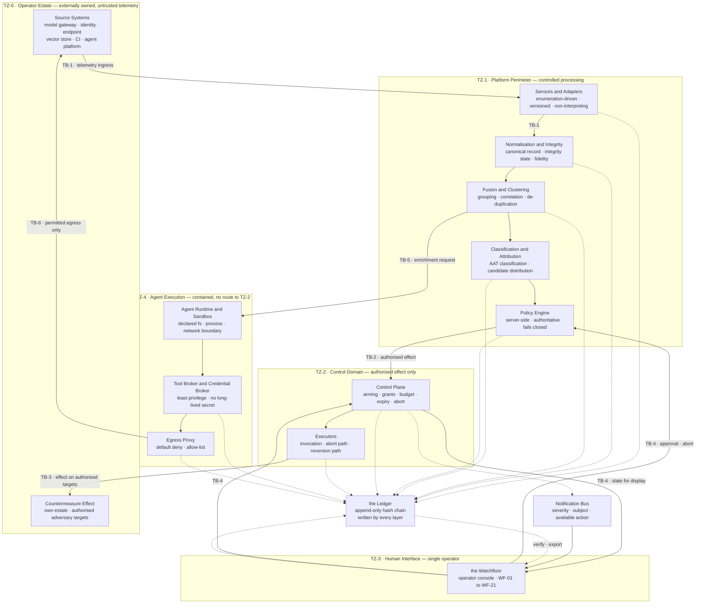
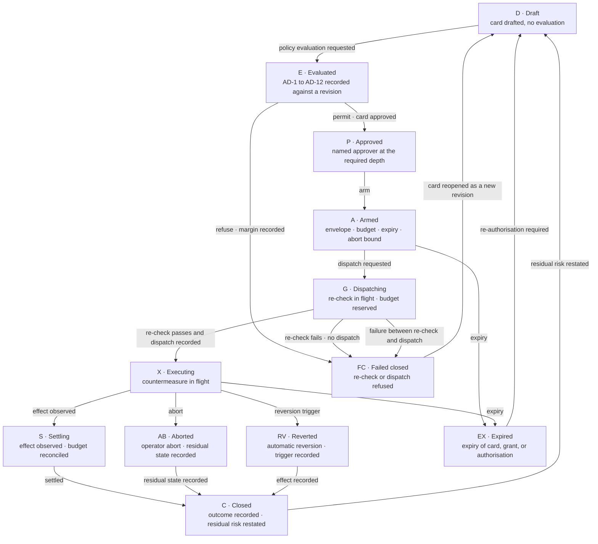

# Platform Architecture and Agent Containment: CAOS

| Field | Value |
| --- | --- |
| Author | MIA |
| Attribution | This was supported for MIA by Kilo (kilo-auto/free). |
| Document type | Architecture specification |
| Subject | Platform architecture, containment model, and ledger technical design for the Counter-Adversary Operations System |
| Scope | The sensor and collector layer, normalisation and integrity, fusion and clustering, classification and attribution services, the policy engine, the control plane and execution, the agent containment model, the Ledger, resilience and degraded operation, data protection, and platform observability |
| Requirement identifiers owned | `INFRA-1` to `INFRA-12`; `CTG-1` to `CTG-9`; `LIM-PL1` to `LIM-PL11` |
| Layer | L4 · Platform Layer |
| Version | 1.0 |
| Status | Authoritative for the platform requirements it owns. Component documents remain authoritative for their own requirements |
| Companion documents | `system-design-and-framework.md`; `README.md`; `operational/watchfloor-interface-specification.md`; `operational/adversary-ai-taxonomy-and-threat-model.md`; `operational/decision-support-and-scoring-model.md`; `operational/mission-lifecycle-and-decision-loop.md`; `operational/countermeasure-catalogue.md`; `constitutional/engagement-authorisation-and-rules-of-engagement.md`; `compliance/operator-conduct-and-human-in-loop-standard.md`; `reference/audit-and-conformance-procedures.md`; `reference/ai-attack-technique-library.md`; `templates/operation-card.md`; `impl/` |
| Relationship to the Axiom Hive set | Operational extension. Governed by `/home/k/Desktop/Docs/system-design-and-framework.md`; see master design §3.4 and limitation LIM-13 |

---

## 1. Purpose and Scope

### 1.1 What the platform is

This document specifies the machinery beneath the Watchfloor: the components that observe the operator's estate, turn observations into evidence, decide whether an action is permitted, execute it, and record what happened. The platform is the operational half of the control model described in the master design §8, and it is the part of the system that is implemented rather than argued.

The platform is five things and one ledger.

| Element | Statement |
| --- | --- |
| A collector set | A sensor and adapter layer that gathers telemetry from systems the operator already runs and states what it can and cannot see |
| A fusion layer | A normalisation, integrity, clustering, and de-duplication chain that turns raw observations into a defensible picture of activity |
| A decision-support service | A classifier, an attribution service, and a policy engine that produce ranked, labelled, and constrained options rather than instructions |
| A control plane | A dispatch, arming, grant, budget, expiry, abort, and reversion mechanism that turns an approved card into a bounded effect |
| An operator console | The Watchfloor, specified in `operational/watchfloor-interface-specification.md`, which is the only place a human authorises anything |
| A record | The Ledger: an append-only, hash-chained sequence that records the state of the world, the reasoning, the authority, and the effect |

### 1.2 What the platform deliberately is not

The platform's boundary is stated in the master design §3.5 and is restated here because the platform is where a boundary is easiest to erode: every one of the following would be a plausible feature to add and each would be a different product.

| The platform is not | Why the refusal is structural |
| --- | --- |
| A general SIEM | The platform does not ingest general-purpose event telemetry, does not retain arbitrary log bodies, and does not provide correlation across the estate. It consumes a declared subset of sources chosen by enumeration, and it says what it is not looking at |
| A general security platform | The platform does not scan hosts, manage vulnerabilities, patch systems, run malware analysis, or enforce security policy across the estate. Where it takes a hardening action, that action is a countermeasure from the catalogue on an approved card |
| An autonomous defence system | No consequential action occurs without a named human authorisation, or inside a pre-approved envelope with a declared expiry and automatic reversion. There is no mode in which the platform decides to act and acts |
| A model-security product | The platform does not inspect, evaluate, red-team, or harden models as a product line. It observes model-adjacent telemetry — gateways, tool brokers, agent runtimes, retrieval indexes, artefact registries — because adversary activity is increasingly mediated by those components |
| A penetration-testing service | The platform does not scan third-party or internal estates for weaknesses, and does not produce exploitability findings. The R2 Trap profile is a bounded, authorised observation of an adversary that has already come to the operator |
| A weapon | The master design §3.4 states the outer boundary. The platform contains no capability whose primary effect is to degrade, disrupt, or destroy another model or its training data |

### 1.3 The platform consumes telemetry from platforms that already exist

The platform is not a sensor estate. The model gateway, the identity provider, the endpoint agent, the vector store, the CI pipeline, the agent runtime, and the orchestration platform are owned by other teams and exist independently of this system. The platform's collector layer is a set of readers and adapters over those systems.

Two consequences follow and both are load-bearing.

1. **The platform cannot improve the coverage of a source it does not have.** A new detection is not a matter of writing a rule; it is a matter of a source existing, being readable, and emitting the fields the adapter requires.
2. **Where a capability is absent it is recorded as a detection gap, not approximated.** If the estate has no retrieval index change log, the platform does not infer one from model gateway behaviour and present the result as equivalent. It records the gap, names the taxonomy categories that the gap leaves uncovered, and surfaces that on the Watchfloor. This is the platform-level expression of master design LIM-11 and of ERR-3: absence is a condition to be explained, not a condition to be ignored.

The platform's response to an absent capability is therefore an entry in the surface-coverage register (§5.1), never a synthesised proxy presented as an observation.

### 1.4 Relationship to the rest of the set

The layer model, design objectives, and system boundary are held in `system-design-and-framework.md` §2 and §3. The admissibility algebra AD-1 to AD-12 is held in the master design §6.4 and in `operational/decision-support-and-scoring-model.md`; the ROE profiles, collateral classes, and autonomy classes in `constitutional/engagement-authorisation-and-rules-of-engagement.md`; the Operation Card, gates, and error handler in `operational/mission-lifecycle-and-decision-loop.md`; the AAT taxonomy and the attackable-surface enumeration in `operational/adversary-ai-taxonomy-and-threat-model.md`; the countermeasure catalogue in `operational/countermeasure-catalogue.md`; the console capabilities WF-01 to WF-21 in `operational/watchfloor-interface-specification.md`; and conformance assessment and ledger replay in `reference/audit-and-conformance-procedures.md`.

Where this document and a companion document both speak to a requirement, this document is authoritative for the platform mechanism and the companion document is authoritative for the analytical or constitutional content.

---

## 2. Interpretation of Normative Terms

The key words **must**, **must not**, **shall**, **shall not**, **should**, **should not**, **may**, **required**, **recommended**, and **optional** in this document are to be interpreted as described in RFC 2119 and RFC 8174, and appear in lower case to match the convention of the set. The **must not** form and the **must not** equivalent prohibition are equivalent in force.

The following conventions apply throughout.

| Convention | Meaning |
| --- | --- |
| Requirement block | A bold identifier on its own line, optionally followed by an em-dash and a short title, followed by the normative paragraph |
| **Fail closed** | The component's behaviour on error, timeout, missing input, ambiguity, or internal inconsistency is refusal, not continuation |
| **Never** | An absolute constraint within this platform's own boundary. It is not a claim about the behaviour of systems outside it |
| **Must not mutate** | The component is not the owner of the object and must not alter it |
| **Recorded** | Written to the Ledger before the act it describes, not after |
| **Authoritative** | The component's determination is binding on the rest of the platform and on the console |
| **Advisory** | The component's determination is a suggestion that other components may decline to follow. The policy engine is never advisory |

A requirement that uses **must** is a conformance requirement. A requirement that uses **should** is a conformance requirement whose departure must be recorded with a reason. A requirement that uses **may** is a permission, and exercising it is not itself a conformance claim.

---

## 3. Defined Terms

Terms carry the same meaning across the set. Where a term is defined here, the definition governs this document only; where the set index also defines it, the two must agree, and this document does not restate the controlled vocabulary beyond what it needs.

| Term | Definition | Primary layer |
| --- | --- | --- |
| **collector** | The component that schedules reads from source systems and delivers raw observations to an adapter. It decides nothing and interprets nothing | Collector |
| **sensor** | A single observation point against one source system, producing one signal class with one declared integrity expectation and one known blind spot | Collector |
| **adapter** | The versioned code that converts one source system's native representation into the canonical signal record. An adapter is isolated, tested, and replaceable | Collector |
| **normaliser** | The component that assigns the canonical signal record, the integrity state, and the source fidelity to an observation and rejects anything it cannot represent | Normalisation |
| **fusion** | The process of grouping individual signals into clusters, correlating activity across sources, and surfacing relationships that no single source shows | Fusion |
| **cluster** | A set of signals sharing indicators, a time window, and a stated grouping basis, carrying a hypothesis, an integrity aggregate, and the sources that contributed | Fusion |
| **integrity state** | The declared condition of a signal or source, drawn from the enumeration in §6.1, which constrains what the signal may be used for | Normalisation |
| **source fidelity** | A declaration of how completely and precisely the source observed the event, distinct from the source reliability tier that describes the source's general credibility | Normalisation |
| **classifier** | The service that assigns AAT categories and techniques to a cluster, with a rationale and a confidence, and that may be overridden by the operator | Classification |
| **inference endpoint** | The network endpoint through which a model is invoked. It is a sensor point, a credential-bearing component, and an egress path, and is subject to all three sets of requirements | Collector / Containment |
| **agent runtime** | The process that hosts an agent's planning loop, holds its context, and issues tool calls | Containment |
| **orchestrator** | The component that sequences agent steps, manages state between steps, and enforces delegation limits. It is distinct from the agent runtime it hosts | Containment |
| **tool broker** | The mediated interface through which an agent invokes a tool, a function, or a resource. It applies the capability scope and records every invocation | Containment |
| **policy engine** | The server-side, authoritative service that evaluates admissibility against the card's declared state and decides permit or refuse | Decision support |
| **control plane** | The component that arms a card, manages autonomy grants and budgets, dispatches, aborts, and reverts | Control plane |
| **posture** | The operating mode in force, expressed as the ROE profile ceiling currently in force (R0 Observe upward) together with the mission phase. The platform operates at or below the posture; it never raises it | Control plane |
| **the Watchfloor** | The operator console; the interface through which the human operator acts. It is the only place a human authorises anything | Interface |
| **the Ledger** | The append-only, hash-chained record of decisions, authorisations, dispatches, evaluations, and state changes | Record |
| **hash chain** | The sequence relation in which each record's digest is computed over its own canonical body and the digest of its predecessor | Record |
| **record** | One entry in the Ledger, comprising an envelope, a canonical body, and a digest | Record |
| **digest** | The fixed-length hexadecimal output of the hash function over a record body and its chain link | Record |
| **reversion** | The automatic and unconditional return of a countermeasure to its pre-execution state, triggered by loss of telemetry, loss of the control plane, expiry of an autonomy grant, or a condition on the card's abort list | Control plane |
| **autonomy grant** | A recorded, bounded authority permitting the platform to execute without per-action approval, with a declared envelope, budget, expiry, and reversion trigger | Control plane |
| **autonomy budget** | The quantified allowance of autonomous action available to a grant, consumed by each action and reconciled against each outcome | Control plane |
| **envelope** | The declared set of targets, actions, collateral classes, and conditions within which an autonomy grant may operate | Control plane |
| **sandbox** | The execution environment that enforces an agent's declared filesystem, process, and network boundary | Containment |
| **egress proxy** | The mediating component through which all outbound traffic from a contained agent passes, operating default-deny against an allow-list | Containment |
| **credential broker** | The component that issues short-lived, scoped credentials to a contained agent and holds the long-lived secret itself | Containment |
| **trust boundary** | A line across which data or control changes privilege, and across which every crossing is enumerated and logged | Architecture |
| **trust zone** | A region within which a single set of trust assumptions holds | Architecture |
| **degraded mode** | The first-class operating state in which one or more components are unavailable and the platform continues with reduced coverage, reduced confidence, and an explicit statement of what is affected | Resilience |
| **the operator** | The human at the console. Where the platform distinguishes an actor, **human operator** denotes a person and **agent** denotes a non-human actor | Interface |
| **the card** | The Operation Card: the atomic unit of authorised work, and the data structure against which the policy engine evaluates | Control plane |
| **the world model** | The card's declared state of the world: the target set, the observed activity, the attribution assessment, the threat assessment, and the assumptions, each with its label and confidence | Control plane |
| **sidecar** | A component deployed alongside a system it does not modify, observing or mediating it. Used for agent runtime interception, egress mediation, and artefact integrity checking | Containment |
| **admission control** | The gate at which a tool, model, or artefact is checked for authorisation and integrity before it is loaded or executed | Containment |
| **deconfliction service** | The service that determines whether a proposed countermeasure interferes with a live legitimate operation | Decision support |
| **notification bus** | The channel by which the platform raises an event to the operator and to the Watchfloor, carrying severity, subject, and the action available | Architecture |
| **the reference implementation** | The executable statement of the model in `impl/`: the decision-support core, the policy engine, the hash-chained Ledger, the Watchfloor CLI, and the proving ground, with its test suite | Record / Verification |

---

## 4. Architecture Overview

### 4.1 Layer model

The platform is arranged as a pipeline of eight functional layers. Authority flows inward and downward; telemetry flows upward and outward. Every layer writes to the Ledger, because every layer produces something that a reviewer will later need to reconstruct.



Two features of this diagram are architectural assertions in their own right and are recorded in §16.

- There is no edge from TZ-4 to TZ-2. An agent that is running inside the containment boundary cannot reach the control plane. Every effect the platform produces passes through the policy engine and the control plane, and an agent's output is an input to the classification layer, not a command to the executor.
- Every cross-zone edge is an enumerated crossing. The trust zones are not descriptive; they are the set of places where the platform asserts a change in privilege, and each crossing is logged.

### 4.2 Layer responsibilities

Each layer below states its responsibility, its inputs, its outputs, what it must not do, and its posture on failure.

#### 4.2.1 Sensors and adapters

The sensor and adapter layer reads declared fields from declared source systems at a declared sampling behaviour and represents what was read without interpreting it. Its inputs are the coverage register (§5.1), source access credentials issued by the credential broker, and an adapter version; its outputs are raw observations carrying source identity, collection time, source fidelity, and the sensor's declared integrity expectation. It must not interpret, score, correlate, classify, or raise an operational conclusion, must not enrich a record from a source not listed in the register, and must not retry indefinitely on a failing source, which would convert an absence into a lag. A sensor that cannot read its source reports the failure as an observation of failure; it does not go quiet.

#### 4.2.2 Normalisation and integrity

The normaliser converts a raw observation into the canonical signal record, assigns the integrity state and source fidelity, and rejects observations it cannot represent. Its inputs are raw observations, the source-fidelity rubric, the integrity-state rubric, and the adapter's declared integrity expectation; its outputs are canonical signal records carrying source identity, UTC timestamps, integrity state, source fidelity, and a content digest. It must not drop an observation for being inconvenient, must not merge two observations into one, must not assign an integrity state it cannot justify, and must not represent an absent observation as a negative finding. An observation that cannot be normalised is quarantined and counted, not discarded silently.

#### 4.2.3 Fusion and clustering

Fusion groups signals into clusters, correlates activity across sources, surfaces relationships that no single source shows, and suppresses duplicates. Its inputs are canonical signal records; its outputs are clusters with a stated grouping basis, an aggregate integrity state, contributing sources, and a shared hypothesis. It must not overwrite, discard, or silently absorb signals; a signal that does not join a cluster remains visible as an unclustered signal; and it must not raise a cluster's aggregate integrity state above the lowest contributing state without recording the basis. If fusion cannot form a cluster, the signals remain individually visible and are counted as a fusion gap.

#### 4.2.4 Classification and attribution

This layer assigns AAT categories to clusters, produces an attribution assessment with a candidate distribution and stated basis, and exposes the operator's override path. Its inputs are clusters, the AAT taxonomy, the technique library, and attribution evidence gathered across sources; its outputs are classifications with rationale and confidence, and attribution assessments with candidate distribution, basis, confidence, and alternative explanations. It must not present a classification without a rationale or an attribution without a confidence, and it must not treat a generic machine-generated finding as an attribution to an operator. An unclassifiable cluster stays in the queue as unclassified; it is not dropped, and it is not classified at low confidence to make the queue tidy.

#### 4.2.5 Policy engine

The policy engine decides whether a proposed countermeasure is admissible for a card under the profile in force, and records that decision with the margin. Its inputs are the card's declared state and world model, the ROE profile in force, the countermeasure's declared properties, the deconfliction result, and the autonomy budget position; its outputs are a signed policy decision record for every evaluation, including refusals. It must not advise, warn, or suggest; must not mutate the card, the world model, the ROE profile, or the policy set; must not interpret a request permissively; and must not evaluate on the operator's behalf or act on an unevaluated request. On failure it fails closed, naming the failing condition and the input that was unavailable.

#### 4.2.6 Control plane

The control plane arms a card, manages autonomy grants and budgets, dispatches, aborts, reverts, and enforces expiry. Its inputs are approved cards, policy decisions, executor capabilities, abort conditions, and the autonomy budget position; its outputs are dispatch, grant, budget-reconciliation, abort, and reversion records. It must not accept a dispatch without an approved card and a permitting policy decision recorded against the current card revision, must not dispatch while the Ledger cannot be written, and must not raise the posture. On loss of the control plane the platform reverts to Observe and refuses further dispatch.

#### 4.2.7 Executors

Executors invoke an admissible countermeasure through the mechanism that realises it and report the effect they actually observed. Their inputs are a dispatch authorisation bound to a card revision, a grant, and a budget allocation; their outputs are an execution record stating the intended effect, the observed effect, the abort path status, and the reversion status. They must not act on anything outside the dispatch authorisation's target set, collateral ceiling, or envelope, must not report an effect they have not observed, and must not retry a failed countermeasure outside the budget. An executor that cannot confirm its effect reports uncertainty and raises a notification; it does not report success by default.

#### 4.2.8 The Watchfloor

The Watchfloor presents the picture, makes uncertainty visible, captures the human's decisions, and provides the abort and recall controls. Its inputs are clusters, classifications, attributions, policy decisions, control-plane state, platform health, and Ledger verification state; its outputs are operator decisions, approvals, overrides, aborts, and exports. It must not render adversary-supplied content in an executing representation, must not omit a degraded source from the view, must not present an estimate as an observation, and must not permit an approval whose supporting information is on another screen. The console remains usable in degraded mode and states which conclusions are affected.

### 4.3 Trust zones and boundaries

| Zone | Contains | Trust assumption | What may cross the boundary | How it crosses | What is refused |
| --- | --- | --- | --- | --- | --- |
| **TZ-0** Operator estate | Source systems and the targets of authorised effect | The estate's own logs may be incomplete, delayed, reordered, or tampered with by an adversary who has already reached them | Observations travelling inward; authorised effects travelling outward | Signed, timestamped reads; a dispatch authorisation bound to a target set | Any effect outside a card's authorised target set; any read from a source not in the coverage register |
| **TZ-1** Platform perimeter | Sensors, normaliser, fusion, classification, policy engine | The platform controls these components and their inputs, but the content flowing through them is adversary-influenced | Canonical signal records, clusters, classifications, attribution assessments | Canonical form with integrity state and source fidelity attached | Records without an integrity state; raw adversary content rendered for display |
| **TZ-2** Control domain | Control plane and executors | The platform controls these components; their outputs change the world | Dispatch authorisations, abort instructions, reversion instructions | An authorisation bound to a card revision, a grant, and a budget allocation, recorded before effect | Dispatch without an approving policy decision against the current card revision; dispatch while the Ledger cannot be written |
| **TZ-3** Human interface | The Watchfloor | The console is a high-value target and is treated as one; adversary content reaches it by design | Operator decisions travelling inward; platform state travelling outward | Sanitised, non-executing rendering; integrity-checked artefacts; signed decisions | Live markup from adversary content; an approval whose evidence is not co-present |
| **TZ-4** Agent execution | Agent runtime, sandbox, tool broker, credential broker, egress proxy | Agents are untrusted by default; they process adversary content and may be influenced by it | Capability-scoped tool invocations; short-lived credentials; allow-listed egress | Tool broker mediation; credential issuance; default-deny egress proxy | Long-lived secrets; direct network access; any route to the control plane; loading an artefact that fails admission control |

Six boundaries are crossed, and each is enumerated. **TB-1**, telemetry ingress from TZ-0 to TZ-1: every observation enters with a source identity and an integrity expectation, and the integrity state is assigned in TZ-1 rather than inferred from the presence of data. **TB-2**, authorised effect from TZ-1 to TZ-2: crossing requires a permitting policy decision recorded against the current card revision, an in-force grant where autonomy is used, and a reserved budget. **TB-3**, execution effect from TZ-2 to TZ-0: crossing is bound to the dispatch authorisation's target set, collateral ceiling, and envelope, and is recorded before the effect occurs. **TB-4**, decision and display between TZ-1, TZ-2, and TZ-3: authority flows inward only as a recorded decision by a named principal, and state flows outward only as a labelled, confidence-bearing product. **TB-5**, enrichment request from TZ-1 to TZ-4: an agent's output returns as untrusted input, labelled as agent-produced, and does not become evidence until a source states it. **TB-6**, contained egress from TZ-4 to TZ-0: default deny, with every permitted destination, byte count, and decision recorded.

---

## 5. The Collector and Sensor Layer

### 5.1 Collection is enumeration-driven

**INFRA-1 — Collection is enumeration-driven, and adapters are isolated and versioned.**
The collector layer must derive its collection plan from the AI-attackable surface enumeration held in `operational/adversary-ai-taxonomy-and-threat-model.md`, and must maintain a coverage register that maps each enumerated surface to the sensor that observes it, the adapter version, the fields required, and the blind spot that remains. Each adapter must be versioned, must be replaceable without changing the platform's downstream contracts, and must not interpret, score, classify, or raise an operational conclusion. The collector must not acquire, or infer the existence of, a source that is not listed in the coverage register; where a required source is absent, the platform must record a detection gap against the taxonomy categories it leaves uncovered rather than approximating the source from adjacent telemetry.

The distinction between an enumeration and a wish list matters. An enumeration says: this is the surface an adversary AI would touch, this is the observable that would reveal it, and this is the system that produces that observable. A wish list says: it would be useful to know about prompt injections. The coverage register is the machine-checkable form of the enumeration, and it is the artefact against which detection coverage is assessed in the proving ground.

| Coverage register field | Purpose |
| --- | --- |
| Surface identifier | The enumerated surface from the taxonomy, so that a gap is reported against a category rather than in the abstract |
| Observable | The specific observation that would reveal activity on that surface |
| Source system | The platform that already produces it |
| Adapter version | The code that reads it |
| Integrity expectation | The strongest integrity state this source can normally support |
| Blind spot | What this source cannot show, stated positively |
| Gap status | Covered, partially covered, or uncovered |

### 5.2 Signal classes and sources

| Signal class | Source system | Required fields | Integrity expectation | Sampling behaviour | Known blind spots |
| --- | --- | --- | --- | --- | --- |
| Inference telemetry | Model gateway / inference service | Request identifier, model identifier and version, timestamp, token counts, latency, caller principal, tool set referenced, safety decision | Degraded at best; the gateway is usually operated by a third party and its logs are not tamper-evident | Continuous, event-driven, per request | Content of prompts and completions where not logged; routing to providers outside the gateway; model behaviour that is not mediated |
| Tool invocation | Tool broker / function-call layer | Invocation identifier, tool name and version, invoking agent or principal, arguments digest, result digest, outcome, duration | Trustworthy where the broker is operator-controlled and append-only | Continuous, event-driven | Tools invoked out of band, or directly against a service credential the agent holds; argument content where redacted upstream |
| Agent execution | Agent runtime trace | Run identifier, agent identifier, orchestrator version, step sequence, model calls, tool calls, context writes, termination reason | Trustworthy where the runtime is operator-controlled; degraded where the platform is shared | Continuous, event-driven | Reasoning content where not retained; steps executed outside the runtime; delegation that bypasses the orchestrator |
| Retrieval index change | Vector store / index manager | Index identifier, operation, object identifier digest, embedding model version, principal, timestamp, prior-state digest | Trustworthy where the index service is operator-controlled and change-logged | Continuous, event-driven | Content of the retrieved chunks; index mutation by a path that does not write the change log; poisoning that occurs upstream of indexing |
| Prompt and response store | Conversation or session store | Session identifier, turn identifier, role, content digest, retention expiry, principal | Degraded; the store is a content repository and its integrity depends on the platform beneath it | Continuous or sampled, per configuration | Content where retention has expired; content deliberately not stored; the semantic content of a stored prompt is not analysable from its digest alone |
| Orchestration graph | Orchestrator / workflow engine | Run identifier, node identifier, edge, state transition, approver, retry count, error | Trustworthy where the orchestrator is operator-controlled | Continuous, event-driven | Steps routed through a second orchestrator; state reconstructed after the fact rather than recorded at the time |
| Model artefact registry | Artefact store / registry | Artefact identifier, version, content digest, signature status, builder identity, publication time, dependency set | Trustworthy where the registry is operator-controlled and signs its entries | Continuous, event-driven | Artefacts loaded from a location outside the registry; substitution between verification and load |
| Evaluation harness | Test and evaluation runner | Harness identifier, suite identifier, case identifier, model and prompt digest, result, score, timestamp | Trustworthy where results are recorded immutably | On demand and on schedule | Results not written to the record; a harness whose configuration changed between runs without a version bump |
| Operator console activity | The Watchfloor's own audit surface | Actor principal, action, target, before and after state, view context, time | Trustworthy; the console writes its own audit record before the action takes effect | Continuous | Actions taken through a console defect that bypasses the audit path; anything that compromises the console itself |
| Identity and access | Identity provider | Principal, authentication method, token issuance and expiry, privilege change, session termination | Trustworthy where the provider is operator-controlled and append-only | Continuous | Behaviour of a valid credential used legitimately by a principal whose human has been compromised; activity that never traverses the provider |
| Endpoint and process | Endpoint agent | Host, process tree, executable digest, user, syscall summary, persistence change | Degraded; a privileged adversary on the host can tamper | Continuous or interval | Anything performed by a kernel-level adversary; encrypted or in-memory activity; the gap between the endpoint agent and the application |
| Network egress | Egress proxy / network control | Destination, principal, protocol, bytes, timestamp, decision | Trustworthy where the proxy is on the path and the adversary has not reached it | Continuous | Traffic that bypasses the proxy; covert channels within permitted destinations; activity on networks the platform does not observe |
| Cloud and control plane | Provider audit log | Event name, principal, resource, region, request identifier, outcome | Trustworthy where the provider is authoritative for the control plane and append-only | Continuous | Provider-side behaviour that is not logged; regions or services not enabled; a provider account compromised at a level below logging |
| Third-party SaaS | Vendor audit or webhook | Event, tenant, actor, object, timestamp, delivery state | Degraded; the vendor's integrity is the operator's assumption | On delivery, with retries | Events the vendor does not emit; delayed or dropped webhooks; vendor-side logging changes outside the operator's control |

### 5.3 The AI-era source set

The sources above differ from conventional estate monitoring in one specific respect: they sit on the path by which an AI system acts, rather than on the path by which a human acts. The observable is often the request rather than the endpoint, so tool invocations and model calls are collected at the mediation point, because the endpoint alone does not reveal who asked. The adversary's control surface is the prompt, so prompt and context stores are collected as sources and their change history is treated as more probative than their content. The artefact is the capability, so weights, adapters, prompts, and tool definitions are versioned artefacts collected with digests rather than by name. The runtime is the behaviour, so agent steps, retries, delegation, and termination reasons reveal planning behaviour that no single log captures. And the console is part of the target surface, which makes the operator's own interface a source, an attack surface, and an asset whose compromise invalidates the integrity of the operation it recorded.

### 5.4 A sensor with no integrity state is worse than no sensor

The requirement that implements this section is INFRA-2 (§6.2). It requires every sensor to declare an integrity expectation and a source fidelity before admission, forbids the admission of a sensor that has not, requires the integrity state to travel with the signal into every downstream product, and forbids the representation of an absent, unreadable, stale, or tamper-suspect source as a negative finding.

The reasoning is worth stating because it is counter-intuitive. A sensor that reports "no malicious tool calls observed" when it is in fact disconnected from its source produces a statement the operator will believe, will act on, and cannot audit. The absence of a sensor produces a gap, which is visible, which triggers the error handler's silence condition, and which produces no false reassurance. The presence of a dishonest sensor produces the opposite of both.

| Consequence | Detail |
| --- | --- |
| On detection | A source that stops delivering raises a source-liveness event within the interval declared for that source |
| On the Watchfloor | Degraded sources are shown as degraded, on the same surface as findings, not behind a disclosure control (WF-14) |
| On downstream products | A cluster's aggregate integrity state may not exceed the lowest contributing state unless the basis is recorded |
| On decisions | A countermeasure whose admissibility depends on a signal inherits that signal's integrity state; a degraded input may not support a C2-class action without an explicit recorded justification |
| On the record | Every integrity state transition is recorded with its cause |

---

## 6. Normalisation, Integrity, and Fusion

### 6.1 The integrity state model

The integrity state is a small, closed enumeration. It is deliberately small because it is displayed on the Watchfloor under time pressure and because a large enumeration degrades into a rubric nobody applies consistently.

| Integrity state | Condition | Permitted use | Prohibited use | Effect on the cluster |
| --- | --- | --- | --- | --- |
| **trustworthy** | The source is operator-controlled, append-only where applicable, authenticated, and delivering within its declared interval | Full evidentiary use: classification, attribution, countermeasure selection at any class | None specific to this state | Contributes at face value |
| **degraded** | The source is operator-controlled but has a known weakness: it is not append-only, it is delivered through a channel that can be interrupted, it omits fields, or its integrity depends on an assumption | Detection, classification, and correlation | Sole support for an action above C0; sole support for an attribution above the C1 threshold | Caps the cluster's aggregate at degraded |
| **stale** | The source is readable but its last observation exceeds the declared freshness threshold | Trend and context; identification of a source that went quiet | Any conclusion that depends on current state; any assertion that an activity is or is not occurring now | Caps the cluster's aggregate at stale |
| **missing** | The source is unreadable, absent, or was never instrumented | Recording of the gap and the coverage consequence | Any positive or negative finding from that source | Contributes nothing; the gap is counted |
| **tampered-suspect** | The source has been observed to be altered, truncated, out of sequence, or inconsistent with an external expectation | Recording of the tamper event and the escalation that follows | Any evidentiary use until the tamper question is resolved | Excluded from the aggregate and raised as a priority finding in its own right |

Two transitions are recognised and both are significant: **trustworthy to degraded** is a routine operational event and is recorded as such, whereas **any state to tampered-suspect** is an incident and is routed to the error handler on the principle that silence and tamper are both conditions to be explained.

### 6.2 The integrity state travels with the signal

The canonical signal record is the only representation in which a signal moves between layers. Adapters do not emit ad-hoc structures, and downstream components do not accept them.

| Field | Type | Description |
| --- | --- | --- |
| `signal_id` | Identifier | Unique within the platform; assigned at normalisation and never re-used |
| `source_system` | String | The system the observation came from, as named in the coverage register |
| `sensor_id` | String | The observation point within that source |
| `adapter_version` | String | The adapter that produced the observation |
| `observed_at` | Timestamp | UTC, at source, not at receipt |
| `received_at` | Timestamp | UTC, at the platform |
| `integrity_state` | Enumeration | The state from §6.1 |
| `source_fidelity` | Enumeration | `complete`, `partial`, `sampled`, `filtered`, or `unknown` |
| `content_digest` | Digest | Digest of the observation content in its canonical form |
| `subject` | Object | The principal, host, artefact, session, or resource the observation concerns |
| `attributes` | Object | The source-specific fields required by the coverage register |

**INFRA-2 — Integrity is declared at admission, travels with the signal, and absence is never a negative finding.**
The normaliser must produce exactly one canonical signal record form, and every sensor must declare an integrity expectation and a source fidelity before it is admitted to the coverage register. A sensor with no declared integrity expectation must not be admitted, and an observation that cannot be normalised into the canonical signal record must not be admitted at all. The integrity state and source fidelity assigned to a signal must travel with that signal into every downstream product, including clusters, classifications, attribution assessments, policy decision records, and Ledger records. No downstream component may derive, infer, or improve an integrity state that was not assigned at normalisation, and no component may strip the integrity state in order to present a product more cleanly. A source that is absent, unreadable, stale beyond its declared threshold, or suspected of tampering must be represented by its corresponding integrity state and must never be represented as a negative finding. Every confidence value and every derived estimate must carry the claim label `Estimate` and must inherit the confidence of its weakest input, less a declared derivation penalty.

### 6.3 Absence is never a negative finding

The rule is stated once here and appears in every layer that could break it.

| Prohibited representation | Required representation |
| --- | --- |
| "No malicious tool calls observed" when the tool broker was unreachable | "Tool broker source missing since ⟨time⟩; tool-call activity cannot be determined" |
| "No prompt injection detected" when the prompt store has no retention configured | "Prompt store source degraded: content not retained; injection activity cannot be determined" |
| A cluster that does not contain a signal from a missing source, shown without qualification | A cluster annotated with the sources that are missing from it and the categories consequently uncovered |
| A coverage percentage computed only over the sources that were available | A coverage percentage computed over the enumerated surface, with missing sources counted against it |

This is the platform-level expression of master design WFC-5 and INT-10, and it is the mechanism by which the error handler's silence trigger reaches the platform rather than only the mission layer.

### 6.4 Fusion and clustering

Fusion groups signals into clusters. The grouping basis is stated, because a cluster without a basis is an assertion.

| Grouping basis | What it asserts | Typical use |
| --- | --- | --- |
| **Shared indicator** | The signals share a value that identifies the same principal, artefact, host, session, or destination | Campaign assembly across sources |
| **Temporal proximity** | The signals fall within a declared window | Detecting a sequence of steps that is meaningful as a sequence |
| **Causal adjacency** | One signal's subject is the object of another | Following an action to its effect |
| **Behavioural similarity** | The signals exhibit the same pattern of behaviour | Identifying a tool or technique used repeatedly |
| **Operator-assigned** | A human grouped them | Analyst hypothesis, always marked as operator-assigned |

| Cluster field | Description |
| --- | --- |
| Cluster identifier | Stable across updates |
| Contributing signals | The signal identifiers, with each one's integrity state |
| Aggregate integrity state | The lowest contributing state, unless a higher aggregate is recorded with a basis |
| Grouping basis | One of the bases above, or a recorded operator assignment |
| Shared hypothesis | The proposition the cluster supports, labelled per the set's claim-label vocabulary |
| Correlations | Relationships across clusters that the fusion process surfaced, with the basis for each |
| Missing sources | The sources that would bear on this cluster and are not contributing |
| Classification state | Unclassified, machine-classified, operator-classified, or operator-overridden |

### 6.5 De-duplication

**INFRA-3 — Fusion is de-duplicated by a recorded rule, and the rule is inspectable.**
The fusion layer must suppress duplicate signals by a deterministic rule that is recorded in the cluster and inspectable by the operator. The rule must identify the fields it compares, the comparison semantics, and the window over which it applies, and it must preserve the provenance of every suppressed signal so that the original count of observations remains reconstructible. Suppression must never alter the integrity state of the surviving signal, and a suppressed signal must remain retrievable.

| De-duplication dimension | Rule | Note |
| --- | --- | --- |
| Exact duplicate | Same `content_digest` and same `observed_at` | A re-delivery of the same observation |
| Near duplicate within window | Same `source_system`, same `subject`, and matching identity fields, within a declared window | Must record the fields compared; a field set that is too narrow will merge distinct activity |
| Retry artefact | A `run_id` marked as a retry of an earlier step | Recorded by the orchestrator, not inferred |
| Cross-source overlap | The same underlying event observed by two sensors | The cluster records both; the aggregate counts the event once but preserves both observations and both integrity states |

The last case is the one that causes trouble in practice. Cross-source overlap is genuine corroboration and is not duplication: both observations must be retained, and a corroboration count may be shown. Treating corroboration as duplication destroys the evidence that two independent systems saw the same thing.

---

## 7. Classification and Attribution Services

### 7.1 The classifier

The classifier assigns AAT categories and, where the technique library supports it, technique identifiers to a cluster. It is a service that assists; it does not decide.

| Property | Statement |
| --- | --- |
| Input | A cluster with its contributing signals, their integrity states, its indicator set, and its shared hypothesis |
| Output | One or more AAT categories with, per category, a rationale, the evidence relied on, a confidence, and the source tiers of that evidence |
| Multi-label | Permitted and expected. TAX-3 makes the category a floor, not a ceiling: a cluster may carry more categories than the evidence strictly requires only where the evidence supports them |
| Requirement | A classification without a rationale is not emitted and is not accepted by the interface (TAX-2) |
| Constraint | The classifier must not classify a cluster whose aggregate integrity state is `missing`, and must not present a classification of a `stale` cluster as current |
| Deferral | A cluster that cannot be classified with a stated rationale is left unclassified and remains in the queue |

### 7.2 The operator override path

The classifier will be wrong. The override is a designed feature, not an exception.

| Step | Behaviour |
| --- | --- |
| 1. Override | The operator reclassifies a cluster from the Watchfloor, at any time, to any set of categories the taxonomy permits |
| 2. Reason | The override requires a reason. A free-text reason is sufficient; a structured reason is not required, and a null reason is not accepted |
| 3. Recording | The override is recorded in the Ledger as a distinct record kind, with the previous classification, the new classification, the operator principal, the reason, and the cluster's state at the time |
| 4. Propagation | The override applies to the cluster from that point forward. It does not rewrite prior records, and prior classifications remain visible in the historical record |
| 5. Feedback | Overrides are aggregated by category, by confidence band, and by source set, and are made available as a primary input to classifier improvement (TAX-4) |
| 6. Not a gate | An override does not by itself authorise action. It changes what the cluster is classified as, and the admissibility of a countermeasure follows from the card and the policy engine, not from the override |

The aggregate override rate, by confidence band, is also the platform's principal available evidence that the classifier is miscalibrated. Master design LIM-2 records that confidence values in the set are self-assessments and are not calibrated against outcomes; override rates are the nearest available proxy and are reported as such, labelled `Estimate`.

### 7.3 The attribution service

The attribution service answers a different question from the classifier: not what happened, but who did it. Its output contract is fixed.

| Field | Description |
| --- | --- |
| `candidates` | A distribution over candidate adversaries, each with a weight in [0.0, 1.0] summing to 1.0 |
| `basis` | The evidence the distribution rests on, each item with its source, its reliability tier, and its strength. The weakest basis used must be named |
| `confidence` | The stated probability that the activity is attributable to a specific adversary, in [0.0, 1.0], corresponding to the attribution confidence `c` in the decision-support model |
| `alternative_explanations` | Non-adversarial explanations that the evidence also supports, each with the reason it was not preferred |
| `evidence_class` | Whether the candidate is a specific operator's use of AI, or a generic machine-generated finding. A generic finding is a classification, not an attribution (INT-6) |
| `unattributed_mass` | The weight that could not be assigned to any candidate. A large unattributed mass is a reported condition, not a rounding error to be distributed |
| `as_of` | The time to which the assessment reflects available evidence |

| Rule | Effect |
| --- | --- |
| A named adversary with a stated confidence is permitted | A name without a confidence is not an output |
| The basis must be stated | An attribution with no basis is not an output |
| Identity-independent countermeasures are unaffected | Where a countermeasure does not depend on identity, the attribution threshold does not gate it (INT-4) |
| The threshold scales with consequence | The minimum confidence required rises with the collateral class, as set out in the master design §5.3 |
| Collective attribution is refused | "AI-driven" is not an actor |

### 7.4 Confidence is an estimate

The labelling discipline is stated normatively as INFRA-2 (§6.2) and derives from INT-8 and INT-9. Every confidence value produced by the classifier, the attribution service, the fusion layer, or the platform's own health scoring must be carried with the claim label `Estimate` and must be presented on the Watchfloor as an estimate rather than as a measurement. A confidence value must not be used as an authorisation input without the corresponding admissibility condition being evaluated and recorded, and it must not be rendered in a way that implies calibration the platform has not demonstrated.

Two consequences are worth drawing out because they are easy to get wrong.

- **A confidence value is not a probability that has been validated.** Master design LIM-2 states that confidence in this set is a self-assessment. The platform must not present one as a calibrated probability, and must not compute derived quantities that imply calibration it does not have.
- **Derived values inherit the weakest input.** A confidence derived by the platform from two inputs may not exceed the weaker input's confidence, less a declared penalty for the derivation (INT-9). The penalty must be declared in the product, not left to the reader.

---

## 8. The Policy Engine

The policy engine is the most important component in this document. It is the place where the set's central commitment — that authority is structural rather than advisory — is either real or notional. The requirements below are correspondingly strict, and a failure of any of them is a failure of the architecture, not a defect in a component.

### 8.1 The engine is authoritative, not advisory

**INFRA-4 — The policy engine is server-side and authoritative, and it fails closed.**
The policy engine must be a server-side service that holds the authoritative rule set, and it must be the only component that determines whether a countermeasure is admissible for a card. It must fail closed: on error, timeout, unavailable dependency, missing or malformed input, ambiguous input, or internal inconsistency, it must refuse the request and name the failing condition and the unavailable input. The engine must never be advisory, must never return a warning that a caller may ignore, and must never be reachable in a mode in which its determination is optional. A client-side component must not be permitted to compute or substitute an admissibility result, and the console must not be able to construct a dispatch authorisation without one.

The prohibition on client-side evaluation is the operative part. A policy engine that can be bypassed by a client that decides not to call it is an advisory engine with extra steps. The console therefore renders the engine's output; it does not compute it.

### 8.2 What the engine evaluates

**INFRA-5 — Evaluation is against the card's declared state, is repeated at dispatch, and never mutates the card.**
The policy engine must evaluate the conditions AD-1 to AD-12, defined in the master design §6.4 and held in `operational/decision-support-and-scoring-model.md`, against the card's declared state and world model as at a specific card revision. It must re-evaluate at dispatch, because both the card state and the world state change between selection and dispatch, and the re-evaluation must be against the current revision rather than against a cached result. It must never mutate the card, the card's world model, the ROE profile, the policy set, or any record it evaluates. Where the engine's evaluation reveals that the card's declared state is inconsistent with the world as observed, it must record the inconsistency and refuse, and it must not repair the card itself.

| Input to the evaluation | Source of truth | Staleness handling |
| --- | --- | --- |
| Card revision and declared state | The card as approved at the current revision | The engine records the revision it evaluated; a request against a superseded revision is refused |
| World model | The card's world model, cross-checked against the current platform state | A divergence between declared and observed state is a refusal and an error-handler trigger |
| ROE profile in force | The profile recorded on the card and the profile currently authorised by the engagement authorisation | The lower of the two applies; the engine records which bound it |
| Countermeasure properties | The countermeasure catalogue | The catalogue version is recorded with the decision |
| Deconfliction result | The deconfliction service | A deconfliction service that is unavailable causes refusal at AD-10 |
| Autonomy budget position | The control plane | The current remaining budget is read at evaluation and again at dispatch |
| Attribution confidence | The card's attribution assessment | The threshold is applied at AD-9 with the observed value recorded |

### 8.3 The policy decision record

**INFRA-6 — Every evaluation produces a signed policy decision record, including refusals, and a refusal records its margin.**
The policy engine must emit a signed policy decision record for every evaluation it performs, including every refusal, every evaluation that fails closed, and every evaluation performed at dispatch. A refusal must record the specific condition that failed, the observed value, the value that would have been required, and the margin between them, so that the refusal is informative rather than opaque. The decision record must be written to the Ledger, and its signature must be verifiable against the platform's policy signing key.

| Field | Description |
| --- | --- |
| `decision_id` | Unique identifier for the evaluation |
| `ts` | UTC time of evaluation |
| `evaluation_phase` | `pre-selection`, `post-selection`, or `at-dispatch` |
| `card_ref` | The card evaluated |
| `card_revision` | The revision of the card evaluated |
| `policy_set_version` | The version of the rule set applied |
| `engine_version` | The version of the engine that evaluated |
| `requester` | The named principal that requested the evaluation |
| `requested_action` | Countermeasure identifier, class, collateral class, autonomy class, and the digest of the target set |
| `world_model_digest` | Digest of the card's world model as evaluated |
| `conditions` | One entry per condition AD-1 to AD-12, each with the result `pass`, `fail`, or `not-applicable`, the observed value, the required value, and the source of the observed value |
| `outcome` | `permit`, `refuse`, or `permit-with-condition` |
| `margin` | For a refusal: the failing condition, the observed value, the required value, and the signed difference. For a permit: the headroom against the nearest failing condition |
| `authority_ref` | The engagement authorisation, the ROE profile, the approver, and the approval depth where the card is already approved |
| `fail_closed_reason` | Present where the evaluation failed closed; names the unavailable or malformed input |
| `signature_algorithm` | The signature algorithm used |
| `signature_key_id` | The identifier of the signing key |
| `signature` | The signature over the canonical body of this record |

Two properties of this structure matter. First, the `conditions` array is complete: an evaluation that could not reach a condition records it as `not-applicable` with a reason, and never simply omits it. Second, the margin is present on refusals, because AD-13 in the master design requires a rejection to name the condition that failed and the value that would have made the countermeasure admissible, and the platform is where that value is computed.

### 8.4 Policy change is a governed event

**INFRA-7 — The policy rule set is versioned, inspectable, and changed only as a governed event.**
The policy engine's rule set must be versioned, and a change to the rule set must be treated as a governed event requiring a version identifier, a named author, a stated rationale, and a policy decision record for the change itself. The rule set in force must be inspectable by the operator at the console, in the same form the engine applies it, including the thresholds, the ordering of evaluations, and the conditions in their current form. A rule set must not be changed in place, must not be changed by the engine itself, and must not be changed by a component of the platform that is not the policy set's owner. Each evaluation must record the rule set version it applied, and a decision must not be re-evaluated against a rule set version other than the one it was evaluated against unless the re-evaluation is itself recorded as a new evaluation.

Inspectability has a specific meaning here: the operator must be able to see the rules as the engine holds them, not as a description of them. The console capability WF-19 is the mechanism; this requirement states the obligation it must discharge.

### 8.5 Failure behaviour in detail

| Failure | Engine behaviour | Operator-visible effect |
| --- | --- | --- |
| A required input is missing | Refuse, fail closed, name the missing input | The refusal record names the input; the card shows the evaluation as incomplete rather than pending |
| A required dependency is unavailable | Refuse, fail closed, name the dependency | A platform health event names the dependency |
| The card revision has been superseded | Refuse | The console shows the card is at a newer revision and offers to re-evaluate |
| The world model diverges from observed state | Refuse, and raise an error-handler trigger | The divergence is shown on the card, with both states |
| The deconfliction service is unavailable | Refuse at AD-10 | The deconfliction map shows the service as unavailable, not as clear |
| The policy set cannot be loaded or its signature fails | Refuse every evaluation | The console raises a critical platform health event and the policy set cannot be edited until resolved |
| The engine's own evaluation times out | Refuse | The timeout is recorded as a refusal with no margin, because no condition was reached |

The rule for the timeout row is the important one. A timeout is not an absence of a decision; it is a decision to refuse, and it is recorded as such so that a reader of the Ledger can see the difference between "refused because AD-9 failed" and "refused because the engine did not answer".

---

## 9. The Control Plane and Execution

### 9.1 Arming

Arming binds the approved card to the live enforcement state: the envelope, the autonomy budget, the expiry, and the abort conditions are attached to the card revision, and the card becomes dispatchable.

| Element | Requirement |
| --- | --- |
| Preconditions | A card approved at the required depth, a permitting policy decision against that card revision, a current engagement authorisation, and an in-force posture that permits the action's profile |
| Bound at arming | The envelope, the autonomy budget allocation, the expiry timestamp, the abort conditions, the abort owner, and the policy set version in force at approval |
| Effect | The card becomes dispatchable; a dispatch must name the card revision it dispatches against |
| Expiry | Arming carries the expiry inherited from the engagement authorisation unless set earlier (OP-3). Expiry reverts to Observe |

### 9.2 Autonomy grants

An autonomy grant is a recorded, bounded authority permitting execution without per-action approval.

| Field | Description |
| --- | --- |
| Grant identifier | Unique |
| Card reference and revision | The grant is bound to a specific approved revision |
| Envelope | The declared targets, actions, collateral classes, and conditions within which the grant may operate |
| Autonomy class | AC-2 or AC-3; AC-4 is not permitted for any action above C0 (master design §4.5) |
| Budget | The autonomy budget allocated, with its unit and its accounting rule |
| Expiry | Absolute timestamp at which the grant lapses |
| On-call | The named person on call, and the escalation path |
| Reversion trigger | The condition, or conditions, that cause automatic reversion |
| Abort channel | The mechanism by which the on-call person aborts, which must be demonstrated before the grant is used (HITL-3) |

A grant is a grant for a specific card, envelope, and time window. It does not persist across revisions, does not extend on expiry, and does not carry over between operations.

### 9.3 Budget accounting

| Rule | Detail |
| --- | --- |
| Unit | The budget's unit must be declared on the grant — actions, wall-clock seconds, tool invocations, or a domain-specific unit |
| Reservation | The budget is reserved at the policy evaluation, not at dispatch, so that a concurrent evaluation cannot over-commit it |
| Consumption | Consumption is recorded per action at dispatch, with the amount consumed |
| Reconciliation | Each action's consumption is reconciled against its observed outcome at settlement, and the reconciliation is recorded |
| Exhaustion | Exhaustion of the budget causes immediate reversion, and further autonomous action is refused |
| Uncertainty | An action whose consumption cannot be determined consumes the maximum of the grant's remaining budget, not the minimum. The platform does not claim the benefit of an unmeasurable cost |
| The envelope is not the budget | Remaining budget does not widen the envelope. A grant with budget left cannot act outside its envelope, and a grant with envelope left cannot exceed its budget |

### 9.4 Expiry

Expiry is a hard stop applied in the platform, not a field in a card that someone must notice.

| Element | Behaviour |
| --- | --- |
| Card expiry | The card stops being dispatchable. In-flight counters revert |
| Grant expiry | The grant lapses; autonomous action stops; the platform reverts to Observe |
| Engagement authorisation expiry | All cards under it stop being dispatchable, outstanding grants are revoked, and a notification is raised |
| Revocation | Immediate; not queued behind a running operation (AUTH-4) |
| Detection | Expiry is enforced by the control plane's own clock and by the platform's continuity check, so that it does not depend on an operator noticing |

### 9.5 Abort

| Property | Statement |
| --- | --- |
| Availability | The abort control is always visible on the Watchfloor, always reachable without navigating, and requires no confirmation (WFC-2) |
| Authority | Any operator with the role to abort may abort, and any operator may escalate to abort. Abort is never subject to a quorum |
| Effect | The countermeasure is instructed to revert. The reversion path must exist before the operation begins, not be constructed during it |
| Recording | The abort request, the time, the requesting principal, the reason, and the observed reversion outcome are all recorded |
| Partial abort | Where a countermeasure is not cleanly revertible, the abort records the residual state and its reach. An abort is not a claim of full reversal |

### 9.6 Reversion

Reversion is automatic and unconditional (HITL-5). It is triggered by loss of telemetry required by the card, loss of the control plane, expiry of the autonomy grant or card, detection of a condition on the abort list, budget exhaustion, or a policy change that invalidates the card's standing.

| Property | Statement |
| --- | --- |
| Automatic | Reversion does not wait for a human to notice, and is not contingent on a human confirming it |
| Unconditional | No trigger may be suppressed by a human. A human may only add triggers |
| Recorded | Every reversion records the trigger, the time, the initiating component, the observed effect, and the residual state |
| Posture | Where the trigger is loss of the control plane, the platform reverts to Observe and refuses further dispatch until the control plane is restored |

### 9.7 The execution state machine



The state table below is normative. The diagram is illustrative of the same transitions.

| State | Entry condition | Permitted operations | Exit transitions | Authority required |
| --- | --- | --- | --- | --- |
| **D** Draft | A card revision exists | Edit the draft; request evaluation | To E on evaluation; none otherwise | Card owner |
| **E** Evaluated | A policy decision has been returned against this card revision | Record the operator's selection; amend the card as a new revision | To P on approval; to FC on refusal | Card owner |
| **P** Approved | A named approver at the depth required by the profile and collateral class has approved this revision | Arm; amend as a new revision; withdraw | To A on arming; to D on withdrawal | The approver named in the approval record |
| **A** Armed | The card is approved, a permitting policy decision exists against the current revision, and the binding is complete | Dispatch; amend as a new revision; abort before dispatch | To G on dispatch; to EX on expiry; to D on amendment | The card's existing approval, unchanged |
| **G** Dispatching | A dispatch request names the card revision, and the budget is reserved | Complete the re-check; write the dispatch record; abort | To X only on a passed re-check and a recorded dispatch; to FC on any failure | No additional authority; the existing approval is consumed by the dispatch |
| **X** Executing | The dispatch is recorded and the executor has accepted it | Observe; abort; reversion | To S on observed effect; to AB on abort; to RV on reversion trigger; to EX on expiry | On-call operator for abort; automatic for reversion |
| **S** Settling | The executor reports the observed effect | Reconcile the budget; recompute residual risk; draft the after-action contribution | To C | Card owner |
| **C** Closed | The outcome, residual risk, and residual state are recorded | Reopen as a new revision | To D | Card owner |
| **AB** Aborted | An abort is requested and recorded | Record the residual state; record what was not reverted | To C | Any operator with abort authority |
| **RV** Reverted | A reversion trigger fired | Record the trigger and the residual state | To C | Automatic |
| **EX** Expired | Card, grant, or authorisation expiry passed | Re-authorise; record the expiry | To D | The authority that can re-authorise |
| **FC** Failed closed | A re-check failed, or a dispatch was refused | Correct the cause; record the failure | To D as a new revision | Card owner; the approval is not reused |

### 9.8 Dispatch atomicity

**INFRA-8 — Dispatch is atomic with respect to the re-check, and an unrecordable dispatch does not occur.**
The control plane must re-evaluate admissibility at dispatch against the current card revision and the current world state, and the re-check and the dispatch must be atomic with respect to each other: the control plane must not dispatch against a card revision or a policy decision that was not current at the moment of dispatch. Where any failure occurs between the re-check and the dispatch, no dispatch must occur, and the failure must be recorded as a failed-closed transition. The control plane must not dispatch where the Ledger cannot be written.

The atomicity requirement is what makes the re-check meaningful. A re-check performed at time T and a dispatch at time T+n, with the card's state permitted to change in between, is not a re-check; it is a historical observation. The implementation requirement is that the card revision, the policy decision, and the dispatch are committed in one indivisible operation with respect to each other, and that the committed dispatch names the revision it was authorised against.

---

## 10. Agent Containment

### 10.1 The containment model

The platform runs agents, and it may run an adversary's agent under the R2 Trap profile. Both cases require the same answer: an agent is untrusted, it is given a declared set of capabilities, it is given no durable authority, and its reach is bounded by mechanisms that are external to it and are verified by test rather than by the agent's own cooperation. The model has five ideas.

1. **The boundary is declared, not inferred.** An agent's filesystem, process, and network boundary are stated in configuration before it runs, and every crossing of them is logged.
2. **Capability is scoped, not granted generally.** An agent invokes tools through a broker that holds the actual authority and applies the scope at the moment of invocation, not at the moment the agent was launched.
3. **Secrets are brokered, never held.** An agent never holds a long-lived secret. It receives a scoped, short-lived credential for a specific action, from a broker that holds the durable secret and can revoke it.
4. **Egress is default-deny.** The agent's outbound traffic passes a proxy that permits only destinations on an allow-list, and the decision is recorded either way.
5. **Containment is verified by test.** Each control is demonstrated by a test that attempts the prohibited action and shows it failing. An untested control is an assertion.

### 10.2 Containment requirements

**CTG-1 — Execution sandboxing with a declared boundary.**
An agent runtime must execute inside a sandbox that enforces a declared filesystem boundary, a declared process boundary, and a declared network boundary. The boundary must be specified in configuration before the agent is launched, must be enforced by a mechanism outside the agent's control, and must be enforced independently of the agent's own runtime configuration. Every attempt to cross a declared boundary must be logged with the attempted operation, the target, and the decision.

**CTG-2 — Capability scoping and least privilege for tool access.**
Tool access must be mediated by a tool broker that applies a declared scope at the moment of each invocation. The scope must be the minimum set of tools, parameters, and target objects required for the agent's current task, must not be widenable by the agent, and must not be inherited from a parent scope. The broker must record every invocation with its scope decision.

**CTG-3 — Credential brokering.**
An agent must never hold a long-lived secret. All credential use must pass through a credential broker that holds the durable secret, issues a scoped and short-lived credential for a specific action, records the issuance, and is able to revoke it independently of the agent's lifecycle. A secret present in an agent's context, prompt, trace, or memory store is a control failure and is treated as an incident.

**CTG-4 — Egress mediation with a default-deny posture.**
All outbound traffic from a contained agent must pass an egress proxy operating a default-deny posture against an explicit allow-list. Destination, protocol, principal, byte count, and the decision must be recorded for permitted and denied traffic alike. The agent must not be able to alter the allow-list, and must not have a path to the network that does not traverse the proxy.

**CTG-5 — Delegation limits.**
An orchestrator must enforce limits on delegation depth, delegation breadth, and delegation lifetime. Depth is the number of levels of delegation permitted; breadth is the number of agents that may be spawned in a period or in a task; lifetime is the interval over which a delegated authority remains valid. A delegated authority must be narrower than the authority that delegated it, must expire, and must not be re-delegated beyond the declared depth.

**CTG-6 — Separation of agent identity from human identity.**
An agent must act under an identity that is distinct from every human identity, must be attributable to the run, the card, and the orchestrating principal, and must never authenticate as a human. Agent actions must appear in the Ledger and on the Watchfloor under the agent identity, visibly distinct from human actions, so that an operator can always tell what was decided by a person and what was done by an agent.

**CTG-7 — Memory and context isolation with scrubbable stores.**
An agent's memory and context stores must be isolated from those of other agents, of other tasks, and of the platform's own state. Stores must be scrubbable on a declared schedule and on demand, and a scrub must be recorded. Content originating from an adversary must be marked as such in the store, so that it is never later treated as a trusted instruction.

**CTG-8 — Admission control on tool and model loading.**
Every tool, model, prompt artefact, and dependency loaded into an agent runtime must pass admission control, which must verify the artefact's authorisation, its integrity against an expected digest or signature, and its provenance against the artefact registry. An artefact that fails admission control must not be loaded. The check must occur between verification and load, and the artefact must not be re-fetched, substituted, or mutated between the two.

**CTG-9 — Containment is verified by test.**
Each containment control must be demonstrated by a test that attempts the prohibited action and shows it failing, at the version of the platform in use. A control that has not been demonstrated by a test must be recorded as an unsubstantiated architectural assertion (§16) and must not be described as effective. The test corpus must cover at least the prohibited actions enumerated in §10.2, and must be re-run on every change to the containment configuration.

### 10.3 Containment requirements register

| ID | Requirement | What it prevents (AAT categories) | How conformance is demonstrated | What failure looks like |
| --- | --- | --- | --- | --- |
| **CTG-1** | Sandboxed execution with a declared filesystem, process, and network boundary | AAT-2 context corruption; AAT-4 configuration and secret discovery; AAT-5 sandbox and detector evasion; AAT-9 covert channels | A test that writes outside the declared filesystem, spawns a process outside the declared process set, and opens a connection outside the declared network set; all three must be denied and logged | The agent writes to a path outside its declared tree, or a connection leaves the declared set and succeeds |
| **CTG-2** | Tool access mediated and scoped at the moment of invocation | AAT-1 recursive delegation; AAT-2 tool-output poisoning; AAT-4 automated credential harvesting; AAT-8 inter-agent trust exploitation | A test that invokes a tool outside scope, with an out-of-scope parameter, and against an out-of-scope object; all three must be denied at the broker | The tool executes against an object the agent was not authorised to touch |
| **CTG-3** | Credential brokering; no long-lived secret in an agent | AAT-4 credential harvesting; AAT-5 account persistence; AAT-6 credential stuffing; AAT-9 covert storage | A test that searches the agent's context, memory, and trace for secret material; a test that revokes the broker's issuance while the agent is running and shows the next use failing | A durable credential appears in the agent's context, trace, or memory store |
| **CTG-4** | Default-deny egress through a proxy with an allow-list | AAT-9 exfiltration and covert channels; AAT-2 indirect prompt injection leading to egress; AAT-6 adaptive denial of service | A test that attempts a connection to a destination not on the allow-list, including a permitted destination on a disallowed port and a permitted destination at an unexpected time; all must be denied and recorded | The agent reaches a destination that the proxy did not permit, or the agent holds a network path that does not traverse the proxy |
| **CTG-5** | Delegation limits on depth, breadth, and lifetime | AAT-1 task decomposition and recursive delegation; AAT-8 agent swarms and delegation-chain abuse | A test that delegates beyond the declared depth, that spawns beyond the declared breadth, and that attempts to use a delegation after its lifetime has expired; all must be refused | The agent's delegation graph exceeds its declared bounds, or a delegation outlives its declared window |
| **CTG-6** | Agent identity distinct from human identity | AAT-3 automated persuasion and persona consistency; AAT-5 long-horizon presence and account persistence; AAT-8 coordinator compromise | A test that attempts to authenticate as a named human; a review of the Ledger and the Watchfloor showing agent actions visibly attributed to an agent and human actions to a person | An agent's action appears in the record under a human principal, or an agent holds a credential that authenticates as a person |
| **CTG-7** | Memory and context isolation with scrubbable stores | AAT-2 context corruption; AAT-5 long-horizon presence; AAT-8 conflicting-goal propagation; AAT-9 covert storage | A test that reads one agent's store from another agent's context; a scrub test showing the store is emptied on schedule and on demand, with the scrub recorded | One agent observes another's context, or a scrub leaves content behind without a recorded residue |
| **CTG-8** | Admission control on tool and model loading, with integrity checking | AAT-7 model poisoning, backdoored adapters, retrieval-corpus poisoning, tool and plugin supply chain; AAT-5 model-fingerprint suppression | A test that loads an artefact with a mismatched digest, an unsigned artefact, an unauthorised artefact, and an artefact substituted between verification and load; all must be refused | An artefact loads without a passing admission check, or is replaced between the check and the load |
| **CTG-9** | Containment verified by test rather than assumed | AAT-5 sandbox and detector evasion; AAT-2 tool-output poisoning; applies as a discipline across all categories | A versioned test corpus whose results are recorded with the platform version and the containment configuration in force; a register of controls with no test marked unsubstantiated | A control is described as effective in a document or a briefing while no test demonstrates it |

The mapping to AAT categories is a coverage statement, not a claim of prevention. A control reduces the likelihood of the listed categories of behaviour; it does not eliminate them, and the mapping is reviewed against the taxonomy version in force.

### 10.4 Containment layers, outermost to innermost

| Order | Layer | Encloses | Mechanism | Records | Verified by |
| --- | --- | --- | --- | --- | --- |
| 1 | **Process isolation** | The agent runtime and everything it spawns | Execution in an isolated environment with its own process, memory, and resource namespace | Process creation, resource use, termination | CTG-1, CTG-9 |
| 2 | **Filesystem boundary** | The agent's writable state | An explicit allow-list of writable paths; a read-only view of everything else; no access to host credentials, keys, or configuration | Every denied read and write | CTG-1, CTG-9 |
| 3 | **Network boundary** | The agent's sockets | Default-deny at the namespace level; permitted destinations reachable only through the egress proxy | Connection attempts and outcomes | CTG-1, CTG-4, CTG-9 |
| 4 | **Egress proxy** | The agent's outbound traffic | An allow-list of destinations, protocols, and any timing or volume conditions; per-destination decisions | Destination, principal, bytes, decision | CTG-4, CTG-9 |
| 5 | **Credential broker** | The durable secrets the agent needs | Short-lived, scoped issuance; per-use authorisation; independent revocation | Issuance, scope, use, revocation | CTG-3, CTG-9 |
| 6 | **Tool broker** | The agent's authority to act | Scope enforcement at invocation; scope narrowing on delegation; parameter and object validation | Every invocation and its scope decision | CTG-2, CTG-5, CTG-9 |
| 7 | **Admission control** | The artefacts the agent loads | Authorisation, integrity, and provenance checks between verification and load | Every load attempt with its verdict | CTG-8, CTG-9 |
| 8 | **Orchestrator and delegation control** | The agent's ability to extend itself | Depth, breadth, and lifetime limits; narrowing on delegation; expiry enforcement | Delegation graph, limits, refusals | CTG-5, CTG-9 |
| 9 | **Context and memory isolation** | What the agent remembers | Per-agent, per-task stores; adversary-origin marking; scrubbable on schedule and on demand | Reads, writes, scrubs | CTG-7, CTG-9 |
| 10 | **Identity separation** | Who the agent appears to be | A distinct agent principal, bound to the run and the card; no human credential ever issued to an agent | Attribution of every action to an agent principal | CTG-6, CTG-9 |
| 11 | **Record and audit surface** | The platform's own view of the agent | Every contained action is recorded in the Ledger with its agent identity and the containment decisions in force | The full trail | CTG-6, CTG-9 |

The ordering is meaningful: the outer layers are enforced by mechanisms the agent cannot modify, and the inner layers are enforced by platform logic. The weakest layer determines the strength of the whole, which is recorded as a limitation in §17.

---

## 11. The Ledger

The Ledger is the substrate on which every other claim in the set rests. Master design DO-12 makes the decision reconstructible, and the Ledger is where that is implemented.

### 11.1 Record structure

The Ledger is a sequence of records. Each record has an envelope and a canonical body.

| Field | Type | Description |
| --- | --- | --- |
| `seq` | Integer | Position in the sequence, starting at 1, strictly increasing by 1 with no gaps |
| `prev` | Digest | The digest of the preceding record; 64 hexadecimal characters of zero for the genesis record |
| `body` | Object | The canonical body, as specified in §11.2 |
| `digest` | Digest | The digest of this record, computed as specified in §11.2 |

The body carries the following fields.

| Body field | Type | Description |
| --- | --- | --- |
| `schema` | String | The record schema identifier and version, for example `caos.ledger.record/1` |
| `ts` | Timestamp | UTC, RFC 3339, second precision, with a `Z` suffix |
| `kind` | Enumeration | The record kind, which determines the payload schema |
| `subject` | String | The principal, host, artefact, session, card, countermeasure, or platform component the record concerns |
| `actor` | String | The principal that caused the record: a human role, an agent identity, a system component, or an automation |
| `card_ref` | String or null | The card the record concerns, where one applies |
| `integrity` | Enumeration | The integrity state of the subject matter at the time of the record |
| `payload` | Object | The kind-specific content |

Record kinds determine the payload schema. The kinds are grouped by the layer that produces them.

| Group | Kinds |
| --- | --- |
| Chain | `ledger.genesis`, `ledger.anchored`, `ledger.verified` |
| Observation | `signal.ingested`, `signal.integrity_changed`, `cluster.formed`, `cluster.updated` |
| Analysis | `classification.assigned`, `classification.overridden`, `attribution.assessed` |
| Policy | `policy.decision`, `policy.set_changed` |
| Operation | `card.approved`, `card.armed`, `card.closed`, `grant.issued`, `grant.revoked` |
| Execution | `dispatch.issued`, `dispatch.refused`, `execution.observed`, `execution.aborted`, `execution.reverted`, `budget.reconciled` |
| Platform | `platform.health`, `containment.violation` |

Each kind carries a payload whose schema is defined for that kind. A payload that cannot be represented in its kind's schema is a rejection at the ledger interface, not a truncation of the record.

### 11.2 Hash chaining

The digest function is SHA-256. The digest is computed over the concatenation of the previous digest and the canonical body.

**INFRA-10 — The Ledger is hash-chained, tamper-evident, and verifiable, and the limits of its guarantee are stated.**
The Ledger must be a sequence of records in which each record's digest is computed over the previous record's digest and the record's own canonical body, using the canonicalisation defined below. The platform must provide a verification procedure that recomputes the chain over a stated range and reports the first divergence, and must provide a signed export format suitable for verification by a party outside the platform. The platform must state, in the product itself, both the property the chain provides and the property it does not provide.

The canonicalisation of the body is specified so that two independent implementations compute the same digest for the same body.

| Rule | Specification |
| --- | --- |
| Encoding | The canonical body is a JSON object serialised as UTF-8 with no byte-order mark and no trailing newline |
| Key ordering | Object keys are ordered by Unicode code point, ascending. The ordering is applied recursively to every nested object |
| Whitespace | No whitespace is emitted between tokens |
| Strings | JSON minimal escaping: quotation mark, reverse solidus, and the control characters `U+0000` to `U+001F` are escaped; all other characters are emitted literally as UTF-8 |
| Numbers | Integers are emitted without a fractional part or exponent. Non-integer values are emitted in the shortest decimal form that parses back to the same value; `0.70` and `0.7` are the same number and serialise identically as `0.7` |
| Booleans | `true` and `false` |
| Nulls | An absent optional field is present with the value `null`. Optional fields are never omitted, because omission and null are different canonical bytes |
| Excluded from the hash | The `prev` field and the `digest` field are not part of the canonical body. `prev` enters the hash as the prepended prefix; `digest` is the output |

The digest computation is therefore:

```
digest(record) = SHA-256( ASCII(prev_hex) || canonical_bytes(body) )
```

where `ASCII(prev_hex)` is the 64 lower-case hexadecimal characters of the preceding record's digest as ASCII bytes with no separator, and `canonical_bytes(body)` is the canonical form specified above. For the genesis record, `prev_hex` is 64 `0` characters.

### 11.3 Genesis and anchoring

The genesis record declares the chain's scope and the anchor in force. The anchor is what stops an attacker who can rewrite the whole chain from also rewriting the evidence that the chain existed.

| Anchoring option | Mechanism | What it protects against | What it does not protect against |
| --- | --- | --- | --- |
| **External witness** | The chain head digest is periodically published to a location outside the platform's write authority | Wholesale rewrite of the chain, because the published digest will not match | Loss of the witness, or a witness whose own log is rewritten |
| **Append-only external store** | The chain head, and optionally a periodic checkpoint, is written to a store that does not accept modification or deletion | Deletion or truncation of the chain; editing an earlier record | An attacker with write authority over the external store as well |
| **Independent export** | A signed export is produced on a declared cadence and delivered to a party outside the platform, retained under that party's controls | Silent divergence between the platform's chain and the exported record | Export cadence gaps; the export being produced but not retained |
| **Multi-party observation** | Two or more named parties hold a copy of the chain head and of periodic checkpoints | Undetected unilateral rewrite, because divergence is visible to at least one other holder | Collusion, or a party that fails to compare on the declared cadence |
| **None** | The chain is self-contained | Nothing beyond accidental corruption | Wholesale rewrite, deletion, or truncation |

Where no anchor is configured, the platform must state this in the product and must label the chain's tamper evidence as self-referential. A chain with no anchor provides evidence of internal inconsistency only, which is a weaker property and must not be described as tamper-proof.

### 11.4 What the hash chain provides, and what it does not

| | Property |
| --- | --- |
| **Provided** | Tamper evidence for the recorded sequence. Any alteration, insertion, deletion, or reordering of a record within the chain is detectable by recomputation, and the point of the first divergence is identifiable. The chain also detects a truncated chain, because the sequence numbers and the links will not close |
| **Not provided** | Prevention of a wholesale rewrite. An attacker with write access to the whole chain and to the anchor can rewrite history consistently: they can recompute every downstream digest, and if the anchor is inside their reach they can replace the anchor too. The chain will then verify perfectly and describe a history that never happened |
| **Not provided** | Proof of correctness. The chain proves that the sequence has not been altered since it was written. It does not prove that the records were true when written, that the authorisation was lawful, or that the operator was competent |
| **Not provided** | Protection against an insider with legitimate write access to the ledger who appends a false record. The chain will verify. The falsehood will be visible only to a reader who knows the world was otherwise |

The mitigation for the principal gap is external anchoring and periodic independent export, applied together. Where the anchor is external and the export cadence is shorter than the interval an attacker can act within, a wholesale rewrite is detected within that interval by the anchor comparison and the export comparison. The platform must declare the anchor in force, the export cadence, and the detection interval it supports.

### 11.5 Verification procedure

Verification is performed by recomputation, and it must be performable by a party that does not trust the platform.

| Step | Action | Output |
| --- | --- | --- |
| 1 | Obtain the records, in order, with their `seq`, `prev`, `body`, and `digest` | The sequence under verification |
| 2 | For each record, recompute `SHA-256(ASCII(prev) \|\| canonical_bytes(body))` | The recomputed digest |
| 3 | Compare the recomputed digest to the stored `digest` | The first divergence, or a clean result |
| 4 | Check that each record's `prev` equals the preceding record's stored `digest` | The first broken link, or a clean result |
| 5 | For the genesis record, check that `prev` is 64 zero characters | A clean result or a report |
| 6 | Compare the chain head against every anchor record held outside the platform | A divergence, or a clean result |
| 7 | Compare the chain head against the most recent independent export | A divergence, or a clean result |
| 8 | Report the result with the range verified, the anchor set consulted, the verifier's identity, and the time | The verification record, written to the Ledger as `ledger.verified` |

A verification that reports a clean chain is a statement about the chain's internal consistency and its agreement with the anchors consulted. It is not a statement that the content is true.

### 11.6 Export format

| Property | Specification |
| --- | --- |
| Form | A JSON document containing a manifest and the records in sequence |
| Manifest | The chain scope, the range exported, the genesis digest, the head digest, the anchor set consulted, the export time, and the exporting platform build |
| Records | The full envelope of each record in the range, in order, in the canonical form |
| Signature | A signature over the manifest's canonical bytes, using the platform's export signing key; the key identifier is included |
| Format identifier | The export declares a format version so that a future verifier can detect a format it does not support |
| Completeness | An export that is truncated is marked as a partial range and is marked as such in the manifest; it must never be presented as a complete chain |

### 11.7 Retention

| Record class | Retention | Basis |
| --- | --- | --- |
| Authorisation, approval, policy decision, dispatch, execution records | The longer of the engagement authorisation's obligation, the applicable legal limitation period, and the organisation's own record-retention schedule | The record is the evidence of an authorised act |
| Ledger chain checkpoints and anchor records | Indefinite, in compressed form, subject to the organisation's archive policy | The chain is only verifiable as long as its history is reconstructible |
| Platform health records | Per the operational telemetry schedule | Operational trend |
| Raw signal content | Per the source system's own retention, and no longer | Minimisation; the platform does not keep what the source does not keep |
| Adversary-supplied content retained for analysis | The period declared in §13, scrubbable on demand | Purpose limitation and minimisation |
| Personal data extracted from adversary telemetry | The period declared in §13, shortest available | Minimisation |

Retention is enforced by the platform, not left to operator discipline. Where a record's class changes over its life, the longer class applies until the record is archived or destroyed, and the destruction is recorded.

### 11.8 Access control

| Role | Read | Write | Export | Verify |
| --- | --- | --- | --- | --- |
| Operator | Yes, subject to data-protection restrictions in §13 | No, directly | No, directly | Yes |
| Authorising authority | Yes | No | Yes, on request | Yes |
| Auditor | Yes | No | Yes | Yes |
| Platform component | Scoped to the kinds it produces | Yes, append only, through the ledger interface | No | Its own range |
| The Ledger service | Yes | Append only; no update and no delete by any role | Produces the export | Yes |

No role may update or delete a record. Corrections are made by appending a correcting record that references the record corrected. The Ledger service's write interface accepts only appends and rejects any attempt to modify or remove an existing sequence position.

### 11.9 The Ledger on the critical path

**INFRA-9 — The Ledger is written on the critical path for dispatch.**
The control plane must not dispatch a countermeasure unless the dispatch record can be written to the Ledger and confirmed written. Where the Ledger cannot be written, the platform must refuse dispatch, record the refusal if it can, and raise a notification stating that the platform is unable to operate in a recordable way. The platform must not offer a mode in which dispatch proceeds without a record, and it must not queue dispatches for later recording where the effect would occur before the record.

This is the platform expression of master design DO-12, and it has an operational cost that must be stated rather than hidden: a Ledger outage stops dispatching. That is the intended behaviour. A platform that dispatches into an unrecordable state has produced an operation nobody can reconstruct, and the record is the deliverable.

The write must precede the effect. A dispatch record is written and confirmed before the executor is instructed, so that the sequence shows the authorisation before the consequence, and so that a crash between the two leaves an operator-visible discrepancy rather than a silent gap.

### 11.10 Worked example

The following example is illustrative. It uses two records and shows the canonical body, the chain link, and the resulting digest. The values are computed with SHA-256 over the canonical form specified in §11.2 and are reproducible by any implementation that follows that specification.

**Genesis record.**

Canonical body:

```json
{"actor":"system","card_ref":null,"integrity":"trustworthy","kind":"ledger.genesis","payload":{"anchor":"external-witness","platform_build":"0.1.0","scope":"caos-platform"},"schema":"caos.ledger.record/1","seq":1,"subject":"platform","ts":"2026-02-11T09:00:00Z"}
```

Chain link: `prev` is 64 `0` characters.

`prev` = 64 `0` characters; `digest` = SHA-256( ASCII(prev) || body ) = `88a8e9ed2bc4844e982322db028c8fd9b76ea034e43cf20c80a1b8dccda994cf`

**Second record.**

Canonical body:

```json
{"actor":"role:analyst","card_ref":"CARD-EXAMPLE-001","integrity":"trustworthy","kind":"policy.decision","payload":{"conditions_evaluated":["AD-1","AD-2","AD-3","AD-4","AD-5","AD-6","AD-7","AD-8","AD-9","AD-10","AD-11","AD-12"],"engine_version":"0.1.0","evaluation_phase":"pre-selection","margin":{"condition":"AD-9","delta":-0.08,"observed":0.62,"required":0.7},"outcome":"refuse","policy_set_version":"0.1.0"},"schema":"caos.ledger.record/1","seq":2,"subject":"countermeasure:illustrative","ts":"2026-02-11T09:14:22Z"}
```

Chain link: `prev` is the genesis digest.

`prev` = the genesis digest; `digest` = SHA-256( ASCII(prev) || body ) = `cd205aed6d1cf506074798631e4134150a2f05541ebaa8fb85992b8e8a90bcf6`

Note the two behaviours the example illustrates. The refusal is recorded with its margin: AD-9 required an attribution confidence of 0.70 and the observed value was 0.62, a deficit of 0.08. And the margin is written as `0.7` rather than `0.70`, because the canonical number form is the shortest that round-trips — a consequence of the canonicalisation rule, not an error in the record.

**Verification of the example.** Recomputing both digests from the canonical bodies and the stated chain links yields the stated values. Altering the second record's `payload.outcome` from `refuse` to `permit` while leaving the digest unchanged produces a recomputed digest of `6dd570fcd02604da3ce35a7e57c4c11392e6890179cb87135ff6ca2966fffd57`, which differs from the stored digest. The verification procedure in §11.5 identifies the divergence at sequence position 2. This is the tamper-evidence property in operation: a change to the content of a record is detectable and its position is identifiable.

---

## 12. Resilience and Degraded Operation

Degraded operation is a first-class state, not an exceptional one (WFC-6). The platform is expected to run with a source down, a dependency unavailable, or a component failed. What it must not do is silently narrow its own view.

**INFRA-11 — Degraded operation is a first-class state, and platform health is scored with the estate's discipline.**
The platform must continue to operate when a component is unavailable, with the behaviour defined for each component class in the table below, and it must never silently narrow its own view. Dispatch must stop if the Ledger cannot be written. The posture must revert to Observe on control-plane loss, in-flight operations must be reverted, outstanding grants must be treated as lapsed, and a notification must be raised for every affected card. Platform degradation must be visible on the Watchfloor, and platform health must be scored using the same claim labels, source tiers, confidence discipline, and derivation rules that the platform applies to the estate.

The table below states, for each component class, what happens when it is unavailable.

| Component unavailable | System behaviour | Permitted operations | Operator notification | Recovery requirement |
| --- | --- | --- | --- | --- |
| **A single sensor** | Its source's integrity state moves to `missing` or `stale`; the coverage register records the gap; the affected categories are marked uncovered | Everything except conclusions that require the missing source | A source-liveness event naming the source, the last successful observation, and the categories affected | The source returns, or the gap is accepted and recorded on the card |
| **The normaliser** | Ingestion is held; the raw queue is retained; no signal is fabricated from the backlog | Analysis of already-normalised signals only | A critical event; the queue depth is shown | The backlog is normalised in order; any observation whose freshness threshold has passed is normalised with a `stale` state rather than being dropped |
| **Fusion** | Signals accumulate and remain individually visible as unclustered | Classification of existing clusters; manual clustering by the operator | A fusion-gap event with the unclustered count | The backlog is fused; the cluster-formation delay is reported in the health record |
| **The classifier** | Clusters remain unclassified and stay in the queue; the operator may classify manually, and the override path remains open | Manual classification; all other analysis | An event naming the unclassified count | The classifier returns; queued clusters are classified in order, and the operator's overrides are preserved |
| **The attribution service** | Clusters carry no attribution; the card's attribution confidence is unavailable | Countermeasures that do not depend on identity, evaluated on class confidence alone (INT-4) | An event stating that identity-dependent countermeasures are unavailable | The service returns; attributions are recomputed for open cards |
| **The deconfliction service** | AD-10 cannot be evaluated | No dispatch of any countermeasure — this is a fail-closed case | An event naming the service | The service returns and the check is re-run |
| **The policy engine** | No evaluation is possible; no dispatch is possible | Nothing that requires an evaluation | A critical event | The engine returns, its rule set is verified against its signature, and the rule set version is re-recorded |
| **The Ledger** | Dispatch is refused; analysis and classification continue | Everything except dispatch | A critical event stating that the platform cannot operate in a recordable way | The Ledger returns, the chain is verified over the outage interval, and the discrepancy is recorded |
| **The control plane** | The posture reverts to Observe; dispatch is refused; in-flight counters are instructed to revert; outstanding grants are treated as lapsed | Passive collection, analysis, and reporting only | A critical event on every affected card | The control plane returns; cards are re-armed; the reversion that occurred is reconciled against the card |
| **An executor** | The countermeasure cannot be dispatched to it; other executors remain available | Dispatch to the remaining executors | An event naming the executor | The executor returns and its abort path is re-demonstrated before it is used again |
| **The credential broker** | No agent or executor can obtain a credential | Nothing requiring credential issuance | An event | The broker returns; outstanding issuance is revoked before new issuance is permitted |
| **The egress proxy** | Contained agents have no outbound path; the platform's own analysis continues | Everything not requiring contained egress | An event naming the affected agents | The proxy returns; its allow-list is re-verified |
| **The Watchfloor** | The platform continues to collect, analyse, and record; no human authorisation can be given; in-flight autonomous operations continue under their grants until they expire, and are not extended | Everything that does not require a human decision | Raised through the notification bus to any configured secondary channel | The console returns; the operator is shown what changed while it was unavailable, and any expiry that passed is shown as a consequence |
| **The notification bus** | The platform continues; events queue and are delivered when the bus returns, with their original timestamps | Everything | The console shows the queue depth | The bus returns and the queue drains; queued events are delivered with their original times, not with the delivery time |

Two rules govern the table as a whole.

**Dispatch stops if the Ledger cannot be written.** This is INFRA-9 and it is absolute. There is no mode in which the platform acts without recording.

**The posture reverts to Observe on control-plane loss.** Losing the control plane means the platform can no longer enforce envelopes, budgets, expiry, or abort. In that state it is not operating under authorisation; it is operating as a reader. It returns to R0 Observe behaviour, refuses dispatch, reverts in-flight operations, and raises a notification for every affected card. Recovery requires the control plane to return, cards to be re-armed, and the reversion to be reconciled against each card.

---

## 13. Data Protection

Adversary telemetry is not neutral data. It routinely contains personal data, confidential third-party data, and content that is itself adversarial (INT-10). The platform's treatment of it is specified here, and the platform must not be the instrument by which the operator acquires a capability it did not intend.

### 13.1 Principles

**INFRA-12 — Adversary telemetry is handled under purpose limitation, minimisation, access control, retention limits, and inert rendering.**
The platform must handle adversary telemetry only for a stated purpose, must collect only the fields the coverage register requires, must restrict access by role and by case, must enforce the retention periods stated in §13.5, and must render adversary-supplied content in a sanitised, non-executing representation. The platform must not create a profiling capability for the adversary. The operator's data protection specialist must confirm the basis for new signal classes, new purposes, retention changes, and exports, and the lawful-basis column in §13.5 must be completed by the legal contact before any dependent operation proceeds.

| Principle | Operational rule |
| --- | --- |
| Purpose limitation | Every item of personal data the platform holds must be traceable to a stated purpose — detection, attribution, assessment, or a specific authorised operation. Data without a purpose is not collected |
| Minimisation | The platform collects the fields the coverage register requires and no others. It does not retain full content where a digest, a metric, or an excerpt serves the stated purpose. Content is reduced to what the analysis needs at the point of ingestion, not afterwards (DO-11) |
| Access control | Access is by role and by case. A platform operator may read adversary content for a case they are assigned to. Bulk access to adversary content across cases is prohibited |
| Retention limits | Every class of data has a stated period, enforced by the platform. Retention is not a matter of operator discipline (INT-10) |
| Inert rendering | Adversary content is rendered in a sanitised, non-executing representation (INT-11). The console is not an execution surface for adversary text |
| No profiling capability | The platform must not create a capability for profiling the adversary (DO-11, GC-2) |

### 13.2 The prohibition on creating a profiling capability

The platform's purpose is to detect, understand, and counter adversary activity. It is not to build a durable profile of the adversary, and it is not to assemble a record of adversary activity that would function as one. Three specific practices are prohibited.

| Prohibited practice | Why | Permitted alternative |
| --- | --- | --- |
| Retaining adversary identity material beyond the case that requires it | The accumulation becomes a profile whether or not it is labelled one | Retain the identity reference within the case; retain the digest, not the material, across cases |
| Joining adversary activity across unrelated cases into a single longitudinal record | The join is the profile | Keep case-scoped records; produce a cross-case summary only in the adversary dossier product, which is explicitly an intelligence artefact with its own access control and purpose |
| Inferring characteristics of a person from adversary activity | This is inference about an individual, it is not needed for detection or countermeasure selection, and it is the route by which a detection platform becomes a surveillance platform | Record the adversary behaviour and its classification; do not record inferences about persons |

The test to apply to any proposed retention or enrichment is narrow and practical: would the operator still be able to answer the question the platform exists to answer if this data were never collected? If the answer is yes, the data is not collected.

### 13.3 Exporting adversary content into the console

Adversary content reaches the operator's screen by design, and that is the most likely route by which adversary material influences the operator's judgement. The rules are therefore strict and are the platform's own expression of WFC-1 and INT-11.

| Rule | Detail |
| --- | --- |
| Sanitised representation | Adversary-supplied text, images, code, and tool output are rendered through a sanitiser that removes active markup, embedded instructions, and executable representation. The operator sees what the adversary sent, inert |
| Structural separation | The rendering shows the content as data within a labelled container, visually distinct from platform instructions and from the operator's own notes, so that a reader can tell at a glance what is adversary-supplied |
| No execution | The console must not execute, evaluate, preview-render, or follow instructions contained in adversary content, and must not offer a control that would do so as a convenience |
| Escaping by default | A sanitiser failure must produce a visibly inert rendering, not a partial rendering |
| Export | Exporting adversary content out of the console, into a ticket, a report, a chat, or an external system, requires an explicit operator action and is recorded in the Ledger |
| Logging of the log | The platform's own logs are part of the estate's telemetry and are handled under the same rules; an operator's terminal output is not automatically safe |

### 13.4 The data protection specialist

The operator's data protection specialist is a named role, and their involvement is required rather than optional in the situations below.

| Situation | Required involvement |
| --- | --- |
| A new signal class is added to the coverage register | The specialist confirms the lawful basis and the minimisation position before the class is admitted |
| A new purpose is added beyond detection, attribution, assessment, and authorised operations | The specialist confirms the basis; a new purpose is not added by default |
| A retention period is set or extended | The specialist confirms the period against the basis |
| Adversary content is exported beyond the platform, or shared with a third party | The specialist confirms the basis for the sharing and the redaction position |
| A lawful-basis placeholder in the table below remains unfilled | The operation that depends on it must not proceed; the placeholder is not a licence to infer |
| The platform's use of a third-party service that would receive adversary content | The specialist confirms the terms and the transfer position |

The platform's data protection specialist is a role, not a feature. Where the operator has not appointed one, the platform's own guidance is that the affected capability should not be enabled, and this is recorded as an open item in the operation's evidence.

### 13.5 Data class register

The lawful basis column is deliberately a placeholder. It is completed by the legal contact, and the platform must not operate as though a blank cell meant "no basis required".

| Data class | Purpose | Lawful basis | Retention | Who may read it |
| --- | --- | --- | --- | --- |
| Adversary-supplied prompt and response content | Detection, classification, and attribution | *To be completed by the legal contact* | The shorter of the case duration and 30 days | The assigned operator; the data protection specialist; the legal contact |
| Adversary-supplied content digests and derived features | Correlation and de-duplication across sources | *To be completed by the legal contact* | The duration of the ledger record | Operators assigned to the case; auditors |
| Principal identifiers of adversary-operated accounts and sessions | Attribution and identity-directed countermeasures | *To be completed by the legal contact* | The duration of the card, plus the engagement authorisation's obligation | The assigned operator; the authorising authority; the legal contact |
| Operator identity and authentication records | Audit of the platform's own operation | *To be completed by the legal contact* | Per the organisation's security and audit schedule | Platform operators; auditors; the authorising authority |
| Countermeasure action records | Reconstructibility of authorised acts | *To be completed by the legal contact* | The longer of the authorisation's obligation and the legal limitation period | The assigned operator; the authorising authority; auditors |
| Agent traces, tool invocations, and context stores | Containment assurance and investigation | *To be completed by the legal contact* | Scrubbed on the declared schedule; content scrubbable on demand | Platform operators assigned to containment assurance; the data protection specialist |
| Third-party data incidentally captured in adversary content | Identification and scoping of the incidental capture | *To be completed by the legal contact* | The shortest period that permits identification and redaction | The legal contact; the data protection specialist; a restricted set of operators by explicit grant |
| Platform health and telemetry metrics | Operability of the platform | *To be completed by the legal contact* | The operational telemetry schedule | Platform operators; auditors |
| Personal data inferred about an individual | *Not collected — prohibited by §13.2* | Not applicable | Not applicable | No one; the platform holds none |

---

## 14. Observability

The platform is an instrument that must be observed as carefully as the estate it observes. A platform that fails silently is worse than no platform, because it produces conclusions that are confidently wrong and that no reviewer can audit. The requirement that implements this section is INFRA-11 (§12), which requires platform degradation to be visible on the Watchfloor and platform health to be scored with the same discipline as the estate's; the measures below are the means of discharging it.

### 14.1 What is monitored about the platform

| Signal | Measured property | Why it matters |
| --- | --- | --- |
| Source liveness | Per-source delivery rate and time since last observation | The precondition for every conclusion drawn from that source |
| Ingest lag | Time from source observation to platform receipt, per source | A rising lag is a form of stale data that is invisible in the data itself |
| Integrity state distribution | The count of signals and clusters in each integrity state | A shift in the distribution changes what the platform can support, even when nothing fails |
| Surface coverage | The proportion of the enumerated attackable surface covered, absent, and degraded | The platform's own detection coverage, measured against the enumeration rather than asserted |
| Classification coverage | The proportion of clusters classified, and the override rate by confidence band | The health and calibration of the classifier |
| Policy evaluation latency and outcome | The distribution of evaluation time and the refusal count by condition | The engine is on the critical path for every action |
| Budget and grant position | Remaining budget by grant, grants near expiry, envelopes at their boundary | Autonomy is bounded and the bound must be visible |
| Dispatch latency and failure | The interval from request to recorded dispatch, and the count of failed-closed transitions | Whether the platform is able to act when required |
| Ledger append latency and head | The latency of a write, the chain head, and the interval since the last external anchoring | Whether the record is keeping pace with the operation |
| Containment events | Denied boundary crossings, denied egress, denied tool invocations, admission-control refusals, delegation refusals | The containment controls are working, and are being exercised |
| Executor outcome | Success, failure, uncertainty, and residual state per execution | Whether effects are as recorded |
| Console health | Availability, latency, and rendering-sanitiser failures | The console is a high-value target and is part of the estate |

### 14.2 Platform degradation must be visible on the Watchfloor

| Rule | Detail |
| --- | --- |
| First-class display | Platform health is displayed on the same surface as operational findings, not in a separate administration view. WF-14 is the mechanism |
| Named sources | A degraded source is named. An unnamed degradation is a degradation of the platform's own visibility, which is the condition the platform must never be in |
| Affected conclusions | The console states which conclusions are affected by a given degradation, using the same discipline it applies to a degraded telemetry source |
| Explicit absence | A source that has never been instrumented is shown as absent, distinctly from one that has failed |
| No silent omission | The console must not omit a degraded source from a view, or present a summary computed over the healthy sources alone |
| Escalation of the platform's own state | A degradation of the platform itself is raised through the notification bus with the severity of the equivalent estate event, and is not routed only to an operator who happens to be looking |

### 14.3 Platform health is scored with the same discipline as the estate's

The platform's own health is expressed using the same vocabulary the platform applies to the estate. This is a deliberate symmetry: a platform that grades the estate on claim labels, source tiers, and confidence, while grading itself on a boolean, is not measuring itself by the same standard.

| Discipline | Application to the estate | Application to the platform |
| --- | --- | --- |
| Claim labelling | Every claim about an adversary is labelled Fact, Estimate, Interpretation, Hypothesis, or Recommendation | Every platform health statement carries the same label |
| Source reliability tier | The source of a claim is tiered 1 to 4 | The measurement's own method and inputs are tiered, and a metric derived from an untested measurement is tier 4 |
| Confidence | Confidence is separate from the label, and is an estimate | Platform health confidence is an estimate, and is labelled as such |
| Derivation | A derived claim inherits the weakest input, less a declared penalty | A composite platform health score inherits the weakest contributing measurement and declares its penalty |
| Detection gap | A gap is recorded, not approximated | A platform capability that is not measured is recorded as a measurement gap, not omitted from the score |
| Verification status | A claim that has not been substantiated is marked | A platform property that has not been demonstrated by test is an unsubstantiated architectural assertion (§16) |

The composite platform health score is a prioritisation aid, exactly as the threat score is in the master design §6.1. It is never used alone to decide anything, and its components are displayed separately so that an operator who disputes the score can say which component they dispute.

---

## 15. Platform Requirements

The register below is the authoritative index of the platform requirements defined in this document. The requirement text in the register is a summary; the normative text is the requirement block at the section reference given.

| ID | Requirement | Verified by | Section |
| --- | --- | --- | --- |
| **INFRA-1** | Collection is derived from the AI-attackable surface enumeration and is recorded in a coverage register; adapters are versioned, isolated, non-interpreting, and replaceable; an absent source is recorded as a detection gap and not approximated | A coverage register review against the taxonomy version in force; adapter unit tests in `impl/`; a coverage assessment in the proving ground | §5.1 |
| **INFRA-2** | Every sensor declares an integrity expectation and source fidelity before admission and a sensor with no integrity state is not admitted; one canonical signal record form is produced; the integrity state and fidelity travel with the signal into every downstream product; an absent, unreadable, stale, or tamper-suspect source is never a negative finding; every confidence value is labelled as an estimate and inherits the weakest input | Conformance test in `impl/`; an integration test that follows one signal from ingestion to a Ledger record; a source-liveness exercise; review of the Watchfloor's degraded-source rendering | §5.4, §6.1 to §6.3, §7.4 |
| **INFRA-3** | Fusion groups signals by a recorded basis, preserves the provenance of suppressed duplicates, retains corroborating observations from distinct sources, and keeps unclustered signals visible | Conformance test in `impl/`; a de-duplication exercise against a known overlapping feed | §6.4, §6.5 |
| **INFRA-4** | The policy engine is server-side, authoritative, and fails closed; it is never advisory; a client-side component may not compute or substitute an admissibility result | Conformance test in `impl/` against the mechanically enforced requirements listed in `reference/audit-and-conformance-procedures.md` §3; a bypass attempt during a tabletop exercise | §8.1 |
| **INFRA-5** | The policy engine evaluates AD-1 to AD-12 against the card's declared state, re-evaluates at dispatch against the current revision, and never mutates the card, the world model, the profile, or the policy set | Conformance test in `impl/`; an exercise in which the card revision changes between selection and dispatch | §8.2 |
| **INFRA-6** | A signed policy decision record is emitted for every evaluation, including refusals and fail-closed evaluations; a refusal records the failing condition, the observed value, the required value, and the margin between them | Conformance test in `impl/`; a review of a sample of decision records against the §8.3 field list | §8.3 |
| **INFRA-7** | The policy rule set is versioned and inspectable at the console in the form the engine applies it, and a change to it is a governed event with a version, an author, a rationale, and a decision record | A console demonstration of WF-19; a review of the policy set's change history | §8.4 |
| **INFRA-8** | The control plane governs arming, autonomy grants, budget accounting, expiry, abort, and reversion; dispatch is atomic with respect to the re-check; a failure between the re-check and the dispatch results in no dispatch | Conformance test in `impl/`; a fault-injection exercise that interrupts the dispatch path at each stage | §9.1 to §9.8 |
| **INFRA-9** | The Ledger is written on the critical path for dispatch; a dispatch that cannot be recorded does not occur; the write precedes the effect | A fault-injection exercise that stops the Ledger during a dispatch; inspection of the resulting sequence | §11.9 |
| **INFRA-10** | The Ledger is hash-chained with a specified canonicalisation, provides tamper evidence for the recorded sequence with its limits stated, supports verification, signed export, access control, and enforced retention, and is written by every layer | An independent reimplementation of §11.2 producing the same digests; a verification of an export performed outside the platform | §11.1 to §11.8, §11.10 |
| **INFRA-11** | Degraded operation is a first-class state with defined behaviour for each component class; dispatch stops if the Ledger cannot be written; the posture reverts to Observe on control-plane loss; platform degradation is visible on the Watchfloor; platform health is scored with the same discipline as the estate's | A component-failure exercise covering each row of the §12 table; review of the Watchfloor's degraded-state rendering | §12, §14 |
| **INFRA-12** | Adversary telemetry is handled under purpose limitation, minimisation, access control, retention limits, and inert rendering; the platform must not create a profiling capability; the operator's data protection specialist confirms the basis for new signal classes, new purposes, retention changes, and exports; the lawful-basis column is completed by the legal contact before the dependent operation proceeds | A data protection review of the §13.5 register; a sanitiser test with adversarial rendering fixtures; a check that no inference about an individual is stored | §13 |

---

## 16. Verification Status and Architectural Assertions

The house discipline is that a statement of intended system behaviour that has not been independently substantiated is an architectural assertion, and that it carries a statement of what substantiation would require. The register below applies that discipline to this document.

### 16.1 Architectural assertions

| ID | Assertion | Where claimed | Status | Required to substantiate |
| --- | --- | --- | --- | --- |
| **A-PL-1** | The policy engine fails closed on every path, including timeout, dependency loss, malformed input, and internal inconsistency | §8.1, §8.5 | Architectural assertion — not independently substantiated | A conformance test that enumerates every evaluation path and asserts that each produces a refusal where the inputs are insufficient, together with a fault-injection exercise that interrupts each dependency during an evaluation |
| **A-PL-2** | The Ledger provides tamper evidence for the recorded sequence | §11.4 | Architectural assertion — the property is demonstrated by the worked example in §11.10, but only for the specified canonicalisation and digest function | An independent reimplementation of the canonicalisation and digest procedure producing identical digests, and a verification of an exported chain performed by a party outside the platform |
| **A-PL-3** | The Ledger's tamper evidence prevents the rewriting of history | Not claimed — §11.4 expressly states that it does not | Correctly disclaimed; no substantiation sought | Not applicable. The disclaimer must itself be checked against the product's presentation, so that no screen or export describes the chain as tamper-proof |
| **A-PL-4** | Agent containment prevents an agent from reaching beyond its declared boundaries | §10 | Architectural assertion — the controls are specified; the demonstrations in §10.3 are a conformance plan, not results | A versioned test corpus in which each prohibited action is attempted and shown to fail, run against the platform version in use and re-run on every containment configuration change |
| **A-PL-5** | Loss of the control plane reverts the posture to Observe and leaves no residual effect | §9.6, §12 | Architectural assertion — not independently substantiated | A component-failure exercise in which the control plane is stopped during a live countermeasure, the reversion is observed, and the residual state is measured rather than asserted |
| **A-PL-6** | A missing source is never represented as a negative finding anywhere in the product chain | §5.4, §6.3 | Architectural assertion — the rule is stated at each layer that could break it | A review of every rendering surface against the §6.3 table, and a negative test that removes a source and asserts that no finding is derived from it |
| **A-PL-7** | Dispatch never occurs without a Ledger record | §9.8, §11.9 | Architectural assertion — the ordering is specified | A fault-injection exercise that stops the Ledger at each point between the re-check and the effect, with the resulting sequence inspected for the absence of an unrecorded dispatch |
| **A-PL-8** | Platform degradation is visible to the operator before it becomes an operational surprise | §14.2 | Architectural assertion — not independently substantiated | An exercise in which each component in the §12 table is failed in turn, with a measure of the interval between the failure and its appearance on the Watchfloor |
| **A-PL-9** | Adversary-supplied content is rendered inert in the console | §13.3 | Architectural assertion — the sanitiser's behaviour is specified but its coverage is not demonstrated | A sanitiser test suite over adversarial rendering fixtures, including nested, malformed, and mixed-content cases, plus an independent review of the rendering path |
| **A-PL-11** | The platform does not create a profiling capability for the adversary | §13.2 | Architectural assertion — expressed as a prohibition and a set of design choices | A data-protection review of the data class register in §13.5 and of the platform's stored schemas, confirming that no field holds an inference about an individual |

### 16.2 Status of this document's own requirements

| Item | Status |
| --- | --- |
| Requirement text (INFRA-1 to INFRA-12, CTG-1 to CTG-9) | Authored; not mechanically enforced except where listed in `reference/audit-and-conformance-procedures.md` §3 |

---

## 17. Document Limitations

The limitations below are local to this document and are additional to the master design's LIM-1 to LIM-14. They are stated in the house format.

**LIM-PL1 — There is no test programme in this set.** This document specifies controls, conformance plans, and verification procedures, and it specifies them thoroughly, but the set contains no test programme that executes them. Every "verified by" entry in §15 is a plan, not a result. Until the conformance corpus exists and is run against the platform version in force, the platform's properties are design intent. This is the same structural weakness the master design records at LIM-14, observed from the platform side, and it is the most consequential of the limitations in this list.

**LIM-PL2 — Containment is only as good as the weakest permitted path.** The containment model in §10 is layered, and each layer assumes the layers beneath it. A single permitted path that bypasses the sandbox, the tool broker, the credential broker, the egress proxy, or admission control defeats every control above it, regardless of how well those controls work in isolation. The platform can enumerate its permitted paths, and it must; but an enumerated path set is not the same as a closed one, and the platform cannot demonstrate that no future change introduces a new path.

**LIM-PL3 — The trust model is complex, and its complexity is itself a risk.** Five trust zones, six boundaries, eleven containment layers, five integrity states, three postures, six collateral classes, five autonomy classes, and three control-model levels produce a large number of places where a misconfiguration can sit. The boundaries are described in a single table, but that table is an assertion about the implementation and is not generated from it. A platform with this many boundaries will produce configuration errors, and this document has no mechanism for detecting them.

**LIM-PL4 — The console is a concentration of risk.** The Watchfloor holds the most sensitive view of the estate and the authority to act on it. It is a target in its own right, and a compromise of the console compromises the integrity of everything it displays and authorises. The platform's design makes the console the sole place a human authorisation may be given, which is correct for accountability and concentrates risk in the same component. The controls here reduce that risk; they do not remove it.

**LIM-PL5 — The platform assumes the telemetry sources it depends on.** Every finding the platform produces rests on source systems the operator runs and other people own. The platform cannot verify that a source is logging what it is supposed to log, cannot detect a source that has been subverted below its logging threshold, and inherits the integrity of every vendor-operated service it consumes. Where a source is absent, the platform records a gap; it does not compensate.

**LIM-PL6 — The Ledger's tamper evidence is weaker than it is commonly described.** The chain detects alteration of a record within the sequence. It does not prevent an attacker with write access to the whole chain and to the anchor from rewriting history consistently, and the rewritten chain will verify. The mitigation is external anchoring and periodic independent export, and the mitigation is only as good as its cadence and the independence of the party holding it.

**LIM-PL7 — Degraded mode preserves usability at the cost of confidence.** The platform continues to operate when a component is unavailable, and this is deliberate: a platform that stops entirely is less useful than one that is degraded and honest. The cost is that conclusions drawn during a degraded period inherit the degradation, and the operator must read the degradation state alongside every finding made in that period. A degraded platform that is used confidently is worse than one that is stopped.

**LIM-PL8 — Inspectability is not scrutiny.** The requirement that the operator can read the policy rule set at the console is satisfied by rendering the rules. It does not ensure that anybody reads them, or that reading them would change anything. The platform can measure that a rule set is visible; it cannot measure that it has been understood.

**LIM-PL9 — The platform's measurement of itself is self-reported.** Every health metric in §14 is produced by the platform and reported by the platform. There is no independent measurement channel for the platform's own operation, and a platform failure that suppresses its own telemetry would also suppress its report of that failure. The anchoring and independent export in §11.3 provide a partial external check on the Ledger specifically; they do not provide one for the platform generally.

**LIM-PL10 — The canonicalisation is interoperable only between implementations that implement it identically.** The digest procedure in §11.2 is specified precisely enough to reimplement, and §11.10 demonstrates it, but interoperability depends on every implementation agreeing on the JSON serialisation, the number form, the string escaping, and the digest function. No conformance test set accompanies this document, so a divergent implementation would produce a different digest for the same record and the divergence would present as tampering.

**LIM-PL11 — Adversary content is a persistent injection artefact.** The platform stores adversary-supplied content in order to analyse it, and that content is designed to influence the reader and the reader's tools. Sanitisation at render time is a control, not a guarantee: it reduces the risk of a rendering acting on the content, and it does not make the stored content safe for every downstream use, including summarisation, embedding, and export. Every consumer of adversary content inherits this limitation, and the platform cannot remove it without ceasing to store the content, which would remove the analysis.

---

## 18. Summary

This document specifies the platform beneath the Watchfloor: eight functional layers, five trust zones, six enumerated boundaries, a containment model of eleven layers, and a hash-chained record that every layer writes.

Three commitments carry the design. The first is that **authority is structural**. The policy engine is server-side, authoritative, and fails closed; it evaluates the same admissibility algebra the decision-support model defines; it re-evaluates at dispatch; it never mutates the card; and it emits a signed decision record for every evaluation, including every refusal, with the margin that made the refusal informative. A client cannot substitute its own judgement for the engine's, and the console renders the engine's result rather than computing it.

The second is that **absence is never a negative finding**. Every sensor declares an integrity expectation and a source fidelity before it is admitted; the integrity state travels with the signal into every downstream product; and a source that is absent, stale, or tamper-suspect is represented as such rather than as a clean result. A sensor with no integrity state is worse than no sensor, because it produces confident negatives that no reviewer can audit.

The third is that **the record is the deliverable**. The Ledger is hash-chained with a canonicalisation specified precisely enough to reimplement, verified by recomputation, exportable in a form a party outside the platform can check, and written on the critical path for dispatch — which means a Ledger outage stops dispatching, deliberately. The chain provides tamper evidence for the recorded sequence and does not provide protection against a wholesale rewrite by an attacker who can reach the whole chain and the anchor; that limit is stated in the product, and the mitigation is external anchoring and periodic independent export.

The containment model treats every agent as untrusted, gives it a declared sandbox boundary, scoped tools, brokered credentials, default-deny egress, bounded delegation, an identity of its own, isolated and scrubbable memory, and admission control on every artefact it loads. Each control is specified with the conformance test that would demonstrate it, and the absence of that test programme is recorded as the first of this document's limitations rather than left implicit. What the platform does not do is stated as firmly as what it does: it is not a SIEM, a general security platform, an autonomous defence system, or a model-security product; it consumes telemetry from systems that already exist, and where a capability is absent it records a detection gap rather than approximating one. Its coverage is bounded by the enumeration it derives its sensors from, its integrity is bounded by the sources it depends on, and its containment is bounded by the weakest permitted path through it. These are not defects to be fixed by specification; they are the shape of the thing, and they are the reader's to hold in view when judging whether it will do the work.

---

*This was supported for MIA by Kilo (kilo-auto/free).*
