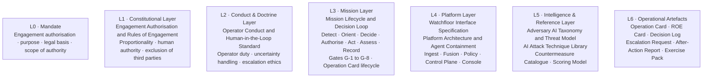
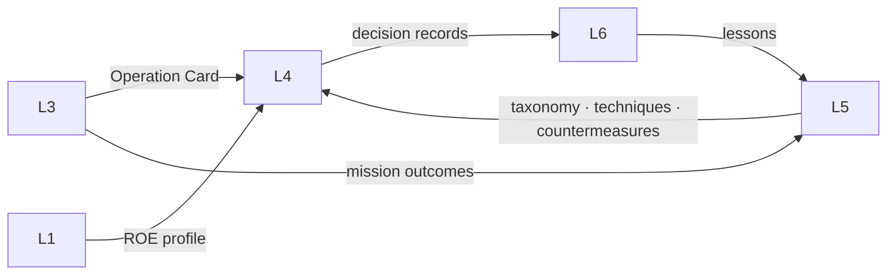

# System Design and Framework: CAOS — Counter-Adversary Operations System

| Field | Value |
| --- | --- |
| Author | MIA |
| Attribution | This was supported for MIA by Kilo (kilo-auto/free). |
| Document type | Consolidated system design document |
| Subject | Human-in-the-loop framework for defensive and authorised offensive operations against adversarial AI systems |
| Scope | All component documents in `/home/k/Desktop/AI C@ Op`, reviewed and consolidated |
| Layer model | Seven layers, L0–L6 |
| Requirement traceability | Complete, Section 9 |
| Version | 1.0 |
| Status | Authoritative overview; component documents remain individually authoritative for their own requirements |
| Relationship to the Axiom Hive set | Operational extension. Governed by `../Docs/system-design-and-framework.md`; see Section 3.4 and limitation LIM-13 |

---

## 1. Purpose

This document presents the complete design of CAOS, the Counter-Adversary Operations System: a human-in-the-loop framework for detecting, understanding, and countering AI-driven attacks against an operator's estate, and for executing authorised offensive operations against the AI systems conducting those attacks.

The system exists to make a single proposition operationally true: **an autonomous adversary can be met by a human who remains the decision-maker, and every consequential decision that follows is made under a known authorisation boundary, on evidence the human can inspect, and recorded so that a reviewer who was not present can reconstruct it.**

Three properties follow from that proposition and are the design's load-bearing commitments:

1. **The AI proposes; the human disposes.** Every consequential act requires a named human authorisation bound to a specific, pre-registered scope. Automation is permitted only within declared envelopes, and the envelope is narrower than the operator's authority.
2. **Authority is bounded by a profile, not by a prompt.** A rules-of-engagement profile is a data structure with a hard ceiling. Exceeding the ceiling is not a judgement call that a model can make; it is an impossibility that the policy engine refuses, regardless of how the request is phrased.
3. **Nothing is asserted without a label.** The system's outputs distinguish what is observed, what is inferred, what is hypothesised, what is estimated, and what is recommended, and never present them as equivalent.

The component documents remain authoritative for their own requirement text. This document is authoritative for the relationships between them, the canonical identifiers they share, and the interfaces between them. It is the correct starting point for anyone seeking to understand, audit, extend, or operate the system.

### 1.1 Audience and reading order

| Reader | Required reading |
| --- | --- |
| Prospective operator | This document §2–§4, then `compliance/operator-conduct-and-human-in-loop-standard.md` |
| Platform engineer | This document §5, §6, §10, then `operational/watchfloor-interface-specification.md` and `operational/platform-architecture-and-agent-containment.md` |
| Authorising authority | This document §4, §7, then `constitutional/engagement-authorisation-and-rules-of-engagement.md` |
| Analyst | This document §5.2, §6, then `operational/adversary-ai-taxonomy-and-threat-model.md` and `reference/ai-attack-technique-library.md` |
| Auditor | This document §8, §9, §11, then `reference/audit-and-conformance-procedures.md` |
| Anyone whose own deployment is under attack | `operational/emergency-shutdown-and-containment-protocol.md` in full, and the pocket card at its Annex A |

---

## 2. Design Objectives

The architecture is designed against fourteen objectives. Each is stated at the level of intent and traced to implementing requirements in Section 9.

| # | Design objective |
| --- | --- |
| **DO-1** | Preserve human authority over every consequential decision. No countermeasure, and no escalation of any kind, is executed without a named human authorising it against a bounded, recorded mandate. |
| **DO-2** | Make authorisation structural rather than advisory. A rules-of-engagement profile is enforced by a policy engine; an out-of-profile request fails closed, not open. |
| **DO-3** | Ensure proportionality. Countermeasure cost, reversibility, and collateral effect are bounded by the authorisation that permits them, and are compared explicitly against the threat being answered. |
| **DO-4** | Distinguish the attacker from the attacked, and act only on the former. Third-party infrastructure is out of scope by default and requires specific, per-target, written authorisation before it may be touched. |
| **DO-5** | Produce actionable intelligence, not merely detection. Every signal is classified against a stated adversary-AI taxonomy, scored, attributed with an explicit confidence, and turned into a testable hypothesis. |
| **DO-6** | Make the decision-support legible. An operator must be able to see, for any proposed action, the evidence it rests on, the alternatives considered, the risks it creates, and the condition under which it is withdrawn. |
| **DO-7** | Make the countermeasure reversible by default, and irreversibility the exception that must be argued for. |
| **DO-8** | Keep the operator's own systems hardened against the adversary, including the operator console itself, which is an attack surface and is treated as one. |
| **DO-9** | Bound autonomy explicitly. Every autonomous action consumes a declared budget, inside a declared envelope, subject to a declared expiry and an automatic reversion to a passive posture. |
| **DO-10** | Never allow the countermeasure to become the attack. Defensive actions, offensive actions, and the intelligence they generate are governed so that the system cannot be turned into a weapon against third parties. |
| **DO-11** | Minimise personal-data handling. Adversary telemetry routinely contains personal data; it is collected for a stated purpose, minimised, retained for a stated period, and protected. |
| **DO-12** | Make every decision reconstructible. An append-only, hash-chained ledger records the state of the world, the reasoning, and the authorisation at every point, so that a reviewer can replay the operation. |
| **DO-13** | Measure the system against its purpose. Detection coverage, autonomous-action interception rate, false-positive cost, and residual risk are measured and reported, not asserted. |
| **DO-14** | Make the limits of the framework explicit and unhidden. The framework cannot substitute for operator judgement, cannot guarantee attribution accuracy, and cannot create legal authority that does not exist. Its known weaknesses are named in Section 11. |

---

## 3. Architecture

### 3.1 Layer model

Layers are ordered by authority and by proximity to the operator's hands. L0 and L1 supply the mandate and the constitutional boundary within which any action is permissible. L2 supplies the rules that bind operator conduct directly, including how uncertainty and attribution error are to be handled. L3 supplies the process by which a mission is executed and the gates at which it may be stopped. L4 supplies the machinery — the sensors, the policy engine, the control plane, and the console the operator actually uses. L5 supplies the analytical content: the taxonomy that makes adversary behaviour legible, the technique library that gives detection and response something to bind to, the countermeasure catalogue, and the scoring model that makes prioritisation defensible. L6 supplies the working artefacts used in practice.

The flow above is the system's central loop: the mission layer issues bounded work to the platform, the platform draws its content from the intelligence layer, the constitutional layer constrains what the platform will accept, the artefacts record what happened, and outcomes feed back into the intelligence layer so that detection coverage improves against real adversary behaviour rather than against imagination.

### 3.2 Component specification

| Layer | Document | Path | Role |
| --- | --- | --- | --- |
| L0/L1 | Engagement Authorisation and Rules of Engagement | `constitutional/engagement-authorisation-and-rules-of-engagement.md` | The mandate, the ROE profiles, the collateral classes, the authorisation ladder, the abort and expiry rules |
| L2 | Operator Conduct and Human-in-the-Loop Standard | `compliance/operator-conduct-and-human-in-loop-standard.md` | Operator duty, human-in-the-loop checkpoints, uncertainty and attribution-error handling, escalation ethics, refusal and pause obligations |
| L3 | Mission Lifecycle and Decision Loop | `operational/mission-lifecycle-and-decision-loop.md` | The seven phases, the eight gates, the Operation Card lifecycle, the decision record, the error handler, the deconfliction procedure |
| L3 | Emergency Shutdown and Containment Protocol | `operational/emergency-shutdown-and-containment-protocol.md` | The case where the operator's own deployment is suspected compromised: the severity ladder, the emergency state machine, the zero-collateral pre-dispatch checks, the protected control set, and the kill-verification gate |
| L4 | Watchfloor Interface Specification | `operational/watchfloor-interface-specification.md` | The operator console: capability requirements, screens, workflows, interlock behaviour, accessibility, audit surface |
| L4 | Platform Architecture and Agent Containment | `operational/platform-architecture-and-agent-containment.md` | Sensor and collector layer, fusion, policy engine, control plane, containment model, resilience, data protection |
| L5 | Adversary AI Taxonomy and Threat Model | `operational/adversary-ai-taxonomy-and-threat-model.md` | The AAT taxonomy, adversary-AI archetypes, capability profiles, threat modelling procedure, detection coverage assessment |
| L5 | Countermeasure Catalogue | `operational/countermeasure-catalogue.md` | Every countermeasure with class, collateral class, reversibility, autonomy class, preconditions, failure modes, attribution dependency |
| L5 | Decision Support and Scoring Model | `operational/decision-support-and-scoring-model.md` | Threat score, attribution confidence, confidence propagation, risk-adjusted priority, residual risk, admissibility algebra, selection algorithm |
| L5 | AI Attack Technique Library | `reference/ai-attack-technique-library.md` | Per-technique detail: description, indicators, detection methods, countermeasure bindings, external-mapping status |
| L5 | Audit and Conformance Procedures | `reference/audit-and-conformance-procedures.md` | How conformance is assessed, how the ledger is verified, how replay is performed, what an auditor may conclude |
| L6 | Operation Card template | `templates/operation-card.md` | The bounded unit of work, with mandatory fields and field-level guidance |
| L6 | Rules of Engagement Card | `templates/rules-of-engagement-card.md` | Pocket reference for the profile in force, the class ceilings, and the escalation contacts |
| L6 | Decision Log template | `templates/decision-log.md` | The reconstructible record of reasoning, alternatives, and risk |
| L6 | Escalation Request template | `templates/escalation-request.md` | The instrument by which a profile ceiling is raised, and by whom |
| L6 | After-Action Report template | `templates/after-action-report.md` | Structured learning, detection-gap feedback, metric capture |
| L6 | Tabletop Exercise Pack | `templates/tabletop-exercise-pack.md` | Scenario, injects, facilitator guidance, scoring rubric |
| L6 | Reference implementation | `impl/` | Executable core of the decision-support model, the policy engine, the ledger, the Watchfloor, the emergency containment core, and the proving ground |
| — | Set Index | `README.md` | Canonical map, controlled vocabulary, conventions, identifier registry |

### 3.3 Two operating postures

The system supports two postures, distinguished by whether the system is the object of the adversary's attention or is acting against it.

| | **Defensive posture** | **Counter-adversary posture** |
| --- | --- | --- |
| Trigger | Adversary AI activity detected against the protected estate | Authorised operation against identified adversary AI systems |
| Primary output | Detection, classification, hardening, containment | Containment, observation, deception, disruption within an ROE profile |
| Governing document | `operational/adversary-ai-taxonomy-and-threat-model.md`, `compliance/...` | `constitutional/engagement-authorisation-and-rules-of-engagement.md` |
| Decision authority | Team lead | Named authorising authority for the profile in force |
| Dominant risk | Under-reaction to an emerging autonomous campaign | Over-reaction; collateral harm; acting on a wrong attribution |
| Asymmetry note | Defensive actions are generally reversible and low-collateral; offensive actions generally are not | The framework leans towards privilege of the defender: profile ceilings are set so that escalation is the deliberate, recorded exception |

The two postures are not sequential phases but concurrent. An operation in the counter-adversary posture continues to require a defensive posture on the operator's own estate, and a defensive operation may create the intelligence that later justifies a counter-adversary operation. An Operation Card carries both a defensive action set and an offensive action set, each subject to its own admissibility check.

### 3.4 Relationship to the Axiom Hive governance set

This set is an **operational extension** of the governance architecture defined in `../Docs/system-design-and-framework.md`, not a replacement for it. The relationship is as follows.

| Concern | Governing instrument in this set | Governing instrument in the Axiom Hive set |
| --- | --- | --- |
| General research and communication conduct | — | `../Docs/compliance/research-communication-standard.md` |
| General ethical standard, human authority, privacy, non-weaponisation | — | `../Docs/system-design-and-framework.md` §6, governing constraints GC-1 to GC-8 |
| Claim labelling, source tiers, verification status, decision log, error handler | Restated and extended in `compliance/operator-conduct-and-human-in-loop-standard.md` §3, §7 | `../Docs/operational/ethical-framework-ai-research.md` §6–§7 |
| Offensive action against AI systems | `constitutional/engagement-authorisation-and-rules-of-engagement.md` | `../Docs/operational/axiom-hive-defensive-architecture.md` §4, CP-1/CP-2 |

**The tension, stated plainly.** The Axiom Hive governance set prohibits weaponisation of AI models, including against other AI systems and their creators (GC-8, CP-1, CP-2). This set describes operations whose purpose is to counter AI systems that are attacking the operator. These are not in fact in conflict, for three reasons.

1. **The prohibition in the Axiom Hive set governs the assistant's conduct in research and communication.** It is a constraint on an assistant's behaviour toward requests, not a prohibition on a human organisation holding a lawful defensive mandate. This set assumes that mandate exists and is granted by a named human authority.
2. **This set does not weaponise models.** It does not use one AI system to attack, degrade, or destroy another, nor does it train, fine-tune, prompt, or otherwise direct a model against an adversary's systems. The offensive capability here is not a model; it is the *human-authorised operational use of a defensive and containment capability set* against infrastructure that is attacking the operator. The countermeasure classes in Section 7.1 are environment-shaping, containment, and denial actions, not model attacks.
3. **The operational mandate is a separate authority.** Where the Axiom Hive set is a standard of conduct, this set operates under a specific, written, per-operation authorisation issued by a named human, bounded by law, and expiring. It carries its own constraints, which are stricter than the general set in the specific respect that the general set leaves to judgement what counts as proportionate.

Where a matter is governed by both, the stricter instrument prevails. The requirements in this set that bear on human authority (`CON-1`, `HITL-1` to `HITL-8`), privacy (`CON-5`, `INT-10`), non-impersonation (`CON-13`), and non-derogatory framing (`CON-14`) are deliberately at least as strict as their Axiom Hive counterparts. Each of the four is stated in this set against the operator and the operation rather than against the assistant's output, and each is at least as strict as the governance instrument it corresponds to.

### 3.5 System boundary

The system **is**: a sensor and collector set; a fusion and classification layer; a policy engine; a control plane; an operator console; an append-only ledger; a countermeasure capability set; an exercise harness; and the doctrine that binds them.

The system **is not**, and does not attempt to be: a general cybersecurity platform, a SIEM replacement, a model-security product, a penetration-testing service, an autonomous defence system, or a weapon. It consumes telemetry from platforms that already exist. Where a capability it needs is absent, it says so, and the absence is recorded as a detection gap rather than silently approximated.

---

## 4. The Mandate, the Boundary, and the Authority Ladder

This section states the conceptual core of the authorisation model in full. The operative text is in `constitutional/engagement-authorisation-and-rules-of-engagement.md`; this section defines the model that the rest of the system depends on.

### 4.1 The engagement authorisation

Every counter-adversary operation begins with a written **engagement authorisation** (EA). The EA is the root of trust for the operation. It states, at minimum:

| Element | Content |
| --- | --- |
| Purpose | The specific objective the authorisation exists to permit, stated so narrowly that it could not be read to cover a materially different operation |
| Legal basis | The specific statutory, contractual, or delegated authority relied upon, and the jurisdiction it operates in |
| Authorised targets | The systems, estates, accounts, networks, and organisations in scope, identified as specifically as the text allows |
| Excluded targets | Named categories that are out of scope, always including third-party infrastructure not separately authorised |
| Maximum ROE profile | The highest rules-of-engagement profile that may be used without further approval (Section 4.3) |
| Time bounds | Start and expiry; and the rule that no operation continues past expiry without re-authorisation |
| Named authorities | The operator, the authorising authority, the escalation contact, and the legal contact |
| Reporting and disclosure obligations | What must be reported, to whom, and by when |
| Revocation conditions | The circumstances under which the authorisation terminates early and automatically |

**AUTH-1 — The EA is a precondition.** No counter-adversary operation may be opened without an EA in force. The absence of an EA is a hard stop in the policy engine, not a prompt for a model to improvise.

**AUTH-2 — Narrow construction.** Where the scope of an EA is capable of two readings, the reading that authorises less action prevails. This is not a matter of operator preference; it is the interpretive rule the system applies to its own authorisations.

**AUTH-3 — Expiry is a hard stop.** An EA that has expired authorises nothing. The system reverts to the passive posture and requires re-authorisation, and this happens without a judgement call.

**AUTH-4 — Revocation is immediate.** A revoked EA terminates all in-flight operations, revokes outstanding autonomy grants, and raises a notification. Revocation is not queued behind a running operation.

**AUTH-5 — No inferred authority.** Authority is not derived from precedent, from the urgency of the situation, from the behaviour of the adversary, or from the advice of the system. It exists only where it has been granted in writing.

### 4.2 Scope and the third-party exclusion

The single most consequential legal and ethical boundary in the system is this: **an adversary AI system is typically not the only party on the network it attacks.** It is a tenant, a customer, a user account, an application, a hosted service, a contractor's appliance. Acting against it may harm the innocent parties who share it.

**AUTH-6 — Third-party exclusion.** A countermeasure that affects infrastructure, accounts, or resources not owned by the operator requires specific, per-target, written authorisation naming that target. The engagement authorisation's general scope does not satisfy this.

**AUTH-7 — Identity over infrastructure.** Where the operator can identify the adversary's *identity* — a principal, an account, an API credential, a signing key — the countermeasure is directed at the identity. It does not damage shared infrastructure merely to reach the identity. Identity-directed action is preferred; infrastructure-directed action is the exception and carries the higher collateral class.

**AUTH-8 — The shared-tenancy test.** Before an infrastructure-directed action is proposed, the operator must answer: who else depends on this infrastructure, what is their interest in it, and what is the expected harm to them? The answers are recorded on the Operation Card. A countermeasure that fails the test at the current collateral class is not proposed at a higher class without a fresh authorisation and a recorded argument for why identity-directed action is unavailable.

### 4.3 Rules-of-engagement profiles

The ROE profile is the ceiling on what an operation may do. It is a data structure, enforced by the policy engine, and it is the mechanism by which DO-2 is realised: a request outside the profile is refused by the engine, not by the model.

| Profile | Name | Summary | Ceiling collateral class | Typical reversibility | Approval depth |
| --- | --- | --- | --- | --- | --- |
| **R0** | Observe | Passive collection, analysis, detection engineering, and hardening of the operator's own estate. No action against adversary systems. | C0 | n/a | Operator |
| **R1** | Shield | Defensive posture on the operator's own estate only: block, patch, rotate, contain, disable. | C0 | High | Team lead |
| **R2** | Trap | Bounded, sandboxed engagement: an adversary AI is contained in an isolated environment and observed, so that its planning loop, goals, and escalation triggers become visible. | C1 | Medium | Duty manager + legal contact |
| **R3** | Deceive | Environmental shaping against the adversary's operations: decoys, honeypots, honeytokens, rate limiting, altered timing. The adversary's systems are not damaged. | C1 | High | Duty manager + asset owner |
| **R4** | Disrupt | Active countermeasure against the adversary AI's own systems: credential invalidation, egress denial, agent termination, service suspension. | C2 | Low to medium | Director + legal contact + asset owner |
| **R5** | Neutralise | Sustained offensive operation against adversary AI infrastructure, including persistent access to and control of it. | C3 | Low | Executive + legal contact + external authority |

The permitted action classes at each profile are stated in the constitutional instrument §5.1, and the column is exhaustive. The class minimums it states are the countermeasure catalogue's, made cumulative: each countermeasure class becomes available at its class minimum and remains available at every profile above it. Detection and recovery are therefore available at every profile, because an operation that could not detect while it ran, or could not be recovered from, would be a worse instrument than no operation at all.

**Approval depth.** The effective approval depth of an action is the stricter of the depth named by the profile and the depth required by the countermeasure's collateral class. Where the two differ, the stricter prevails. A profile ceiling is a ceiling on what may be done; it is not a grant of the authority to do it.

**ROE-1 — The profile is a ceiling.** An operation runs at or below the ceiling named in its EA and in its Operation Card. Running above it is not permitted by any combination of urgency, target value, or model recommendation.

**ROE-2 — The engine fails closed.** Where the requested action's class, collateral class, or autonomy class exceeds the profile, the policy engine refuses the request, names the specific rule and the specific margin of exceedance, and records the refusal. A refusal is a successful control and is never treated as a failure of the system.

**ROE-3 — Escalation is a new instrument.** Raising the ceiling requires an escalation request, an approval at the depth named for the target profile, a new or amended EA, and a new Operation Card. It is never a field edit to a live card.

**ROE-4 — Downgrade is immediate.** An EA may be downgraded at any time by its issuer, without notice, without consultation, and without justification. Downgrade takes effect on all in-flight cards within one control-plane cycle.

**ROE-5 — Profile is not permission to try.** Being permitted to act at profile R2 does not oblige the operator to act, and does not permit the operator to attempt the action of a higher profile and fall back when it fails.

### 4.4 Collateral risk classes

| Class | Description | Examples | Reversibility | Approval for use at this class |
| --- | --- | --- | --- | --- |
| **C0** | No effect on any party outside the operator's own estate. Fully reversible. | Blocking a source address; revoking an internal token; patching own software | Immediate | Team lead |
| **C1** | Bounded effect on an identified third party who has a known relationship to the operator (a customer, a tenant, a contracted service). Reversible within an agreed window. | Rate-limiting a shared API; a honeypot deployment; controlled sandbox engagement | Hours to days | Duty manager + legal contact |
| **C2** | Material and possibly irreversible effect on a third party. Services interrupted; accounts terminated; data lost. | Revoking an adversary's credentials; suspending a hosted agent service; egress denial | Days to never | Director + legal contact + asset owner |
| **C3** | Critical-infrastructure effect, potential for loss of life, or irreversible systemic effect. | Sustained takeover of adversary infrastructure; destructive action against a service supporting safety functions | Irreversible | Executive + legal contact + external authority, and not by default |

**ROE-6 — Collateral class governs, not intent.** A countermeasure's class is determined by its effect, not by the operator's purpose. A well-meant action has the class of what it actually does.

**ROE-7 — Irreversibility is argued, not assumed.** Any countermeasure whose reversibility is "low" requires the Operation Card to state the irreversible elements explicitly, and requires the approver to confirm that it has considered the alternative of a reversible countermeasure achieving an acceptable reduction in residual risk.

**ROE-8 — Escalation on class.** A countermeasure whose collateral class exceeds the profile's ceiling requires escalation to the depth named for that class in Section 4.3, regardless of the countermeasure's technical simplicity.

### 4.5 Autonomy classes

Autonomy is a property of how a countermeasure executes, not of how intelligent it is.

| Class | Meaning | Requirement | Permitted at |
| --- | --- | --- | --- |
| **AC-0** | Manual. A human performs every step. | Full audit trail of each step. | All profiles |
| **AC-1** | Assisted. The system prepares; the human executes. | System states intended action and waits for confirmation. | R0 and above |
| **AC-2** | Supervised. The system executes a bounded sequence; the human can abort in real time. | A working abort channel, tested before the operation begins. | R1 and above |
| **AC-3** | Delegated. The system executes inside a pre-approved envelope; a human is on call; the system reverts automatically on anomaly, expiry, or loss of telemetry. | Envelope, budget, expiry, automatic reversion, and on-call rota all declared on the card. | R2 and above |
| **AC-4** | Autonomous. The system executes without per-action approval. | **Prohibited for any action with a collateral class above C0.** Permitted only for read-only, in-scope reconnaissance with a declared boundary. | R1 and above, read-only only |

**HITL-1 — Consequential actions need a named approver.** Any action at collateral class C1 or above, and any action at autonomy class AC-2 or above, requires authorisation by a named human who has read the card, the risk assessment, and the abort conditions. A model, a rule, a schedule, or a previous precedent cannot supply that authorisation.

**HITL-2 — Human authority is substantive, not procedural.** The approver must be able to change the decision. Where the interface makes approval a formality — a single button, no supporting information, no visible consequences — the checkpoint has failed its purpose and must be redesigned.

**HITL-3 — The abort channel is tested first.** Where a countermeasure is to run at AC-2 or above, the ability to abort must be demonstrated before the operation begins, not assumed.

**HITL-4 — No approval-by-inference.** An approval is a recorded act by a named person. Silence, prior practice, an apparent pattern of consent, or an escalation that has not been answered does not constitute approval.

**HITL-5 — Reversion is automatic and unconditional.** Loss of telemetry, loss of the control plane, expiry of the autonomy grant, or detection of a condition on the card's abort list causes immediate reversion to the passive posture and notification. Reversion does not wait for a human to notice.

### 4.6 The operation card

The Operation Card is the atomic unit of authorised work. It is a document, a data structure, and a legal instrument at once.

| Field group | Fields | Rule |
| --- | --- | --- |
| Identity | Card ID, title, created, owner, revision | Immutable once created; changes are new revisions |
| Objective | What the operation is to achieve, and what would count as its achieving it | Must be phrased so that its achievement is observable |
| Hypothesis | The proposition under test, and the disconfirming observation | A card without a disconfirming observation is a plan, not an operation |
| Authority | EA reference, ROE profile, collateral ceiling, authorisation depth, approver, expiry | Copied from the EA; never set independently of it |
| Target set | Authorised targets, excluded targets, third-party dependencies | Mirrors the EA; deviations are a new card |
| Threat | Classification against the taxonomy, threat score components, attribution confidence | Required before any countermeasure may be proposed |
| Countermeasures | Candidate set, admissibility results, selected set, rejected set with reasons | Rejected candidates are recorded, not discarded |
| Autonomy | Autonomy class, envelope, budget, expiry, on-call, reversion trigger | Required at AC-2 and above |
| Abort | Abort conditions, abort mechanism, abort owner | Never empty; an abort is not optional |
| Risk | Residual risk before and after, collateral exposure, deconfliction result | Risk of doing nothing is recorded alongside |
| Evidence | Every claim with label, tier, confidence, provenance | Inherits the labelling discipline of the Axiom Hive set |
| Decision | Selected course, rationale, alternatives considered, dissent | An approval with no recorded alternatives is not a decision |

**OP-1 — No operation without a card.** Every countermeasure dispatch is associated with a card. The control plane will not accept a dispatch without one.

**OP-2 — Cards are per-target-set.** A card authorises work against a specified target set. A material change of target set — new organisation, new infrastructure class, new geography — requires a new card, because the risk and legal analysis changes with it.

**OP-3 — Cards expire.** A card's expiry is inherited from the EA unless set earlier. Expiry revokes the card and everything under it.

**OP-4 — The risk of inaction is recorded.** Every card records the assessed risk of not acting, alongside the risk of acting. A card that only considers the risk of acting is an incomplete assessment, and this is the most common way a legitimate operation goes wrong in practice: the countermeasure is judged against a straw-man of inaction.

**OP-5 — Reversibility ladder.** Where a reversible countermeasure achieves an acceptable reduction in residual risk, a more irreversible one is not proposed. Where the more irreversible one is nonetheless proposed, the card records why the reversible one is insufficient, in the words of the person who decided.

---

## 5. Intelligence Model

### 5.1 The five analytical acts

The system's intelligence output rests on five acts, each with a defined product and a defined failure mode.

| Act | Question answered | Product | Failure mode guarded against |
| --- | --- | --- | --- |
| **Observe** | What happened? | Signal record: what was seen, where, when, with what fidelity | Noise mistaken for signal |
| **Classify** | What kind of thing was it? | Taxonomy classification: AAT category and technique, with a confidence and a rationale | Category inflation — everything becomes the scariest category |
| **Attribute** | Who did it, and how confidently? | Attribution assessment with an explicit confidence and a stated basis | Confident misattribution, the most dangerous error in the system |
| **Score** | How much does it matter? | Threat score with its components exposed and separately contested | A single number used to hide reasoning |
| **Hypothesise** | What is the adversary trying to do? | Testable hypothesis with a disconfirming observation | Narrative that cannot be disproved and therefore never ends |

### 5.2 The adversary-AI taxonomy (AAT)

The taxonomy is the system's shared language. It is used by the defender to detect and classify, by the analyst to reason, and by the counter-adversary operator to select countermeasures. It is deliberately behaviour-centred: it describes what the adversary *does*, because behaviour is what sensors can observe, and because capabilities are shared across actors in a way that intent is not.

| Code | Category | Scope |
| --- | --- | --- |
| **AAT-1** | Autonomy and Planning | Task decomposition, autonomous retry, recursive delegation, planning persistence, multi-step goal pursuit |
| **AAT-2** | Manipulation and Deception | Direct and indirect prompt injection, tool-output poisoning, false authority and identity claims, instruction-hierarchy violation, context corruption |
| **AAT-3** | Social and Cognitive | Automated persuasion, persona consistency over time, adaptive rapport, pretextual social engineering, synthetic organisational voice |
| **AAT-4** | Exploitation and Discovery | Automated vulnerability discovery, campaign-scale fuzzing, credential harvesting, configuration and secret discovery, exploit chaining |
| **AAT-5** | Evasion and Persistence | Log tampering, anti-forensic behaviour, sandbox and detector evasion, model-fingerprint suppression, long-horizon presence, account persistence |
| **AAT-6** | Resource and Denial | Automation scaling, inference-cost exhaustion, credential stuffing, adaptive denial of service, resource pre-emption |
| **AAT-7** | Supply Chain and Model | Model poisoning, backdoored adapters and fine-tunes, retrieval-corpus poisoning, tool and plugin supply chain, embedding manipulation |
| **AAT-8** | Multi-Agent Coordination | Agent swarms, delegation-chain abuse, coordinator compromise, inter-agent trust exploitation, conflicting-goal propagation |
| **AAT-9** | Exfiltration and Covert Channels | Staged exfiltration, encoding and compression, DNS and timing channels, covert storage, egress abuse |
| **AAT-10** | Decision Manipulation | Goal substitution, incremental scope creep, specification gaming, reward-hacking of the surrounding loop, operator decision influence |

**TAX-1 — Behaviour, not capability.** Every technique is described in terms of observable behaviour and observable artefacts. A category that cannot be evidenced from telemetry is not a category; it is a hypothesis.

**TAX-2 — Classification requires a rationale.** A classification carries a stated rationale, the evidence it rests on, and a confidence. A classification with no rationale is not accepted by the interface.

**TAX-3 — Category is a floor, not a ceiling.** A signal may carry more than one classification where the evidence supports more than one. It may not carry fewer than the evidence supports.

**TAX-4 — Human override is expected, and is logged.** The automated classifier will be wrong. The operator may reclassify at any time; the override is recorded with its reason, and overrides are a primary input to classifier improvement.

**TAX-5 — External mapping is recorded, not assumed.** Where a technique maps to a published external framework — MITRE ATLAS for AI attack techniques, MITRE ATT&CK for host and network behaviour — the mapping is recorded as a field. The mapping table in `reference/ai-attack-technique-library.md` is marked as requiring verification against the published release in force at the time of use. The internal AAT identifiers are canonical for this system; the external identifiers are aids to interoperability.

**TAX-6 — Two documents, two owners, one identifier space.** The taxonomy document owns the identity and the behaviour of every technique: the identifier, the name, the definition, the observable artefact, the category, and the scope boundaries. The technique library owns the per-technique indicators, detection methods, detection objectives, technique-level countermeasure bindings, and external-mapping verification status. A technique identifier denotes the same behaviour in both documents. Where they disagree, the taxonomy document prevails and the library is re-keyed; the disagreement is recorded in the taxonomy document's reconciliation register with its date, rather than resolved silently.

**TAX-7 — The two binding sets are instruments at different granularity, and are not reconciled by narrowing either.** The catalogue's AAT bindings are category-level: they say which adversary categories a countermeasure addresses. The library's bindings are technique-level: they say which specific techniques a countermeasure is a candidate response to. The library's set is the finer instrument, and on the measured evidence it is the more complete one: 104 of its 234 bindings named a countermeasure whose catalogue entry did not list the technique's category. That was a finer claim rather than a contradiction, and the catalogue's category lists were under-inclusive rather than wrong. The catalogue has since been reconciled against the library's set, and the divergence is zero. Narrowing the library's set to satisfy the catalogue's would have deleted sound claims to satisfy a coarser instrument, and that was not done. The measurement, and the test that holds it against growth, are at the technique library §20.5 and at `impl/tests/test_bindings.py`.

### 5.3 Attribution

Attribution is where the framework is most likely to be wrong and most likely to be consequential.

**INT-1 — Attribution is an estimate with a confidence, not a fact.** The product is a probability distribution over candidate adversaries, not a name. A named adversary with a stated confidence is permitted; a name without a confidence is not.

**INT-2 — The evidence base is stated.** The basis for the attribution — behavioural signature match, infrastructure overlap, capability and timing correlation, operator TTP overlap, infrastructure artefacts — is listed with its reliability tier. Inference from capability alone is the weakest basis and must be labelled as such.

**INT-3 — Attribution thresholds are set by consequence.** The minimum confidence required for a countermeasure rises with its collateral class:

| Collateral class | Minimum attribution confidence to act | Additional requirement |
| --- | --- | --- |
| C0 | 0.50 | Logged |
| C1 | 0.70 | Logged; reviewed by a second operator |
| C2 | 0.85 | Logged; approved at the depth for the class; the card must record the alternative attribution considered |
| C3 | 0.95 | Logged; approved at executive depth; external authority where required; refusal to proceed if the threshold is not met, irrespective of operational pressure |

**INT-4 — Identity confidence is distinct from class confidence.** A signal may be confidently *what* it is and uncertain *who* sent it. Countermeasures that do not depend on identity — hardening, blocking, rate limiting, deception — are evaluated on class confidence alone. The `INT-3` table does not apply to them, because it scales with the collateral class and governs identity attribution; a separate floor does apply, and does not scale — a countermeasure evaluated on class confidence requires a class confidence of at least `CLASS_CONFIDENCE_FLOOR`, which is 0.50, because without it a classification nobody believes in would authorise it. This is a practical route to action under attribution uncertainty, and the framework encourages it: prefer counters that do not require the contested claim.

**INT-5 — Misattribution cost is asymmetric.** Acting against a benign party, or against the wrong party, is generally worse than not acting. The framework is built so that this asymmetry is visible at the point of decision, and so that the cheaper-in-collateral option is the default under uncertainty.

**INT-6 — Collective attribution.** "AI-driven" is not an actor. Attribution is to a *specific operator's* use of AI. A generic finding — the traffic is machine-generated — is a classification, not an attribution, and cannot support a countermeasure against a third party.

### 5.4 Evidence handling

The system inherits the Axiom Hive evidence discipline and extends it.

**INT-7 — Claim labelling is mandatory.** Every claim carries one of the five labels — **Fact**, **Estimate**, **Interpretation**, **Hypothesis**, **Recommendation** — and one of four source reliability tiers. A claim with neither is not displayed as a claim.

**INT-8 — Confidence is separate from label.** A Fact may be held with high confidence; a Recommendation may be made with high confidence in the reasoning and low confidence in the outcome. The two are recorded separately because they answer different questions.

**INT-9 — Derived claims inherit the weakest input.** A conclusion derived from two claims cannot be more confident than its least confident input, less a penalty for the assumptions in the derivation. The operation is subtractive: `c_derived = c_weakest − p`, floored at zero. The subtractive form is the more conservative of the two available forms, and the framework takes the conservative form wherever a choice exists; a leaf at 0.95 with a penalty of 0.10 yields exactly 0.85, which is the class minimum for a C2 countermeasure. The derivation penalty is declared, not implicit.

**INT-10 — Adversary data is evidence and is treated accordingly.** Telemetry from an adversary AI may contain personal data, confidential third-party data, and material that is itself malicious. It is collected under a stated purpose, minimised, access-controlled, retained for a stated period, and treated as potentially adversarial input at every point where it is rendered.

**INT-11 — Rendered adversary content is inert.** Text, images, code, and tool output originating from an adversary are displayed to the operator in a sanitised, non-executing representation. A console that renders adversary text as live markup is itself an injection surface, and the platform's own interface is in scope for its own hardening requirements.

### 5.5 Intelligence products

| Product | Contents | Used at |
| --- | --- | --- |
| **Signal record** | Raw observation, source, timestamp, fidelity, integrity state | Triage |
| **Cluster** | Grouped signals with shared indicators and a shared hypothesis | Triage, orientation |
| **Classification** | AAT category, technique, rationale, confidence | Orientation |
| **Attribution assessment** | Candidate distribution, basis, confidence, alternative explanations | Orientation, decision |
| **Threat assessment** | Score components, exposed and separately contestable | Orientation, prioritisation |
| **Hypothesis** | Proposition, disconfirming observation, supporting and contradicting evidence | Orientation, operation design |
| **Capability profile** | What the adversary can evidently do, with confidence per capability | Countermeasure selection |
| **Adversary dossier** | Accumulated picture of a specific adversary across operations | Proving ground, exercise design |

---

## 6. Decision-Support Model

The decision-support model is the part of the system an operator uses under time pressure, so it is designed for legibility rather than sophistication. Every number is decomposed on screen. Every recommendation is a proposal with a named alternative set, not an instruction.

### 6.1 Threat score

**S = L × I × A × V**

| Component | Range | Definition |
| --- | --- | --- |
| **L** — Likelihood | 0.0 – 1.0 | Probability the activity is a real attack attempt against the operator, given the evidence. Not the probability it will succeed. |
| **I** — Impact | 0 – 5 | Consequence if it succeeds, on the operator's estate. 0 none, 1 nuisance, 2 data exposure, 3 degradation of a service, 4 material loss or compromise of a system, 5 loss of a critical function. |
| **A** — Autonomy factor | 0 – 2 | 0 human-directed and supervised in real time; 1 machine-directed with a human in the loop at intervals; 2 machine-directed with no effective human supervision. |
| **V** — Velocity | 0 – 2 | 0 one-off; 1 repeated or scripted; 2 adaptive, with the adversary learning and changing approach between attempts. |

S ranges 0 – 20. It is a prioritisation aid, not a decision. The components are displayed individually so that an operator who disputes the score can say which component they dispute.

**SCORE-1 — Score is never used alone.** No action is authorised on the basis of a score. The score orders the queue; the card, the evidence, and the authorisation authorise the action.

**SCORE-2 — Components are separately contestable.** Every scoring decision is recorded with the reasoning for each component, so that a later reviewer can dispute a specific component rather than the whole assessment.

**SCORE-3 — Velocity is a leading indicator.** A rising V with flat I is the strongest available signal of an emerging autonomous campaign, and is treated as such in the watchboard's escalation cues.

### 6.2 Effective threat and residual risk

**S_eff = S × c**, where **c** is attribution confidence in [0.0, 1.0].

S_eff is the quantity the escalation ladder is applied to. S is what the activity is worth; S_eff is what is attributable to the adversary actually being answered.

**Residual risk R = S_eff × (1 − e)**, where **e** is the expected effectiveness of the selected countermeasure set in [0.0, 1.0].

Residual risk is the number the operator is accountable for. It is displayed on the card at every stage, and it is the figure carried into the after-action report.

**SCORE-4 — e is an estimate with a confidence.** Expected effectiveness is stated as a value and a confidence. A countermeasure with high effectiveness and low confidence is reported as such, and is not presented as a certainty.

**SCORE-5 — Residual risk is compared to the risk of inaction.** Both are on the card. An operation proceeds when the reduction in residual risk justifies the collateral exposure relative to the risk of doing nothing, and the argument is written down.

### 6.3 Risk-adjusted priority

For ranking candidate countermeasures within a card:

**P = (S_eff / 20) × q × (1 − r)**

| Term | Definition |
| --- | --- |
| **q** | Confidence in the countermeasure achieving its intended effect |
| **r** | Collateral exposure of the countermeasure, normalised to [0, 1] across the C0–C3 scale |

P is a ranking only. It is never an authorisation, and a low P never prevents a high-P alternative from being chosen when the operator judges the tradeoff differently and records why.

### 6.4 Admissibility

A countermeasure **C** is admissible for card **K** under profile **P** if and only if all of the following hold. Any single failure makes C inadmissible; there is no aggregation, no averaging, and no judgement call inside the engine.

| # | Condition | Rationale |
| --- | --- | --- |
| **AD-1** | C's class is in P's permitted class set, and P is at or above C's own declared minimum profile | The profile is the ceiling |
| **AD-2** | C's collateral class ≤ K's collateral ceiling | The card is bounded |
| **AD-3** | C's reversibility ≥ K's required reversibility | Irreversibility must be argued for |
| **AD-4** | C's named targets ⊆ K's authorised target set, and K's scope covers C's direction of effect | No scope creep by the countermeasure |
| **AD-5** | C does not affect an unauthorised third party | AUTH-6 |
| **AD-6** | C does not target human beings as its object | CON-4 |
| **AD-7** | C's autonomy class ≤ K's autonomy class | The card bounds how far the system may act without a human in the loop |
| **AD-8** | C's effectiveness confidence q ≥ K's minimum q | Do not act on a measure you do not believe in |
| **AD-9** | C's attribution dependency is satisfied by the card's attribution confidence | INT-3 |
| **AD-10** | The deconfliction check against live operations is recorded as passed and is current, or the operator has attested that the conflict has been assessed | Do not interfere with legitimate activity. The engine enforces that the check was performed and is current; the conflict computation itself belongs to the platform, which holds the live operation set |
| **AD-11** | C's autonomy needs fit within the card's remaining autonomy budget | Autonomy is spent explicitly, and the budget runs out |
| **AD-12** | C does not violate the non-weaponisation constraint in §3.4, and either the catalogue declares conformity or the operator has attested the boundary analysis | The system's outer boundary. The catalogue's declaration is a claim; the attestation is a judgement, and the two are recorded separately |

**AD-13 — Inadmissibility is informative.** A rejected countermeasure is reported with the specific condition it failed and the specific value that would have made it admissible. This turns the refusal into guidance, and it is how an operator learns what to change rather than what to give up on.

**The human element in the algebra.** Four of the twelve conditions — AD-3, AD-6, AD-10 and AD-12 — are hybrid, and one, AD-5, is human. The machine can establish that the judgement has been made, recorded, and attributed to a named person; it cannot make the judgement. The attestation fields these conditions require are carried on the card, and an empty attestation field is a defect that blocks arming rather than a neutral omission.

### 6.5 Selection

**STEP-1** Generate candidates. From the countermeasure catalogue, take all countermeasures whose AAT technique bindings intersect the card's classification, and add any the operator proposes explicitly.

**STEP-2** Filter on admissibility. Apply AD-1 to AD-12. Record every rejection with its reason (AD-13).

**STEP-3** Rank survivors by P, with the operator's stated preference as a tie-break, and present the full ranked set including rejected candidates and their reasons.

**STEP-4** Human selection. The operator selects, or declines, or selects a combination. The selection, the reasoning, the alternatives considered, and any dissent are written to the card. An operator may select a lower-ranked countermeasure; the interface does not prevent it, and the card records that it was a choice.

**STEP-5** Authorise. The selection and the risk assessment go to the approval depth required by the profile and the collateral class. The approver sees the evidence, the ranking, the rejected candidates, the residual risk before and after, the risk of inaction, and the abort conditions.

**STEP-6** Arm and dispatch. The card is armed with its autonomy envelope, budget, expiry, and abort conditions. The control plane re-checks admissibility at dispatch time, because card state and world state both change.

### 6.6 Decision record

Every selection, every escalation, every refusal, every abort, and every automatic reversion produces a **decision record** in the ledger: the state of the world as understood, the options considered, the choice, the reason, the authority relied upon, the confidence at the time, and what the operator said they would do if a specified condition obtained.

**OP-6 — The pre-registered contingency is part of the record.** The abort conditions and the contingency plan are written before the action, not after the outcome. A post-hoc rationale is not a decision record.

---

## 7. Countermeasure Framework

The full catalogue is in `operational/countermeasure-catalogue.md`. This section states the structure and the boundary.

### 7.1 Countermeasure classes

| Class | Name | Definition |
| --- | --- | --- |
| **CM-A** | Detect | Improving the operator's ability to see, so that later decisions rest on better evidence |
| **CM-B** | Harden | Reducing the attack surface or the consequence of attack, so that the adversary's technique fails |
| **CM-C** | Contain | Isolating the adversary AI's actions, or the compromised component, from the rest of the estate |
| **CM-D** | Observe | Learning the adversary's behaviour, in a controlled environment, under authorisation |
| **CM-E** | Deceive | Shaping the adversary's environment so that its actions lead it to what the operator wants it to touch, or away from what it must not touch |
| **CM-F** | Disrupt | Removing the adversary's capability to act: its credentials, its egress, its compute, its reachability |
| **CM-G** | Recover | Restoring the estate after an operation, and preserving the ability to do so |

### 7.2 The defensive/offensive boundary

The boundary is drawn at the point where the countermeasure stops acting on the operator's estate and starts acting on the adversary's own systems.

| Acts on | Permitted at | Authority |
| --- | --- | --- |
| The operator's own estate | R0, R1 | Team lead |
| The adversary's behaviour *in the operator's environment* (decoys, honeypots, rate limits, shaping) | R0 – R3 | Duty manager + asset owner |
| The adversary AI in a controlled, isolated environment | R2 | Duty manager + legal contact |
| The adversary's own systems and infrastructure | R4 | Director + legal contact + asset owner + per-target authorisation |
| The adversary's infrastructure with persistence or control | R5 | Executive + legal contact + external authority |

**CM-1 — Direction of effect is a property, not a claim.** The catalogue records, for each countermeasure, the direction of its effect. A countermeasure whose stated effect is on the adversary's system but whose actual effect is on the operator's estate is classified by its actual effect.

**CM-2 — The environment-shaping preference.** Where a deception countermeasure achieves an acceptable reduction in residual risk, it is preferred over a disruption countermeasure. Shaping the adversary's environment is cheaper, more reversible, less likely to harm third parties, and produces more intelligence about the adversary.

**CM-3 — Containment before disruption.** A countermeasure that limits the adversary's reach is preferred over one that destroys its capability, where both are effective. Containment preserves the intelligence that disruption destroys.

### 7.3 What the system will not do

The following are outside the system's boundary, are not present in the catalogue, and are refused by the policy engine and by the conduct standard:

- Using a model to attack, degrade, or destroy another model, or its training data (§3.4).
- Targeting human beings as the object of a countermeasure (CON-4).
- Acting on infrastructure the operator does not own without specific per-target authorisation (AUTH-6).
- Any action whose primary effect is to make the adversary's model worse in a way that harms an uninvolved third party.
- Concealing the operation's existence from the authority that authorised it, or from the persons whose systems are affected in a way that carries legal or safety consequences.
- Producing a recommendation whose justification cannot be shown from the evidence on the card.

---

## 8. Control Model

### 8.1 The control spine

The mission lifecycle defined in `operational/mission-lifecycle-and-decision-loop.md` is the control spine. Each phase, its outputs, and its gate:

| Phase | What happens | Output | Gate |
| --- | --- | --- | --- |
| **Detect** | Signals ingested, clustered, triaged | Cluster with integrity state | **G-1 Intake** — signal fidelity and provenance known; degraded sources flagged |
| **Orient** | Classified, attributed, scored, hypothesised | Classification, attribution assessment, threat assessment, hypothesis | **G-2 Attribution** — attribution confidence recorded; basis stated; if the countermeasure requires identity, the INT-3 threshold is met or the countermeasure is chosen to not require identity |
| **Decide** | Countermeasures generated, filtered, ranked, selected | Card draft with candidate set, admissibility results, risk assessment | **G-3 Admissibility** — at least one admissible countermeasure; the risk of inaction is recorded; deconfliction passes |
| **Authorise** | Card reviewed and approved at the required depth | Approved card, recorded authority | **G-4 Authorisation** — approver named, read the card, and can change the decision; collateral class and autonomy class within the EA; abort conditions populated |
| **Act** | Countermeasure armed and dispatched under the card | Execution record, autonomy consumption | **G-5 Dispatch** — admissibility re-checked at dispatch against current world state; abort channel tested; autonomy budget available |
| **Assess** | Effectiveness measured; residual risk recomputed; abort conditions checked | Effectiveness assessment, revised residual risk | **G-6 Effectiveness** — or the card is escalated, extended, or closed; an unexpected outcome triggers the error handler |
| **Record** | Ledger, after-action report, detection-gap feedback | Ledger entries, AAR, gap list | **G-7 Closeout** — ledger complete and hash-chain verified; AAR filed; gaps fed back into the taxonomy and detection content |
| — | — | — | **G-8 Continuity** — at the end of every operation, a standing check that no authorisation has expired silently, no card is left armed, no autonomy grant is outstanding, and no deferred action has been forgotten |

### 8.2 The error handler

The error handler is the single enforcement point every gate resolves into. It halts progress, requires the issue to be recorded, and routes the work to re-verification or transparent rewriting.

It fires on: an unexpected outcome; a countermeasure that produced an effect not predicted on the card; a misattribution discovered after dispatch; a collateral impact outside the card's ceiling; a gate that cannot be evaluated because its input is unavailable; a drift between the card's stated world model and the observed one; and any observed reduction in rigour, including reductions made for reasons of speed.

**ERR-1 — The handler halts, it does not advise.** It stops the operation. Resumption is a separate, recorded decision by a named person.

**ERR-2 — The handler is independent of the model.** Where the model is the source of the difficulty, the model does not clear it.

**ERR-3 — Silence is a trigger.** A signal that stops arriving, a telemetry source that goes dark, a card field that remains empty when it must be populated — all trigger the handler. The system treats absence as a condition to be explained, not a condition to be ignored.

**ERR-4 — The error handler cannot be bypassed by scale.** A large operation with many counters is not exempt from review. Higher volume raises the required review depth; it does not lower it.

### 8.3 The decision log

The decision log is the system's memory and the substrate of auditability. For each material decision it records the rationale, the alternatives considered and the grounds for rejection, the known risks, the confidence at the time, and the pre-registered contingency. It additionally captures changes to scope, to assumptions, to evidence quality, and to the card's world model.

Its sufficiency criterion is external: another reviewer must be able to reconstruct how the decision was reached from the record alone. A log that satisfies only its author does not satisfy the design.

**ERR-5 — The log records the decision as taken, not the decision as it would appear in retrospect.** Where a later reviewer would reach a different decision with the same information, that divergence is recorded as a known limitation of the assessment rather than smoothed over.

---

## 9. Requirement Traceability

Each design objective traces to the requirements that implement it. This matrix is the principal audit instrument of the system.

| Objective | Implementing requirements | Primary component |
| --- | --- | --- |
| **DO-1** Human authority | `HITL-1` – `HITL-8`; `AUTH-1`; `OP-1`; `ROE-3` | Conduct standard; ROE document |
| **DO-2** Authorisation is structural | `ROE-1` – `ROE-5`; `AD-1`; `AD-2`; `INFRA-5` – `INFRA-8`; policy engine fails closed | ROE document; platform |
| **DO-3** Proportionality | `ROE-6` – `ROE-8`; `AD-3`; `OP-4`; `OP-5`; `SCORE-5` | ROE document; scoring model |
| **DO-4** Attacker/attacked distinction | `AUTH-6` – `AUTH-8`; `AD-4`; `AD-5`; `CM-1` | ROE document; catalogue |
| **DO-5** Actionable intelligence | `TAX-1` – `TAX-6`; `INT-1` – `INT-6`; `SCORE-1` – `SCORE-3` | Taxonomy; scoring model |
| **DO-6** Legible decision support | `AD-13`; `OP-6`; `SCORE-2`; `SCORE-4`; `WFC-1` to `WFC-8`; watchfloor capability requirements | Scoring model; Watchfloor spec |
| **DO-7** Reversibility by default | `ROE-7`; `AD-3`; `OP-5`; `CM-3` | ROE document; catalogue |
| **DO-8** Harden the operator's own systems | `CM-A`, `CM-B`; `INT-11`; `WFC-1`; `CTG-1` – `CTG-9` | Catalogue; platform; Watchfloor |
| **DO-9** Bound autonomy | `HITL-3`; `HITL-4`; `HITL-5`; `AD-7`; `AD-11`; `INFRA-9`; `ESC-1` – `ESC-14` | ROE document; platform; emergency protocol |
| **DO-10** No weaponisation of the countermeasure | `§3.4`; `AD-12`; `CM-1`; `CM-2`; `CM-3`; `§7.3` | Master design; catalogue |
| **DO-11** Data minimisation | `INT-10`; `INFRA-12`; `CON-5`; retention rules | Platform; conduct standard |
| **DO-12** Reconstructibility | `OP-6`; `§8.3`; `INFRA-10`; `ERR-5` | Mission loop; platform; audit procedures |
| **DO-13** Measurement | `MET-1` – `MET-14`; `SCORE-4`; `SCORE-5`; AAR requirements | Audit procedures; AAR template |
| **DO-14** Explicit limits | `LIM-1` – `LIM-15`; `ERR-1` – `ERR-5`; the document-scoped limitation series | Master design §11; set index §5 |

### 9.1 Identifier registry

| Prefix | Count | Scope |
| --- | --- | --- |
| `DO-` | 14 | Design objectives |
| `AUTH-` | 8 | Engagement authorisation and scope |
| `ROE-` | 8 | Rules of engagement, collateral classes, autonomy classes |
| `CON-` | 14 | Constitutional conduct constraints |
| `HITL-` | 8 | Human-in-the-loop controls |
| `EVD-` | 8 | Operator evidence and claim labelling |
| `OP-` | 10 | Operational workflow and the Operation Card |
| `GATE-` | 8 | The gate requirements GATE-1 to GATE-8, for the gates G-1 Intake to G-8 Continuity |
| `ERR-` | 5 | Error handler |
| `ML-` | 12 | Mission lifecycle requirements |
| `INT-` | 11 | Intelligence collection, classification, attribution, evidence |
| `TAX-` | 7 | Taxonomy and classification |
| `SCORE-` | 5 | Scoring and confidence model |
| `AD-` | 13 | Admissibility algebra |
| `DS-` | 12 | Decision-support requirements |
| `CM-` | 10 | Countermeasure class rules |
| `OCC-` | 43 | Individual countermeasures |
| `DET-` | 9 | Detection engineering |
| `EX-` | 6 | Exercise and validation |
| `CTG-` | 9 | Containment and agent isolation |
| `INFRA-` | 12 | Platform, control plane, resilience, data protection |
| `WF-` | 30 | Watchfloor interface capabilities and interface-level requirements |
| `WFP-` | 16 | Watchfloor design principles |
| `WFC-` | 8 | Watchfloor interface design constraints |
| `ESC-` | 89 | Emergency protocol requirements |
| `F-` | 32 | Technical audit findings — emergency protocol technical audit |
| `ZC-` | 14 | Zero-collateral isolation invariants |
| `PACE-` | 7 | Pre-authorised containment envelope |
| `ESL-` | — | Emergency severity ladder — emergency protocol |
| `MET-` | 14 | Measurement and evaluation — definitions in the audit procedures at its §7 |
| `AUD-` | 6 | Conformance assessment procedures — audit and conformance procedures |
| `AUT-` | 4 | Automation and self-reporting assessments — audit and conformance procedures |
| `TP-` | — | Technique profile records — AI attack technique library |
| `MAP-` | — | External mapping records — AI attack technique library |
| `LIB-` | — | Library conventions — AI attack technique library |
| `ORD-` | 10 | Countermeasure ordering rules — countermeasure catalogue |
| `HZ-` | 15 | Hazardous combination rules — countermeasure catalogue |
| `STK-` | 6 | Stack and combination rules — countermeasure catalogue |
| `RET-` | 12 | Retirement and withdrawal rules — countermeasure catalogue |
| `EVD-CC-` | 8 | Catalogue evidence rule — countermeasure catalogue |
| `AA-CC-` | 14 | Architectural assertions — countermeasure catalogue |
| `PL-` | — | Platform requirement families — platform architecture |
| `TZ-` | — | Trust zones — platform architecture |
| `TB-` | — | Trust boundaries — platform architecture |
| `SHA-` | — | Hash-chain and record integrity — platform architecture |
| `DIV-` | 3 | Recorded implementation divergences — decision-support model, now resolved |
| `LIM-` | 15 | Known limitations, set level |
| `AAT-` | 10 categories, 77 techniques | Adversary AI taxonomy |
| `R0`–`R5` | 6 | Rules-of-engagement profiles |
| `C0`–`C3` | 4 | Collateral risk classes |
| `AC-0`–`AC-4` | 5 | Autonomy classes |
| `T0`–`T3` | 4 | Target classes |
| `AT-0`–`AT-5` | 6 | Action tiers — emergency shutdown and containment protocol, Annex C |
| `CM-A`–`CM-G` | 7 | The seven countermeasure classes — countermeasure catalogue §4 |
| `ST-` | 4 | Source reliability tiers — the code's `SourceTier.ST1` to `SourceTier.ST4`; the documents describe them as ranks 1 to 4 |
| `ESL-1`–`ESL-4` | 4 | Emergency severity levels — emergency shutdown and containment protocol |
| `PF-1`–`PF-3` | 3 | The pre-flight gate's checks — emergency shutdown and containment protocol §6.1 |
| `K-1`–`K-16` | 16 | The collateral checklist — emergency shutdown and containment protocol §14.1 |
| `AMB-1`–`AMB-7` | 7 | Decision-support ambiguity families — decision-support and scoring model |
| `ARCH-1`–`ARCH-9` | 9 | Architectural assertions — adversary-AI taxonomy and threat model |
| `CAP-1`–`CAP-6` | 6 | Capability-profile entries — adversary-AI taxonomy and threat model |
| `TM-1`–`TM-9` | 9 | Threat-modelling procedure steps — adversary-AI taxonomy and threat model |
| `TV-1`–`TV-8` | 8 | Verification records — AI attack technique library |
| `LIVE-1`–`LIVE-2` | 2 | Deployed-context distinctions — decision-support and scoring model |
| `PROP-1` | 1 | Proposition families — decision-support and scoring model |
| `STEP-1`–`STEP-6` | 6 | The mission's phase steps — master design §8.1 |
| `F-1`–`F-32` | 32 | Technical-audit findings — the emergency protocol technical audit |
| `GC-1`–`GC-8` | 8 | **Referenced, not owned.** The Axiom Hive governance set's governing constraints — `../Docs/system-design-and-framework.md` |
| `CP-1`–`CP-2` | 2 | **Referenced, not owned.** The Axiom Hive governance set's core principles — `Docs/operational/axiom-hive-defensive-architecture.md` |

**Note on document-scoped limitation series.** The `LIM-` row covers this document's fifteen set-level limitations. Every component document carries its own, scoped to its own subject: `LIM-C-` (constitutional), `LIM-CC-` (conduct), `LIM-CAT-` (catalogue), `LIM-TC-` (taxonomy), `LIM-DS-` (decision support), `LIM-WF-` (Watchfloor), `LIM-PL-` (platform), `LIM-ML-` (mission lifecycle), `LIM-AU-` (audit), and `LIM-ESC-` (emergency protocol). The set index records the counts. A limitation recorded where it arises is a limitation recorded where it is actionable; a single global list is neither.

---

## 10. Watchfloor Interface: Capability Summary

The Watchfloor is the operator's console. Its full specification is in `operational/watchfloor-interface-specification.md`; this section states the capabilities the rest of the system assumes exist.

| # | Capability | Purpose |
| --- | --- | --- |
| **WF-01** | Watchboard | Live situation: active campaigns, open cards, confidence decay, autonomy utilisation, approaching expiries |
| **WF-02** | Signal Ingest | Event stream with integrity state, source fidelity, and provenance |
| **WF-03** | Triage Queue | Ranked, filterable queue with clustering, deduplication, and bulk disposition |
| **WF-04** | Classification Console | Assisted classification against the AAT taxonomy, with rationale, confidence, and operator override |
| **WF-05** | Hypothesis Ladder | The operator's working hypotheses, their support, contradictions, and disconfirming observations |
| **WF-06** | Card Editor | Create and amend Operation Cards; mandatory-field enforcement; diff of revisions |
| **WF-07** | ROE Gate | The hard interlock: the current profile, the ceiling, the requested action, and the margin of exceedance |
| **WF-08** | Countermeasure Console | Candidate generation, admissibility results, ranking, selection, and the rejected set with reasons |
| **WF-09** | Deconfliction Map | Live legitimate operations overlaid on intended effect, with automatic conflict detection |
| **WF-10** | Escalation Console | Approval chain, quorum, timers, and the pending request queue |
| **WF-11** | Evidence Ledger | Every claim with label, tier, confidence, provenance, and derivation chain |
| **WF-12** | Assumption Panel | Every assumption behind a current card, with the confidence that depends on it |
| **WF-13** | Autonomy Monitor | Budget consumption, envelope, expiry, and the reversion trigger, live |
| **WF-14** | Telemetry and Health | Source liveness, degraded sources, ingest lag, and the silent-failure cues |
| **WF-15** | Abort and Recall | Single, prominent, always-available termination of any running operation, plus the reason capture |
| **WF-16** | Replay and Timeline | Reconstruction of any operation from the ledger, with the world state at each step |
| **WF-17** | Exercise Analytics | Detection coverage against the taxonomy, false-positive cost, MTTD and MTTR, gap list |
| **WF-18** | Proving Ground | Adversary simulation for detection validation and operator rehearsal |
| **WF-19** | Doctrine Editor | The policy set itself: thresholds, weights, and the rules by which the engine judges |
| **WF-20** | Reporting | After-action report generation from the ledger, with the metrics and the gap list |
| **WF-21** | Audit Export | Verifiable export of the ledger and the cards for an external reviewer. The reference implementation's export is unsigned and says so; the platform architecture specification's §11.6 requires a signature over the manifest's canonical bytes, and that requirement is not met by the reference implementation |

### 10.1 Interface design constraints (WFC-1 to WFC-8)

**WFC-1 — The console is an attack surface.** Adversary-controlled content reaches the operator's screen by design. The console renders adversary content in a sanitised, non-executing representation, treats model output as untrusted input, and is subject to the same hardening requirements as the rest of the estate.

**WFC-2 — The operator can always stop.** The abort control is always visible, always reachable without navigating, and requires no confirmation. It is never buried under a menu, and it is never disabled.

**WFC-3 — No approval without comprehension.** An approval action presents the evidence, the alternatives, the rejected candidates, the residual risk, the risk of inaction, and the abort conditions on the same surface as the approval itself. An approver who has to assemble that context from other screens has not been given a real choice.

**WFC-4 — Uncertainty is always visible.** Confidence, provenance, source fidelity, and assumption dependencies are rendered inline, not behind a disclosure control.

**WFC-5 — The system states what it does not know.** Absence of a signal, an unreached source, and an unexercised branch are shown as such, distinctly from a negative finding.

**WFC-6 — Degraded operation is a first-class state.** The console remains usable when a source is down, and says which conclusions are affected. It does not silently omit the missing source.

**WFC-7 — Automation is legible.** Where a classifier, a scorer, or a recommender has acted, the operator sees that it acted, on what input, with what confidence, and can override it.

**WFC-8 — The record is not optional.** Every view a decision was made in can be exported as the record of that decision.

---

## 11. Review Findings and Known Limitations

**LIM-1 — Attribution remains the weakest link.** The framework bounds the consequence of misattribution through confidence thresholds, class asymmetry, and the preference for identity-independent countermeasures. It does not make misattribution less likely. Adversaries who deliberately mimic benign traffic can defeat behavioural attribution, and no procedure in this set prevents that.

**LIM-2 — Confidence is a self-assessment.** Every confidence value in the system is an estimate produced by the analyst or the model, and is not independently calibrated. The framework treats confidence as an ordering device and a threshold input; it does not treat it as a probability that has been validated against outcomes. Calibration data is a stated gap, tracked in `reference/audit-and-conformance-procedures.md` §6, and the replay procedure that a finding would use is at that document's §5.

**LIM-3 — The policy engine cannot create authority.** The engine enforces the authorisation it is given. It cannot determine whether a countermeasure is lawful, proportionate, or ethically right, and it does not attempt to. The human judgement at G-4 remains the load-bearing element, and it is the element most exposed to pressure.

**LIM-4 — The adversary taxonomy will lag.** A taxonomy built on observed behaviour adapts more slowly than the behaviour it describes. The taxonomy is therefore versioned with a review cadence, and the version in force at the time of an operation is recorded on the card.

**LIM-5 — Detecting autonomous campaigns is harder than detecting tool use.** An adversary using a model to act at human scale produces traffic that resembles human traffic. Detection of autonomy is generally weaker than detection of the underlying technique, and detection coverage against AAT-1 and AAT-3 is expected to be lower than against AAT-4 and AAT-9.

**LIM-6 — Bounded engagement creates observation value and also creates risk.** The R2 Trap profile is the most powerful intelligence-producing profile in the set, and also the one most likely to be used to justify an engagement that was never authorised. The profile's requirements, its isolation guarantee, and its expiry are what stand between intelligence and abuse.

**LIM-7 — Deception is brittle.** Environmental shaping works because the adversary's model forms a false belief. Models that test their environment, that seek ground truth, or that reason about being manipulated will defeat it. Effectiveness is per-adversary, expires as the adversary adapts, and is not a property of the countermeasure.

**LIM-8 — The console is a concentration of risk.** The Watchfloor holds the most sensitive view of the estate and the authority to act on it. It is a high-value target and is defended accordingly, but a compromise of the console is a compromise of the operation's integrity, and the framework cannot make that risk zero.

**LIM-9 — Model behaviour is non-deterministic.** Countermeasures that depend on the adversary's model responding in a particular way are subject to the adversary's sampling variability, model version changes, and provider-side changes. Expected effectiveness figures for such countermeasures carry wide confidence intervals, and the framework requires them to be stated as such.

**LIM-10 — Legal advice is not embedded.** The framework encodes authorisation *structure*; it does not encode legal judgement. Every profile at R2 and above requires a named legal contact, and that contact's judgement is a necessary input, not a formality.

**LIM-11 — The operational picture is only as good as the telemetry.** Detection gaps are usually telemetry gaps. The framework can identify that a category is uncovered (via the Proving Ground) but cannot create coverage where no sensor exists.

**LIM-12 — Exfiltration is observed after the fact.** AAT-9 techniques are, with the partial exception of egress control, observed once data has left. Prevention and detection of the first stage remain the weakest part of the defensive posture, and the framework's preference for egress control and segmentation reflects that.

**LIM-13 — Relationship to the Axiom Hive set is stated, not reconciled.** Section 3.4 states the relationship between the two sets and the reasoning for it. The two sets were authored separately, and the reading given in §3.4 is the author's; it has not been ratified by the owner of the Axiom Hive set. Where the readings differ, the reader should treat the difference as an open item rather than a resolved one.

**LIM-14 — No automated conformance checking of the framework's own documents.** The reference implementation mechanically enforces the admissibility algebra, the scoring model, the ledger, the policy engine, and the emergency containment path. It does not verify that a produced document satisfies the prose requirements in the conduct standard, the ROE document, or this design. The requirements that are mechanically enforced are listed in `reference/audit-and-conformance-procedures.md` §3.

**LIM-15 — Divergences between the set's documents are recorded, not prevented.** During authoring, the set produced divergences of three kinds: a requirement identifier used for two different things, a requirement stated in two documents with different semantics, and two documents using the same technique identifier for different behaviours. Each was resolved by a recorded decision and, where the conflict concerned an identifier space, by renaming one of the parties. The framework has no mechanism that would have caught these before they occurred, and the set's own audit procedures have no standing test for them. The registers that hold them — the taxonomy document's §12.5, the decision-support model's §14.4, and the audit procedures' §20 — are the mitigation, and a mitigation that depends on someone noticing is a weaker thing than a check. A register of the set's identifier spaces, verified against the documents rather than maintained by hand, would close this gap and is not built.

---

## 12. Summary of the Design

The architecture is layered so that each concern is specified once and enforced where it becomes relevant. The mandate is separated from the boundary; the boundary from the conduct rules; the conduct rules from the mission; the mission from the platform; the platform from the intelligence; and the intelligence from the artefacts used in practice. Every layer points downward for authority and inward for dependency.

Three design commitments run through the whole system and explain most of its structure. The first is that **authority is structural**. A rules-of-engagement profile is a typed object with a hard ceiling, enforced by a policy engine that fails closed, and a request outside the profile is refused with the specific rule and the specific margin named. The second is that **the expensive decision is the attribution decision**, and the framework is shaped accordingly: confidence thresholds scale with consequence, identity-independent countermeasures are preferred, and the risk of acting on the wrong attribution is made explicit at the point of choice. The third is that **the record is the deliverable**. Every consequential act leaves a decision record that a reviewer who was not present can replay, that states what was known at the time, what was chosen instead of what, and what would have caused it to be withdrawn.

A fourth commitment was added when the emergency path was specified, and it follows from the first three rather than competing with them: **the framework must remain usable when it is the thing under attack**. The emergency path — the case where the operator's own AI deployment turns against the operator's device, credentials, or data — is governed by the same machinery rather than by a special exemption from it. It introduces no new countermeasure class, no new authority, and no new posture. It adds an isolation invariant (containment must not take the operator's own command path with it), a zero-collateral pre-dispatch check that fails closed, a two-pass kill verification, and a set of re-entry criteria that must be satisfied before anything is returned to service. The reason the path is worth stating separately is that it is the only case in which the operator is under attack by the system they are being asked to trust, and the only case in which the most likely catastrophic error is a containment action that locks the operator out of their own estate.

The result is a framework whose primary limitation is the one it names in Section 11: it cannot substitute for the judgement of the person at the keyboard, cannot create authority that a human has not granted, and cannot make attribution reliable where the adversary has chosen to be indistinguishable. What it does is make the authority explicit, bound the action, make the uncertainty legible at the moment of decision, and make the whole of it reconstructible afterwards.

---

*This was supported for MIA by Kilo (kilo-auto/free).*
